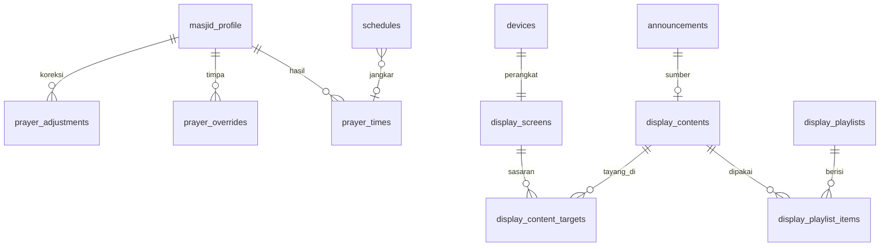

# PRD Modul Masjid — Jadwal Sholat & Papan Pengumuman Digital (SANAD Masjid)

| | |
|---|---|
| **Versi** | 1.1 — keputusan perangkat (Android TV), sumber data (API gratis), dan privasi diperbarui |
| **Tanggal** | 7 November 2026 |
| **Status** | Draf untuk dibahas |
| **Induk** | SANAD — Pesantren Digital Ecosystem (`PRD-Sistem-Pesantren.md`). Dokumen ini **terpisah tetapi terhubung**: memakai login, role, pengaturan, pengumuman, perangkat, jadwal, dan audit milik SANAD |
| **Dipakai untuk** | Claude Code (implementasi) dan Claude Design (layar TV). Visual mengikuti `PRD-UIUX-Pesantren.md` (hijau `#0B5D45`, emas, kertas hangat) dengan penyesuaian untuk layar TV di §9 |
| **Bahasa** | Antarmuka Indonesia, teks Arab RTL |

> Prinsip: **layar TV harus tetap benar walau internet mati.** Jadwal sholat dan konten disimpan di perangkat untuk beberapa minggu ke depan; TV tidak bergantung pada server saat hitung mundur adzan.

---

## 0. Keputusan

### 0.1 Sudah diputuskan (dari percakapan)

| # | Topik | Keputusan |
|---|---|---|
| 1 | Bentuk | Modul terpisah dengan PRD sendiri, tetapi berjalan di dalam SANAD (satu login, satu database, satu admin) |
| 2 | Isi | Jadwal sholat masjid dan papan pengumuman untuk tampil di TV |
| 3 | Stack | Mengikuti SANAD: Laravel, PostgreSQL, Livewire, Redis. Tampilan TV adalah halaman web (PWA) yang dibuka layar penuh di perangkat TV |
| 4 | Feature flag | Modul bisa dinyalakan/dimatikan terpisah dari modul SANAD lain (§2) |
| 5 | Lokasi & data jadwal | Sistem **mencari sendiri** lewat API gratis: koordinat dari pencarian nama kota/alamat, dan jadwal pembanding dari API jadwal sholat berbasis data Kemenag (§8.1, §8.8) |
| 6 | Adzan | **Visual saja.** Adzan bersuara tetap dari sound system masjid; tidak ada audio dari sistem ini |
| 7 | Pengumuman | Boleh **lebih dari satu** tampil sekaligus dan bergilir, serta bisa di **lebih dari satu layar** |
| 8 | Perangkat | **Android TV** dengan aplikasi pembungkus kecil (§12) |
| 9 | Nama santri di layar | **Boleh**, dengan persetujuan wali yang tercatat satu kali dan dapat dicabut (§8.3) |

### 0.2 Belum diputuskan (ditandai eksplisit, bukan placeholder)

| # | Topik | Kenapa belum | Default sementara di PRD ini |
|---|---|---|---|
| M1 | ~~Kota/koordinat~~ | **Selesai**: dicari otomatis (§8.8). Nama kota masjid tetap perlu diisi admin saat setup | Admin mengetik kota/alamat, sistem mengisi lintang-bujur, admin memeriksa titik di peta |
| M2 | Jumlah layar dan lokasinya | "Lebih dari satu" untuk pengumuman, jumlah pastinya belum | Sistem mendukung banyak layar dengan playlist berbeda; mulai dari 1 layar |
| M3 | ~~Perangkat TV~~ | **Selesai**: Android TV | Aplikasi pembungkus + halaman `/display` (§12). Tipe/versi Android TV yang dipakai belum diketahui, dites saat setup |
| M4 | ~~Adzan bersuara~~ | **Selesai**: visual saja | Tidak ada audio |
| M5 | ~~Nama santri di layar~~ | **Selesai**: boleh, dengan persetujuan wali tercatat | §8.3 |
| M6 | Ihtiyath/koreksi menit per waktu sholat | Perlu dicocokkan dengan jadwal resmi kota setempat | Default 0, dikalibrasi saat setup lewat uji pembanding (§8.1) |
| M7 | Halaman publik untuk jamaah (jadwal di web/HP) | Belum diminta | Disediakan sederhana, default OFF (`masjid_public`) |
| M8 | Donasi/infaq di layar | Belum jelas bentuknya | Hanya menampilkan gambar QRIS statis/nomor rekening yang diunggah admin; **tanpa** pembayaran online lewat sistem |
| M9 | Durasi iqamah tiap waktu sholat dan mode layar saat sholat | Kebijakan masjid | Default di §5.1, bisa diubah per waktu sholat |

---

## 1. Ringkasan

**Masalah.** Jadwal sholat di masjid biasanya papan manual atau aplikasi yang ditempel, perlu diganti tiap bulan, tidak sinkron dengan kegiatan pesantren, dan pengumuman disebar lewat kertas atau grup WA. Info yang sama harus ditulis berkali-kali.

**Solusi.** Satu modul di SANAD yang:
1. Menghitung dan menampilkan **jadwal sholat harian** otomatis dengan metode Kemenag RI, lengkap dengan hitung mundur adzan dan iqamah.
2. Menayangkan **papan pengumuman digital** di TV (pengumuman, agenda kajian, jadwal imam/khatib Jumat, QR infaq, kutipan ayat/hadis yang sudah diverifikasi).
3. **Terhubung ke SANAD**: pengumuman yang dibuat admin bisa langsung tayang di TV, jadwal sholat menjadi dasar jadwal kegiatan dan absensi sholat santri, dan jadwal piket imam/muadzin bisa tampil.

**Pengguna.** Admin pesantren, humas/TU (pengelola konten), takmir/ustadz (jadwal imam, khatib, kajian), musyrif, dan **jamaah serta santri sebagai penonton** layar.

---

## 2. Scope & Koneksi ke SANAD

### 2.1 Modul

| `module_key` | Nama | Default | Bergantung pada | Ringkas |
|---|---|---|---|---|
| `masjid_prayer` | Jadwal sholat | OFF | core | Hitung jadwal, koreksi, iqamah, mode Jumat/Ramadan, API jadwal untuk modul lain |
| `masjid_display` | Layar TV & papan pengumuman | OFF | core, `masjid_prayer` | Perangkat layar, playlist, konten, persetujuan, tampilan TV |
| `masjid_public` | Halaman publik jamaah | OFF | `masjid_prayer` | Halaman web jadwal sholat & pengumuman terpilih |

Ditambahkan ke tabel modul di PRD Sistem §2 (lihat catatan sambung di §14).

### 2.2 Peta koneksi dengan SANAD

| Komponen SANAD | Arah | Bentuk koneksi |
|---|---|---|
| **Core**: login, role, audit log, pengaturan, `school_profile` | SANAD → Masjid | Role dan izin baru (§10); zona waktu, logo, nama pesantren dari `school_profile`; semua perubahan tercatat di `audit_logs` |
| **Pengumuman** (`announcements`) | dua arah | Pengumuman baru punya opsi **"Tayangkan di TV"** (membuat konten layar bertaut ke pengumuman, ikut pembaruan dan penarikan) |
| **Perangkat** (`devices`) | SANAD → Masjid | Layar TV terdaftar sebagai perangkat bertipe `tv_display` dengan token baca-saja, bisa dicabut |
| **Jadwal** (`schedules`, ACD-03) | Masjid → SANAD | Waktu sholat menjadi **jangkar** blok jadwal berjenis `sholat` (mis. "Dzuhur berjamaah = adzan + 0 menit"), sehingga jadwal santri ikut berubah saat waktu sholat bergeser sepanjang tahun |
| **Absensi sholat** (`attendance_sessions` kind `sholat`) | Masjid → SANAD | Saat waktu iqamah tiba, sesi absensi sholat dapat **dibuka otomatis** (opsional) untuk musyrif/kartu |
| **Piket** (`duty_rosters`, modul `duty_roster`) | SANAD → Masjid | Jadwal imam rawatib, muadzin, dan khatib Jumat dapat tampil di layar (nama santri mengikuti §8.3) |
| **Notifikasi WhatsApp** (`notification_logs`, Fonnte) | Masjid → SANAD | Opsional: pengumuman penting ikut dikirim ke wali; pengingat "5 menit lagi adzan" ke musyrif (opt-in) |
| **Kalender akademik** (term, libur, ujian) | SANAD → Masjid | Agenda libur/ujian tampil di layar sebagai kartu agenda |
| **Portal santri** | Masjid → SANAD | Kartu "Waktu sholat berikutnya" di Beranda santri (S-01) memakai API jadwal yang sama |

### 2.3 Di luar scope

- Suara adzan dari sistem dan kontrol pengeras suara (keputusan: visual saja).
- Donasi online dan pelacakan infaq (M8).
- Penentuan arah kiblat interaktif, kalender hijriah lengkap, penetapan awal bulan (mengikuti keputusan resmi, lihat §8.2).
- Streaming video kajian langsung.
- Aplikasi native TV (digantikan halaman web layar penuh).

---

## 3. Arsitektur

```
 Admin / Humas / Takmir (panel SANAD)              TV di masjid / kantin / lobi
        │                                                   ▲
        ▼                                                   │ halaman /display (PWA, layar penuh)
┌─────────────────────────────────────────────────────────────────────────────┐
│                    Aplikasi Laravel SANAD (satu monolit modular)             │
│  Modul masjid: PrayerCalculator │ ScreenManifest │ ContentScheduler │ Pairing│
│  Terhubung ke: announcements │ devices │ schedules │ attendance │ audit      │
├─────────────────────────────────────────────────────────────────────────────┤
│  Scheduler: hitung jadwal 60 hari ke depan tiap malam, bersihkan konten kedaluwarsa │
│  Queue (Horizon): render gambar/ thumbnail, kirim WA opsional                │
│  Realtime: Laravel Reverb (WebSocket) + cadangan polling 60 detik            │
├─────────────────────────────────────────────────────────────────────────────┤
│  PostgreSQL │ Redis │ Object storage (gambar, video pendek)                  │
└─────────────────────────────────────────────────────────────────────────────┘
```

### 3.1 Cara TV tetap hidup saat internet putus

```mermaid
sequenceDiagram
    participant TV as Halaman /display
    participant SW as Service Worker + IndexedDB
    participant API as SANAD API
    TV->>API: Bootstrap (token layar) → manifest: playlist, konten, jadwal 60 hari, offset jam server
    API-->>TV: Data + versi manifest
    TV->>SW: Simpan semua ke penyimpanan lokal + media ke cache
    loop Tiap detik
        TV->>TV: Jam = jam perangkat + offset server (bukan jam perangkat mentah)
        TV->>TV: Tentukan mode (normal / menuju adzan / iqamah / sholat) dari jadwal tersimpan
    end
    API-->>TV: Dorong pembaruan (WebSocket) atau TV tanya tiap 60 dtk
    Note over TV,API: Jika offline: TV terus berjalan dari data tersimpan; ikon kecil "Offline" muncul; sinkron otomatis saat kembali online
```

Poin penting: jam perangkat TV box sering melenceng. TV **tidak mempercayai jam perangkat** mentah; ia menghitung selisih terhadap jam server saat online dan memakainya terus (koreksi tiap sinkron). Bila sudah offline lama, selisih terakhir dipakai.

---

## 4. Stack & Perangkat Lunak

| Lapisan | Pilihan | Alasan |
|---|---|---|
| Backend | Bagian dari aplikasi Laravel SANAD | Tidak menambah layanan baru; role, audit, queue sudah ada |
| Panel pengelola | Livewire + Alpine + Tailwind (sama dengan SANAD) | Konsisten |
| Tampilan TV | Satu halaman web ringan (Alpine/JS murni), PWA dengan service worker | Bisa dibuka di TV pintar, TV box, Raspberry Pi, atau mini PC |
| Realtime | Laravel Reverb (WebSocket) dengan cadangan polling | Perubahan konten muncul < 10 detik; tetap jalan jika WebSocket terblokir |
| Perhitungan jadwal | Dihitung **di server** (PHP), hasil 60 hari disimpan dan dikirim ke TV; **API jadwal gratis** dipakai sebagai pembanding dan cadangan (§8.8) | Satu sumber kebenaran yang tidak bergantung pada layanan pihak ketiga; API luar hanya memeriksa dan menjadi cadangan |
| Pencarian lokasi | API geocoding gratis (mis. berbasis OpenStreetMap) dipanggil hanya saat setup, hasil disimpan | Tidak ada panggilan tiap hari; patuhi batas pemakaian layanan |
| Aplikasi layar | Aplikasi Android TV kecil (WebView layar penuh) yang membuka `/display` | Android TV umumnya tidak punya peramban yang cocok untuk kiosk dan tidak memasang PWA dengan baik (§12) |
| Media | Object storage S3-compatible; gambar dikompres dan dibuat varian 1080p | TV tidak memuat gambar mentah besar |
| Font | Amiri/Noto Naskh untuk Arab; Fraunces untuk jam besar; Figtree untuk teks | Sama dengan PRD UI/UX SANAD |

Kebutuhan yang dipakai dari riset: metode perhitungan resmi Indonesia (Kemenag RI) memakai sudut Subuh 20° dan Isya 18°; Kemenag Bimas Islam menyediakan jadwal per kabupaten/kota yang dapat dipakai sebagai pembanding; penetapan awal bulan hijriah (mis. Ramadan) ditetapkan lewat sidang isbat dengan kriteria MABIMS.

---

## 5. Fitur

### 5.1 Jadwal sholat (`masjid_prayer`)

| ID | Fitur | Deskripsi | Definition of Done |
|---|---|---|---|
| MSJ-PRY-01 | Pengaturan lokasi otomatis | Admin mengetik nama masjid/kota/alamat; sistem mencari koordinat lewat API geocoding gratis, menampilkan titik di peta untuk dikonfirmasi, dan mengisi zona waktu (WIB/WITA/WIT). Koordinat bisa dikoreksi manual | Titik tersimpan di `masjid_profile` bersama sumbernya; panggilan API hanya saat setup/ubah lokasi |
| MSJ-PRY-02 | Perhitungan otomatis metode Kemenag | Subuh 20°, Isya 18°, Ashar standar (bayangan = 1× tinggi benda), terbit, dhuha, dzuhur, maghrib; ditambah imsak (default 10 menit sebelum Subuh, dapat diubah) | Hasil 60 hari ke depan dibuat tiap malam; cocok dengan jadwal resmi pembanding dalam toleransi §8.1 |
| MSJ-PRY-03 | Koreksi (ihtiyath) per waktu | Tambah/kurang menit untuk tiap waktu sholat | Perubahan berlaku mulai hari yang dipilih; tercatat di audit |
| MSJ-PRY-04 | Timpa manual per tanggal | Admin dapat menetapkan jam tertentu pada tanggal tertentu (mis. mengikuti keputusan takmir) dengan alasan | Tampil dengan penanda "diubah manual" di panel; layar TV tidak menampilkan penanda |
| MSJ-PRY-05 | Iqamah | Selisih adzan → iqamah per waktu sholat; override khusus Jumat dan Ramadan | Default: Subuh 15 menit, Dzuhur 10, Ashar 10, Maghrib 8, Isya 10 (dapat diubah, M9) |
| MSJ-PRY-06 | Mode Jumat | Pada hari Jumat Dzuhur diganti "Sholat Jumat": jam adzan, khatib, imam, tema khutbah (bila diisi) | Otomatis aktif hari Jumat; bisa dimatikan |
| MSJ-PRY-07 | Mode Ramadan | Tampil imsak, hitung mundur berbuka, jadwal tarawih, tadarus; aktif otomatis pada rentang tanggal yang ditetapkan admin | Admin menetapkan tanggal mulai/akhir setelah keputusan resmi; tidak dihitung otomatis |
| MSJ-PRY-08 | Tanggal hijriah | Menampilkan tanggal hijriah dengan **koreksi ± hari** dan penetapan awal bulan manual | Admin menyesuaikan setelah pengumuman resmi (§8.2) |
| MSJ-PRY-09 | Jadwal bulanan & cetak | Tabel bulanan dapat dilihat, diekspor PDF/xlsx, untuk ditempel atau dibagikan | Ekspor sesuai bulan yang dipilih |
| MSJ-PRY-10 | API jadwal internal | Endpoint dan service untuk modul lain (jadwal santri, absensi sholat, kartu portal) | Satu sumber; perubahan jadwal ikut ke semua pemakai |
| MSJ-PRY-11 | Jangkar jadwal kegiatan | Blok jadwal `sholat` dapat ditandai "ikut waktu sholat X + selisih" | Perubahan jadwal sholat memindahkan blok jadwal santri tanpa edit manual |
| MSJ-PRY-13 | Cocokkan otomatis dengan API jadwal | Tombol "Bandingkan dengan jadwal resmi" mengambil jadwal bulanan kota dari API jadwal sholat gratis (data Kemenag Bimas Islam), menyimpannya sebagai pembanding, dan menampilkan selisih tiap waktu sholat | Hasil bandingan sebulan tampil dalam < 30 detik; selisih > 1 menit ditandai |
| MSJ-PRY-14 | Sumber jadwal bisa dipilih | `Hitung sendiri` (default) atau `API` (mengambil data resmi bulanan lewat API, disimpan, lalu dipakai) dengan cadangan ke hitungan sendiri bila API gagal | Pergantian sumber tercatat di audit; layar TV tetap pakai tabel tersimpan |
| MSJ-PRY-12 | Pembuka sesi absensi sholat | Opsional: pada waktu iqamah, sesi `attendance_sessions` kind `sholat` dibuat otomatis | Musyrif melihat sesi siap pakai di U-13 |

### 5.2 Layar TV (`masjid_display`)

| ID | Fitur | Deskripsi | Definition of Done |
|---|---|---|---|
| MSJ-DSP-01 | Mode tampilan otomatis | Normal → Menuju adzan → Waktu sholat → Menuju iqamah → Sholat berlangsung → kembali normal | Perpindahan mengikuti jadwal tersimpan tanpa server; diuji dengan jam disimulasikan |
| MSJ-DSP-02 | Panel jadwal harian | Lima waktu + imsak/terbit/dhuha, penanda waktu berikutnya, hitung mundur | Terbaca dari jarak jauh (§9.2) |
| MSJ-DSP-03 | Playlist konten bergilir | Daftar konten tayang bergantian dengan durasi per item, prioritas, dan jendela waktu tayang | Konten kedaluwarsa hilang otomatis |
| MSJ-DSP-04 | Jenis konten | Pengumuman teks, gambar/poster, video pendek (opsional), agenda kajian, jadwal imam/khatib, QR infaq, ayat/hadis, ucapan/duka cita, informasi darurat | Tiap jenis punya template yang sudah dirancang |
| MSJ-DSP-05 | Running text | Pita informasi di bawah layar | Panjang dibatasi; berhenti saat mode sholat |
| MSJ-DSP-06 | Mode sholat berlangsung | Layar redup/tenang: tanpa gerakan, tanpa suara, hanya tulisan kecil "Sholat sedang berlangsung" dan jam | Durasi per sholat dapat diatur; tidak ada animasi |
| MSJ-DSP-07 | Pengumuman darurat | Konten prioritas tertinggi yang menimpa seluruh playlist di semua/sebagian layar | Muncul < 10 detik setelah dikirim; dicabut dengan satu tombol |
| MSJ-DSP-08 | Profil layar | Satu layar boleh punya tata letak berbeda: "Masjid", "Kantin", "Lobi/Asrama", "Hanya pengumuman" | Profil menentukan panel jadwal tampil atau tidak |
| MSJ-DSP-09 | Layar tanpa suara | Seluruh layar bisu; tidak ada audio adzan atau peringatan bunyi | Tidak ada keluaran audio dari halaman maupun aplikasi |
| MSJ-DSP-12 | Beberapa pengumuman sekaligus | Dua pola: **bergilir** (satu per slide) dan **daftar** (2–3 pengumuman tampil bersamaan dalam panel yang dibagi). Pola dipilih per layar/profil | Panel daftar menampilkan paling banyak 3 item; urutan dari yang prioritas |
| MSJ-DSP-10 | Perlindungan layar | Pergeseran piksel halus, layar redup terjadwal malam, tanpa elemen statis kontras tinggi yang sama berjam-jam | Diperiksa pada TV OLED/LED di UAT |
| MSJ-DSP-11 | Status offline | Ikon kecil dan satu garis catatan "Terakhir sinkron HH:MM" yang tidak mengganggu jamaah | Tampil hanya di pojok, bukan banner besar |

### 5.3 Pengelolaan konten (CMS)

| ID | Fitur | Deskripsi | Definition of Done |
|---|---|---|---|
| MSJ-CMS-01 | Buat/ubah konten | Form per jenis konten dengan pratinjau tampilan TV (rasio 16:9, juga 9:16) | Pratinjau sama persis dengan layar nyata |
| MSJ-CMS-02 | Penjadwalan | Mulai/akhir tayang, hari tertentu, waktu sholat tertentu (mis. hanya sebelum Isya), berulang mingguan | Konten tampil pada jendela yang benar |
| MSJ-CMS-03 | Alur persetujuan | Humas membuat → takmir/admin menyetujui (bisa dimatikan untuk admin) | Status `draft`, `menunggu`, `disetujui`, `ditolak`; hanya `disetujui` tayang |
| MSJ-CMS-04 | Sasaran layar | Pilih layar tertentu atau semua | Konten hanya tayang di layar sasaran |
| MSJ-CMS-05 | Dari pengumuman SANAD | Pengumuman SANAD dapat ditandai tayang di TV; sinkron ubah/hapus | Tidak ada salin-tempel ganda |
| MSJ-CMS-06 | Jadwal imam & khatib | Tabel tanggal → imam, khatib, tema; impor xlsx | Tampil otomatis pada waktu relevan |
| MSJ-CMS-07 | Agenda kajian rutin | Judul, pemateri, hari/jam berulang, lokasi | Muncul sebagai kartu "Hari ini" dan "Pekan ini" |
| MSJ-CMS-08 | Pustaka ayat/hadis | Teks Arab + terjemah + rujukan; ditandai terverifikasi oleh ustadz sebelum bisa tampil | Tidak ada kutipan yang tayang tanpa penanda terverifikasi |
| MSJ-CMS-09 | Pustaka media | Unggah gambar/video, kompres otomatis, batas ukuran | Gambar > 1080p dikecilkan; video dibatasi durasi dan ukuran |
| MSJ-CMS-10 | Kalender akademik di layar | Libur, ujian, wisuda dari kalender SANAD otomatis menjadi kartu agenda | Opsional per layar |
| MSJ-CMS-11 | Riwayat dan audit | Siapa membuat, menyetujui, menarik konten | Terlihat di audit log |

### 5.4 Perangkat layar

| ID | Fitur | Deskripsi | Definition of Done |
|---|---|---|---|
| MSJ-DEV-01 | Pairing dengan kode | TV membuka alamat `/display`, muncul kode 6 digit; admin memasukkan kode di panel dan memilih nama/lokasi/profil | Tidak perlu mengetik sandi di TV |
| MSJ-DEV-02 | Token layar | Setelah pairing, TV menyimpan token baca-saja (hash di server), bisa dicabut | Token dicabut → layar kembali ke kode pairing |
| MSJ-DEV-03 | Detak jantung (heartbeat) | TV kirim status tiap 60 detik: versi manifest, versi aplikasi, selisih jam, kondisi online | Panel menunjukkan layar mati/offline > 5 menit |
| MSJ-DEV-04 | Perintah jarak jauh | Muat ulang, tampilkan layar tes, mode darurat, redupkan | Perintah sampai < 10 detik saat online |
| MSJ-DEV-06 | Aplikasi pembungkus Android TV | Aplikasi kecil (WebView layar penuh) yang membuka alamat `/display`, mulai otomatis saat TV hidup, menjaga layar tetap menyala, tanpa audio, memuat ulang saat macet, dan menyimpan alamat server | Dipasang lewat file APK (tanpa Play Store); setelah restart layar kembali ke tampilan benar < 60 detik |
| MSJ-DEV-05 | Mode pratinjau | Admin melihat apa yang tampil di layar tertentu saat ini | Cuplikan atau tampilan langsung di panel |

### 5.5 Halaman publik (`masjid_public`, opsional)

| ID | Fitur | Deskripsi | DoD |
|---|---|---|---|
| MSJ-PUB-01 | Halaman jadwal hari ini | Web ringan: lima waktu, hitung mundur, tanggal hijriah | Cepat dimuat di HP (< 2 dtk jaringan seluler) |
| MSJ-PUB-02 | Pengumuman publik | Hanya konten berstatus publik | Konten internal tidak pernah tampil |
| MSJ-PUB-03 | Tautan unduh jadwal bulanan | PDF jadwal bulan ini | Tersedia tanpa login |

---

## 6. Desain Database

Mengikuti konvensi PRD Sistem §6.1: PostgreSQL, `id` + `uuid`, `timestamptz` UTC, `jsonb` untuk kolom fleksibel, soft delete bila relevan, aksi penting masuk `audit_logs`.

**`masjid_profile`** (satu baris): name, city, address_query, geocode_source, geocode_at, latitude (decimal 9,6), longitude (decimal 9,6), elevation_m null, schedule_source (`computed`/`api`, default `computed`), api_location_ref null, timezone (default dari `school_profile`), calc_method (default `kemenag`), fajr_angle (default 20), isha_angle (default 18), asr_method (`standard`/`hanafi`, default `standard`), imsak_minutes (default 10), dhuha_offset_minutes, hijri_offset_days (default 0), friday_mode bool, ramadan_start date null, ramadan_end date null, default_screen_profile.

**`prayer_adjustments`**: prayer (`imsak`,`fajr`,`sunrise`,`dhuha`,`dhuhr`,`asr`,`maghrib`,`isha`), minutes int, effective_from date. Unik (prayer, effective_from).

**`prayer_overrides`**: date, prayer, time, reason, created_by. Unik (date, prayer).

**`iqamah_settings`**: prayer, minutes_after_adhan, prayer_duration_minutes (lama mode "sholat berlangsung"), friday_minutes null, ramadan_minutes null.

**`prayer_times`** (hasil hitung/cache): date (unik), imsak, fajr, sunrise, dhuha, dhuhr, asr, maghrib, isha (semua `time`), source (`computed`/`override`/`imported`), params_hash, computed_at.

**`prayer_reference_times`**: date, city_ref, fajr…isha, source_label — data pembanding hasil impor dari jadwal resmi untuk uji akurasi (§8.1).

**`hijri_months`**: hijri_year, hijri_month, starts_on date, set_by, note — penetapan awal bulan manual setelah keputusan resmi.

**`display_screens`**: name, location, device_id (fk `devices`, type `tv_display`), profile (`masjid`,`canteen`,`lobby`,`announcement_only`), orientation (`landscape`,`portrait`), playlist_id null, brightness_schedule jsonb, audio_enabled bool, is_active, last_seen_at, last_manifest_version, app_version, clock_offset_ms.

**`display_pairings`**: code (6 digit, unik aktif), pairing_token_hash, expires_at, claimed_screen_id null.

**`display_contents`**: type (`text`,`poster`,`video`,`agenda`,`imam_schedule`,`qr_donation`,`quote`,`obituary`,`emergency`), title, body jsonb (isi per jenis), media_path null, thumbnail_path null, starts_at, ends_at, schedule_rule jsonb (hari/waktu sholat/berulang), priority smallint, duration_seconds, status (`draft`,`pending`,`approved`,`rejected`,`archived`), rejected_reason null, announcement_id null (fk `announcements`), is_public bool, created_by, approved_by null, approved_at null, deleted_at.

**`display_content_targets`**: content_id, screen_id null (null = semua layar).

**`display_playlists`**: name, is_default. **`display_playlist_items`**: playlist_id, content_id, sort_order, duration_override null.

**`quotes`**: text_ar, text_id, source_ref, verified_by null, verified_at null, is_active.

**`display_consents`**: student_id, guardian_id, scope (`name`,`photo`), granted_at, revoked_at null, granted_via (`portal`,`paper`). Satu aktif per (student_id, scope).

**`khutbah_schedules`**: date, imam_name, khatib_name, theme null, linked_user_id null (bila ustadz di SANAD), show_student_name bool.

**`kajian_schedules`**: title, speaker, rrule, start_time, end_time, location, is_active.

**`display_events`**: screen_id, type (`heartbeat`,`offline`,`online`,`error`,`command_ack`), payload jsonb, occurred_at — dipangkas > 30 hari.

### 6.1 Indeks & batasan penting

| Tabel | Indeks/batasan | Tujuan |
|---|---|---|
| `prayer_times` | unique `(date)` | Satu jadwal per hari |
| `display_contents` | `(status, starts_at, ends_at)` | Ambil konten yang boleh tayang |
| `display_pairings` | unique `(code)` **WHERE** `claimed_screen_id IS NULL AND expires_at > now()` (partial) | Kode aktif tidak bentrok |
| `display_screens` | unique `(device_id)` | Satu layar per perangkat |
| `display_events` | `(screen_id, occurred_at)` | Status layar dan pembersihan |
| `khutbah_schedules` | unique `(date)` | Satu jadwal Jumat per tanggal |



---

## 7. API & Realtime

Prefix `/api/v1`. Layar TV memakai **token layar** (bukan sesi pengguna); panel memakai sesi/token pengguna seperti SANAD.

### 7.1 Untuk layar TV (token layar, hanya baca)

| Method | Path | Deskripsi |
|---|---|---|
| POST | `/display/pair/start` | Mulai pairing → kode 6 digit |
| GET | `/display/pair/status` | Cek apakah kode sudah diklaim → token layar |
| GET | `/display/manifest` | Playlist, konten (sudah difilter untuk layar ini), jadwal sholat 60 hari, pengaturan iqamah, profil layar, `server_time` |
| GET | `/display/manifest/version` | Versi manifest (ringan, untuk polling) |
| POST | `/display/heartbeat` | Status layar |
| POST | `/display/command-ack` | Konfirmasi perintah dijalankan |

Kanal realtime privat per layar: `screen.{id}` dengan peristiwa `manifest.updated`, `emergency.set`, `emergency.clear`, `command`.

### 7.2 Untuk panel (pengguna masuk)

| Method | Path | Deskripsi |
|---|---|---|
| GET/PUT | `/masjid/profile` | Lokasi & parameter hitung |
| GET | `/masjid/prayer-times?date=` / `?month=YYYY-MM` | Jadwal |
| CRUD | `/masjid/adjustments`, `/masjid/overrides`, `/masjid/iqamah` | Koreksi, timpa, iqamah |
| POST | `/masjid/prayer-times/recompute` | Hitung ulang rentang tanggal |
| POST | `/masjid/reference/import` | Impor jadwal pembanding (xlsx/csv) |
| GET | `/masjid/reference/compare?month=` | Selisih hitungan vs pembanding |
| CRUD | `/display/screens`, `/display/pairings/claim` | Layar dan pairing |
| POST | `/display/screens/{id}/command` | Perintah jarak jauh |
| CRUD | `/display/contents`, `/display/playlists`, `/display/quotes`, `/display/khutbah`, `/display/kajian` | Konten |
| POST | `/display/contents/{id}/submit`, `/approve`, `/reject` | Alur persetujuan |
| POST | `/display/emergency` / DELETE `/display/emergency` | Pengumuman darurat |

### 7.3 Publik (jika `masjid_public` aktif)

| Method | Path | Deskripsi |
|---|---|---|
| GET | `/public/masjid/today` | Jadwal hari ini + pengumuman publik |
| GET | `/public/masjid/month.pdf?month=` | Jadwal bulanan PDF |

Respons error mengikuti format PRD Sistem (`MODULE_DISABLED` bila modul mati).

---

## 8. Aturan Bisnis

### 8.1 Perhitungan dan akurasi jadwal

1. Metode awal: **Kemenag RI** — sudut Subuh 20°, Isya 18°; Ashar dengan bayangan sama panjang dengan benda (standar); semua dihitung dari lintang/bujur masjid dan zona waktu.
2. Koreksi per waktu (`prayer_adjustments`) ditambahkan setelah hitungan; timpa manual (`prayer_overrides`) menggantikan hasil akhir.
3. **Wajib uji pembanding saat setup:** ambil otomatis (MSJ-PRY-13) atau impor manual jadwal resmi Kemenag Bimas Islam untuk kabupaten/kota masjid (`prayer_reference_times`) dan bandingkan sebulan penuh. Terima bila selisih tiap waktu sholat ≤ 1 menit; bila lebih, atur koreksi (M6) sampai lolos, lalu catat hasil di panel.
4. Pustaka perhitungan dipilih saat implementasi. Syaratnya: parameter sudut dapat diatur, ada uji otomatis terhadap data pembanding (golden test) untuk minimal 3 lokasi dan 12 bulan.
5. Jadwal 60 hari ke depan dihitung ulang tiap malam dan saat parameter berubah; perubahan parameter menghitung ulang mulai tanggal berlaku, tidak mengubah masa lalu.
6. Layar TV tidak menghitung sendiri; ia memakai tabel yang dikirim server.

### 8.8 API gratis: lokasi dan jadwal pembanding

1. **Geocoding:** hanya dipanggil saat admin mengisi/mengubah lokasi, hasil disimpan (`geocode_source`, `geocode_at`). Patuhi batas pemakaian layanan (mis. satu permintaan per detik dan identitas aplikasi yang jelas) dan jangan memanggil berulang.
2. **API jadwal sholat gratis:** layanan pihak ketiga yang mengambil data Kemenag Bimas Islam per kabupaten/kota. Layanan ini **tidak resmi dan tanpa jaminan ketersediaan**, jadi dipakai sebagai pembanding dan cadangan, bukan satu-satunya sumber. Alamat dan format respons diverifikasi dari dokumentasi layanan saat implementasi, bukan diasumsikan.
3. Hasil API selalu disimpan di `prayer_reference_times`/`prayer_times` sehingga TV tidak pernah memanggil API luar.
4. Bila API gagal, error dicatat dan sistem memakai hitungan sendiri; admin diberi tahu di MS-03.
5. Tidak ada data pribadi yang dikirim ke API luar selain nama kota/alamat masjid dan koordinat.

### 8.2 Tanggal hijriah dan Ramadan

1. Tanggal hijriah ditampilkan dari tabel perhitungan ditambah `hijri_offset_days`; awal bulan dapat ditetapkan manual di `hijri_months` setelah ada keputusan resmi.
2. Awal Ramadan dan hari raya mengikuti **keputusan pemerintah/ormas yang dianut pesantren**; sistem tidak menetapkannya otomatis. Mode Ramadan aktif berdasarkan tanggal yang diisi admin.
3. Layar menampilkan tanggal hijriah tanpa klaim pasti pada hari-hari sekitar pergantian bulan bila belum ditetapkan manual (mis. "perkiraan").

### 8.3 Privasi layar publik

TV di masjid adalah tempat umum. Aturan berikut **keras**:
1. Tidak pernah tampil: data keuangan, tunggakan, kesehatan, pelanggaran, nilai, izin keluar, atau data pribadi wali/santri.
2. **Nama santri boleh tampil** (imam piket, prestasi, ucapan). Syaratnya ada persetujuan wali sekali pakai di `display_consents` (scope `name`) yang dapat dicabut kapan saja lewat portal wali atau kertas yang dicatat admin. Tanpa persetujuan aktif, entri otomatis ditampilkan tanpa nama atau tidak tayang. Pencabutan menghilangkan nama dari layar < 10 detik.
3. Foto wajah tidak ditampilkan tanpa persetujuan wali scope `photo` (terpisah dari `name`); foto kegiatan massal diperiksa dulu oleh pengelola.
4. Pengumuman SANAD yang bersasaran kelas/asrama tidak otomatis boleh tayang di TV; pengelola harus menandai secara eksplisit.
5. Dua orang berwenang untuk konten sensitif (duka cita, pengumuman insiden): pembuat dan penyetuju berbeda.

### 8.4 Konten dan jadwal tayang

1. Hanya konten berstatus `approved` dalam jendela waktunya yang tayang; di luar itu otomatis hilang tanpa tindakan.
2. Urutan: darurat → konten berprioritas tinggi → bergilir sesuai playlist. Konten yang sama tidak tayang berturut-turut kecuali playlist hanya berisi satu item.
3. Durasi per item default 12 detik, minimal 6, maksimal 60; video mengikuti durasinya (maks 60 dtk).
4. Konten ayat/hadis hanya yang berpenanda terverifikasi.
5. Pengumuman darurat menimpa semua dan harus dicabut manual atau kedaluwarsa pada waktu akhir yang wajib diisi.

### 8.5 Mode layar

| Mode | Mulai | Tampilan | Berakhir |
|---|---|---|---|
| Normal | Di luar jendela sholat | Jam besar, jadwal, playlist, running text | Saat masuk jendela berikutnya |
| Menuju adzan | 15 menit sebelum adzan (dapat diubah) | Hitung mundur besar, nama sholat berikutnya | Saat adzan |
| Waktu sholat | Adzan s.d. 1 menit | "Waktu Dzuhur", jam | Otomatis |
| Menuju iqamah | Setelah itu s.d. iqamah | Hitung mundur iqamah | Saat iqamah |
| Sholat berlangsung | Iqamah s.d. durasi sholat | Tenang, redup, tanpa gerak | Otomatis |
| Jumat | Hari Jumat sekitar Dzuhur | Jadwal khutbah, khatib, imam | Setelah sholat |
| Ramadan | Rentang tanggal Ramadan | Tambahan imsak, hitung mundur berbuka | Akhir rentang |
| Darurat | Dipicu pengelola | Pesan darurat layar penuh | Dicabut/kedaluwarsa |

### 8.6 Jam dan sinkronisasi

1. Jam yang ditampilkan = jam perangkat + selisih terhadap jam server (diperbarui tiap sinkron).
2. Bila selisih > 2 detik saat sinkron, TV mengoreksi tanpa lompat visual mencolok (berubah saat detik berganti).
3. Pergantian hari memakai zona waktu masjid, bukan zona perangkat.

### 8.7 Perangkat

1. Kode pairing berlaku 10 menit, sekali pakai.
2. Token layar hanya bisa membaca manifest dan mengirim heartbeat; tidak bisa mengubah apa pun.
3. Layar tanpa heartbeat > 5 menit ditandai offline di panel; > 30 menit memunculkan notifikasi ke pengelola (opsional).

---

## 9. UI/UX

Mengikuti token warna, tipografi, dan aksesibilitas `PRD-UIUX-Pesantren.md`, dengan aturan tambahan untuk layar TV yang dilihat dari jarak jauh.

### 9.1 Arah visual layar

Suasana tenang dan khusyuk, bukan dasbor ramai. Latar kertas hangat atau hijau sangat tua (`#0B5D45` ke gelap) tergantung jam: **terang pada siang, gelap tenang malam**. Satu panel utama (jam + hitung mundur), jadwal dalam kartu tiket tipis, aksen emas `#8A6212` (versi terang untuk latar gelap diuji kontras). Pola geometris Islami sangat tipis (≤ 6%) sebagai latar, tidak di belakang teks. Tanpa animasi yang berisik; transisi antar konten lembut (fade 400 ms).

### 9.2 Aturan keterbacaan jarak jauh (1920×1080)

| Elemen | Aturan |
|---|---|
| Jam | Angka ≥ 180 px (Fraunces), tabular |
| Hitung mundur | ≥ 120 px saat mode menuju adzan/iqamah |
| Nama dan jam sholat | ≥ 56 px; sholat berikutnya diperbesar dan diberi penanda ikon + teks |
| Teks pengumuman | ≥ 44 px, maksimal ± 40 kata per slide; judul ≥ 72 px |
| Teks Arab | Amiri ≥ 64 px, line-height 2, RTL |
| Kontras | ≥ 7:1 untuk teks utama (target lebih tinggi dari 4,5:1 karena jarak dan silau) |
| Margin aman | 5% dari tepi (overscan TV) |
| Warna | Status tidak hanya warna; tidak ada teks merah murni di atas hijau |
| Orientasi | Mendukung landscape 16:9 (utama) dan portrait 9:16 |

### 9.3 Tata letak layar utama (landscape)

```
┌────────────────────────────────────────────────────────────────────────────────┐
│ {{Nama Pesantren}}                                  Sabtu, 7 Nov 2026 · 26 Rab. II │
├───────────────────────────────────┬────────────────────────────────────────────┤
│                                   │  IMSAK  SUBUH  TERBIT  DZUHUR  ASHAR  MAGHRIB ISYA│
│            18:42:07               │  kartu tiket tipis per waktu; berikutnya diperbesar │
│    MENUJU ISYA   00:12:33         │                                            │
│    Iqamah +10 menit               ├────────────────────────────────────────────┤
│                                   │  Konten bergilir (poster / pengumuman /    │
│                                   │  agenda kajian / jadwal imam / QR infaq)   │
├───────────────────────────────────┴────────────────────────────────────────────┤
│ Running text: info singkat…                                    ● Tersinkron 18:41│
└────────────────────────────────────────────────────────────────────────────────┘
```

### 9.4 Layar panel (pengelola, desktop dan HP)

| ID | Layar | Isi |
|---|---|---|
| MS-01 | Beranda Masjid | Hero: waktu sholat berikutnya; status layar (online/offline); konten menunggu persetujuan; pengumuman tayang sekarang |
| MS-02 | Pengaturan lokasi & metode | Form lokasi, parameter hitung, pratinjau jadwal 7 hari |
| MS-03 | Uji pembanding | Impor jadwal resmi, tabel selisih per waktu sholat, tombol terapkan koreksi |
| MS-04 | Koreksi, timpa, iqamah | Tabel dengan masa berlaku dan alasan |
| MS-05 | Jadwal bulanan | Tabel + ekspor PDF/xlsx |
| MS-06 | Layar & perangkat | Daftar layar, status, versi, tombol pairing, perintah jarak jauh |
| MS-07 | Pairing | Input kode 6 digit, nama, lokasi, profil |
| MS-08 | Konten | Daftar dengan filter status/jenis/layar, pratinjau TV 16:9 dan 9:16 |
| MS-09 | Editor konten | Form per jenis + pratinjau langsung + penjadwalan + sasaran layar |
| MS-10 | Antrean persetujuan | Dua panel: daftar dan detail dengan setujui/tolak (alasan wajib) |
| MS-11 | Playlist | Urut dengan tombol naik/turun, durasi, prioritas |
| MS-12 | Imam, khatib, kajian | Tabel + impor xlsx |
| MS-13 | Pustaka ayat/hadis | Daftar, tanda terverifikasi |
| MS-14 | Pengumuman darurat | Satu tombol besar, konfirmasi, pilih layar, waktu akhir wajib |
| MS-15 | Riwayat | Audit konten dan perintah layar |

Setiap layar data punya keadaan L/E/X/S sesuai PRD UI/UX §8. Teks antarmuka melewati skill antislop-copywriting.

### 9.5 Layar TV (ringkasan keadaan)

| ID | Layar | Keterangan |
|---|---|---|
| TV-01 | Pairing | Kode 6 digit besar + alamat; berganti otomatis bila kedaluwarsa |
| TV-02 | Normal | §9.3 |
| TV-03 | Menuju adzan / iqamah | Hitung mundur raksasa, tanpa playlist |
| TV-04 | Sholat berlangsung | Tenang, redup |
| TV-05 | Jumat | Jadwal khutbah dan khatib |
| TV-06 | Ramadan | Tambahan imsak dan hitung mundur berbuka |
| TV-07 | Darurat | Pesan layar penuh |
| TV-08 | Tidak ada konten | Hanya jadwal dan jam, pesan netral |
| TV-09 | Offline | Tetap berjalan; ikon kecil di pojok |

---

## 10. RBAC

Role baru dan izin (menambah §10 PRD Sistem):

| Role | Izin |
|---|---|
| `admin` | Semua di modul masjid, pengaturan lokasi/metode, perangkat, persetujuan, darurat |
| `masjid_manager` (takmir) | Jadwal imam/khatib/kajian, persetujuan konten, darurat; tidak mengubah parameter hitung |
| `masjid_content` (humas/TU) | Buat dan ubah konten, ajukan persetujuan; tidak menyetujui sendiri bila alur aktif |
| `musyrif` | Lihat jadwal; membuka sesi absensi sholat (sudah ada di SANAD) |
| `student`, `guardian` | Melihat kartu "waktu sholat berikutnya" di portal (membaca saja) |
| Layar TV | Token layar: hanya manifest dan heartbeat |

Tindakan sensitif (ubah parameter hitung, timpa jadwal, kirim darurat, cabut token layar) selalu masuk `audit_logs`.

---

## 11. Persyaratan Non-Fungsional

| Aspek | Target |
|---|---|
| Keandalan layar | Tetap menampilkan jadwal dan hitung mundur benar saat offline sampai 30 hari; tidak membeku lebih dari 5 detik |
| Ketepatan jam | Selisih tampilan terhadap jam server ≤ 1 detik setelah sinkron |
| Latensi pembaruan | Perubahan konten sampai ke layar ≤ 10 detik (online) |
| Pemulihan | Layar otomatis memuat ulang dan kembali ke tampilan benar setelah listrik mati/hidup atau peramban crash (§12) |
| Kinerja | Halaman TV ≤ 2 MB awal di luar media; animasi 60 fps atau dimatikan; tidak ada kebocoran memori dalam uji 72 jam |
| Keamanan | Token layar di-hash, dapat dicabut; manifest hanya berisi konten sasaran layar tersebut; tidak ada data pribadi di manifest |
| Privasi | §8.3 diuji otomatis (konten sensitif tidak pernah muncul di manifest) |
| Aksesibilitas | Kontras dan ukuran font §9.2; tanpa kedipan > 3 kali per detik |
| Skalabilitas | 20 layar tanpa perubahan arsitektur |
| Audit & backup | Mengikuti SANAD |

---

## 12. Perangkat Keras & Deployment

Perangkat yang dipilih: **Android TV** (M3). Harga dan merek yang dipakai belum dicek. Alternatif lain (Raspberry Pi/mini PC dengan Chromium kiosk) tetap bisa memakai halaman `/display` yang sama.

| Opsi | Kelebihan | Kekurangan | Cocok untuk |
|---|---|---|---|
| Raspberry Pi 4/5 + Chromium mode kiosk | Paling bisa dikendalikan; boot otomatis ke halaman; mudah dipulihkan | Perlu casing, penyimpanan andal (SSD/kartu bermutu), setup awal | Layar utama masjid |
| Mini PC kecil + Chromium kiosk | Paling stabil dan kuat untuk video | Lebih mahal dan boros daya | Layar utama dengan video |
| TV box Android/Google TV + aplikasi pembungkus WebView sederhana | Murah, mudah dipasang | Perlu APK kecil agar auto-start; kualitas perangkat bervariasi | Layar kedua (kantin, lobi) |
| Browser bawaan smart TV | Tanpa perangkat tambahan | Sering lambat, tidak ada kiosk/auto-start, rawan lupa layar mati | Hanya untuk uji coba |

**Catatan khusus Android TV:**
- Android TV sering tidak memiliki peramban yang cocok untuk mode kiosk, dan memasang PWA di Android TV tidak andal. Karena itu disiapkan **aplikasi pembungkus kecil** (MSJ-DEV-06) berisi WebView layar penuh.
- Pemasangan lewat APK (sideload dari USB/ADB), tanpa Play Store. Pengaturan penting: izinkan aplikasi berjalan otomatis saat TV hidup, matikan penghemat daya/layar tidur, dan nonaktifkan pembaruan otomatis yang mengganggu.
- Versi Android TV dan WebView di perangkat lama bisa tertinggal, sehingga halaman `/display` ditulis dengan JavaScript dan CSS konservatif (tanpa fitur terbaru) dan **dites di perangkat yang sebenarnya** sebelum rilis. Versi Android TV yang dipakai masih perlu dicek di lokasi.
- Jam perangkat dan penyimpanan lokal (IndexedDB) diuji di perangkat yang sama (UAT #17).

Aturan umum:
- Perangkat dibuka ke alamat `/display`, mode layar penuh, **auto-start saat listrik hidup**, layar tidak boleh tidur.
- Jadwal TV hidup/mati (mis. 03:00–04:00 hidup untuk Subuh, mati larut malam) lewat timer TV atau kontrol HDMI-CEC bila perangkat mendukung. Dukungan CEC belum diuji.
- Jaringan: Wi-Fi/kabel stabil; bila Wi-Fi lemah, layar tetap jalan (offline-first).
- Satu UPS kecil dianjurkan bila listrik sering padam.
- Dokumentasikan prosedur pasang ulang perangkat dalam runbook (satu halaman bergambar).

Deployment: ikut deployment SANAD (§12 PRD Sistem). Reverb berjalan sebagai proses tambahan; polling cadangan memastikan layar tetap menerima pembaruan jika WebSocket diblokir.

---

## 13. Risiko, Asumsi & Pertanyaan Terbuka

| # | Risiko / asumsi | Mitigasi |
|---|---|---|
| R1 | Jadwal berbeda beberapa menit dari jadwal resmi/masjid sekitar | Uji pembanding wajib (§8.1), koreksi per waktu, catatan hasil uji; keputusan akhir ada pada takmir |
| R2 | Jam TV box melenceng, hitung mundur salah | Jam berbasis selisih server (§8.6), uji jam disimulasikan |
| R3 | Internet masjid putus berhari-hari | Cache 60 hari, mode offline teruji |
| R4 | Kontens salah/ tidak pantas tampil di tempat ibadah | Alur persetujuan, pustaka ayat/hadis terverifikasi, tombol darurat cabut, audit |
| R5 | Data anak tampil di layar publik | Aturan keras §8.3 dan uji otomatis |
| R6 | Layar OLED/LED terbakar karena elemen statis | MSJ-DSP-10 dan redup terjadwal |
| R7 | Perangkat murah sering hang | Auto-recover, watchdog muat ulang, rekomendasi perangkat §12 |
| R8 | Awal Ramadan/hari raya berbeda antar keputusan | Penetapan manual dengan disclaimer (§8.2) |
| R9 | Adzan bersuara tidak terintegrasi dengan layar | Keputusan: layar visual saja; pengingat visual cukup |
| R11 | API jadwal gratis berhenti/berubah | Hanya pembanding dan cadangan; jadwal tetap bisa dihitung sendiri dan disimpan 60 hari |
| R12 | Android TV lama: WebView usang, auto-start tidak jalan, memori kecil | Dites di perangkat nyata sebelum dibeli banyak; kode konservatif; aplikasi pembungkus memuat ulang bila macet |
| R13 | Wali mencabut persetujuan nama/foto | Nama hilang dari layar < 10 detik; entri tampil tanpa nama |
| R10 | Beban kerja menambah ke proyek SANAD yang sudah besar | Modul dapat dibangun terakhir; ia berdiri sendiri lewat feature flag |
| Asumsi | Satu masjid, 1–3 layar; takmir mau menyetujui konten; ada internet di lokasi untuk setup | Divalidasi di UAT |

---

## 14. Sambungan ke Dokumen Lain

Perubahan yang diperlukan di dokumen SANAD agar modul ini terhubung (sudah diterapkan pada versi dokumen yang menyertai PRD ini):
1. **PRD Sistem §2 (tabel modul):** tambah `masjid_prayer`, `masjid_display`, `masjid_public`.
2. **PRD Sistem §6 (`devices`):** tipe perangkat bertambah `tv_display`.
3. **PRD Sistem §6 (`announcements`):** relasi opsional ke `display_contents` (lihat MSJ-CMS-05).
4. **PRD Sistem §10 (RBAC):** role `masjid_manager`, `masjid_content`.
5. **Master prompt:** tahap tambahan "Masjid" setelah Tahap 12 (opsional, di balik feature flag).
6. **PRD UI/UX:** layar TV memakai token yang sama; bagian khusus TV ada di dokumen ini (§9).

---

## 15. Kriteria Penerimaan (UAT)

| # | Skenario | Hasil yang diharapkan |
|---|---|---|
| 1 | Admin mengisi lokasi dan impor jadwal resmi bulan berjalan | Tabel selisih tampil; semua waktu ≤ 1 menit setelah koreksi |
| 2 | Layar baru dipasangkan dengan kode 6 digit | Layar tampil jadwal < 30 detik; token tersimpan |
| 3 | Putuskan internet TV selama 24 jam | Jam, jadwal, dan hitung mundur tetap benar; konten tersimpan tetap tayang |
| 4 | Jam perangkat TV sengaja digeser 3 menit | Setelah sinkron, tampilan benar; hitung mundur akurat |
| 5 | Jam disimulasikan mendekati tiap sholat | Mode berpindah benar: normal → menuju adzan → waktu sholat → iqamah → sholat berlangsung → normal |
| 6 | Hari Jumat | Mode Jumat tampil dengan khatib dan imam dari jadwal |
| 7 | Rentang Ramadan diisi admin | Imsak dan hitung mundur berbuka tampil; rentang selesai → kembali normal |
| 8 | Humas membuat poster; takmir menyetujui | Poster tayang pada jendela waktunya, hilang otomatis setelah berakhir |
| 9 | Konten belum disetujui | Tidak muncul di layar maupun di manifest |
| 10 | Pengumuman SANAD ditandai "Tayangkan di TV" lalu diedit | Layar ikut berubah < 10 detik; tidak ada salinan ganda |
| 11 | Pengumuman darurat dikirim ke semua layar | Muncul < 10 detik; dicabut dengan satu tombol |
| 12 | Cek manifest berisi data sensitif | Tidak ada tunggakan, kesehatan, pelanggaran, atau nama santri tanpa persetujuan |
| 13 | Token layar dicabut | Layar kembali ke kode pairing, tak bisa lagi mengambil manifest |
| 14 | Uji 72 jam tanpa interaksi | Tidak membeku, tidak kebocoran memori, jam tetap akurat |
| 15 | Perubahan waktu sholat bulan depan | Blok jadwal berjangkar `sholat` di SANAD ikut bergeser |
| 16 | Kontras dan ukuran font diperiksa dari 8–10 meter | Jam, nama sholat, dan pengumuman terbaca |
| 17 | Pasang APK di Android TV yang akan dipakai; matikan lalu hidupkan TV | Layar membuka `/display` otomatis < 60 detik tanpa menyentuh apa pun |
| 18 | Ketik nama kota masjid | Koordinat terisi, titik di peta benar setelah dikonfirmasi admin |
| 19 | Bandingkan dengan API jadwal gratis; matikan API | Tabel selisih tampil; saat API mati, sistem memakai hitungan sendiri tanpa error di layar TV |
| 20 | Tiga pengumuman aktif di pola "daftar" dan satu layar lain pola "bergilir" | Layar pertama menampilkan ketiganya bersamaan; layar kedua bergantian |
| 21 | Wali mencabut persetujuan nama untuk satu santri | Nama hilang dari layar < 10 detik |

---

*Akhir PRD Modul Masjid. Dokumen induk: `PRD-Sistem-Pesantren.md`; visual: `PRD-UIUX-Pesantren.md`; eksekusi: `MASTER-PROMPT-Claude-Code.md`.*
