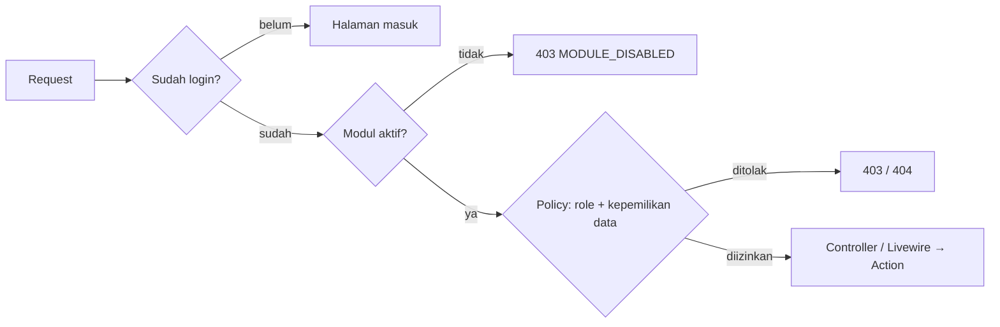
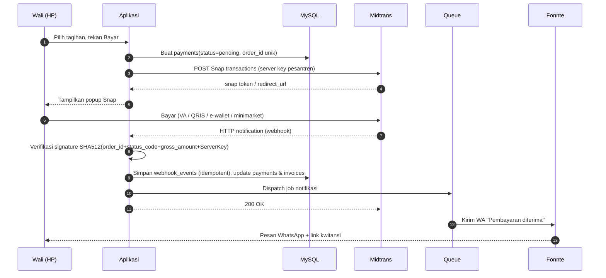
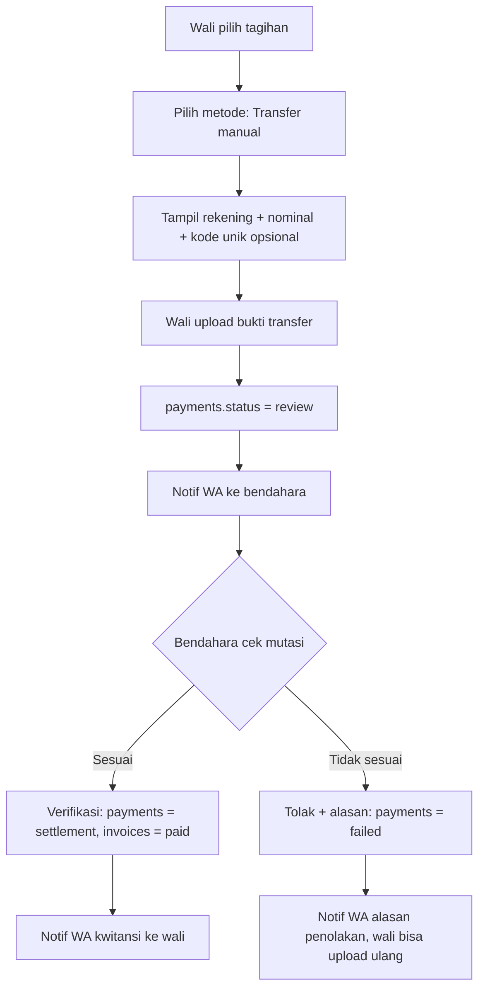
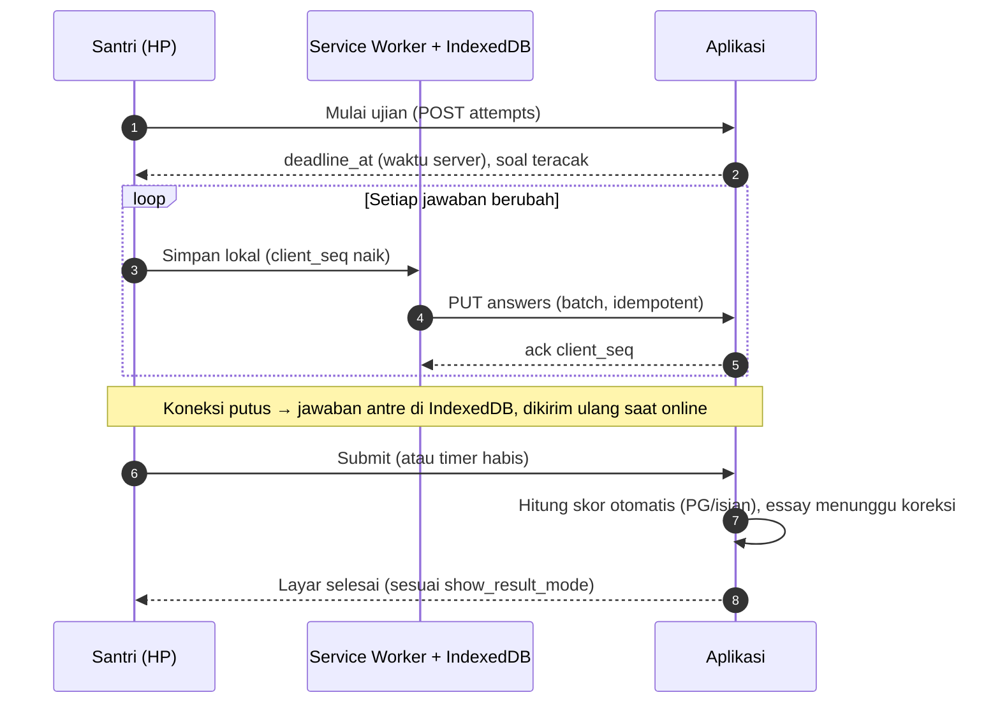
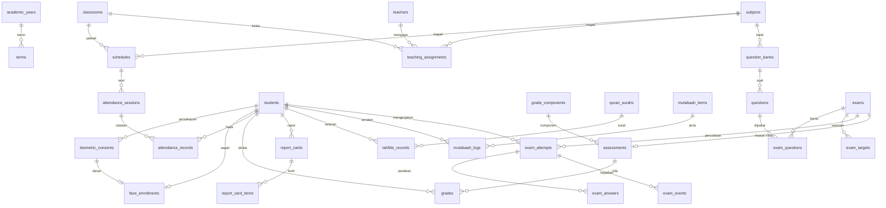
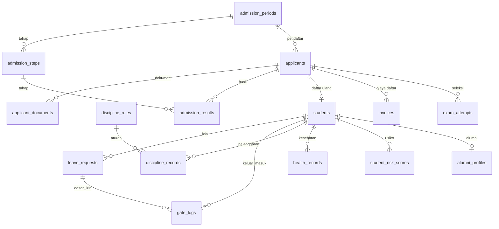

# PRD Sistem — SANAD (Pesantren Digital Ecosystem)

| | |
|---|---|
| **Versi** | 2.0 — single pesantren (menggantikan v1.0 SaaS multi-tenant) |
| **Tanggal** | 6 November 2026 |
| **Owner** | Bung Reza — Operations Digitalization |
| **Dokumen pasangan** | `PRD-UIUX-Pesantren.md` (untuk Claude Design) dan `MASTER-PROMPT-Claude-Code.md` (prompt eksekusi) |
| **Dipakai untuk** | VSCode + Claude Code (eksekusi backend, database, API, integrasi) |
| **Nama sistem** | **SANAD** — Pesantren Digital Ecosystem. Nama pesantren yang memakainya belum diputuskan (D1) |

> Semua fitur dibangun dalam **satu scope penuh** (tidak dipecah fase). Karena setiap modul bisa **diaktifkan/dinonaktifkan** lewat feature flag, peluncuran ke santri bisa bertahap tanpa mengubah PRD ini.

---

## 0. Keputusan yang sudah dikunci & yang belum

### 0.1 Sudah dikunci

| # | Keputusan | Hasil |
|---|---|---|
| 1 | Model | **Satu pesantren milik sendiri** (single-tenant). SaaS ditunda; kode dijaga modular agar bisa dikembangkan nanti (lihat D2, R13) |
| 2 | Stack | **Laravel + MySQL 8** (alasan di §4). Sebelumnya PostgreSQL karena Row Level Security untuk multi-tenant; alasan itu sudah tidak berlaku |
| 3 | Maintainer | Bung Reza (solo/small team) → prioritas: sedikit bahasa, sedikit moving parts |
| 4 | Skala acuan | ±200 santri, beberapa kelas; ujian serentak ≤ 200 santri (didesain headroom 5×) |
| 5 | Notifikasi | **WhatsApp via Fonnte** (+ in-app); Lark tidak dipakai untuk wali karena wali bukan karyawan Bumame |
| 6 | Pembayaran | **Midtrans** + **transfer manual dengan upload bukti**; dapat diaktifkan/dimatikan di pengaturan (memakai akun Midtrans milik pesantren sendiri) |
| 7 | Uang saku | Modul **Dompet** terhubung **Kartu Santri multi-akses** |
| 8 | PPDB | Masuk scope (termasuk seleksi & daftar ulang) |
| 9 | Semua rekomendasi tambahan | Masuk scope: kantin/koperasi cashless, piket, inventaris asrama, alumni, analitik risiko, ekspor Dapodik/EMIS |
| 10 | Konfigurasi | Semua modul bisa **diaktifkan/dinonaktifkan**; jenis tagihan **custom** |
| 11 | Tambahan | Absensi kartu/QR/selfie/wajah (opsional), pos jaga gerbang, Mart & Warung, papan izin keluar |
| 12 | Pengguna | Satu pesantren, tanpa platform admin; role `admin` memegang pengaturan penuh |

### 0.2 Belum diputuskan (ditandai eksplisit, bukan placeholder)

| # | Topik | Kenapa belum | Default sementara di PRD ini |
|---|---|---|---|
| D1 | Nama pesantren & logo SANAD | Nama aplikasi sudah **SANAD**; nama pesantren dan logo belum | Monogram "S" sementara; warna utama `#0B5D45` |
| D2 | Rencana SaaS di masa depan | Keputusan bisnis, ditunda | Single-tenant murni; kode modular per modul. Jika kelak jadi SaaS, perlu migrasi menambah `tenant_id` (tidak gratis, tapi terukur) |
| D4 | Virtual Account **permanen** per santri | Perlu dikonfirmasi ke Midtrans apakah tersedia di akun merchant | Default: VA/QRIS **per transaksi** via Snap |
| D5 | Integrasi langsung ke Dapodik/EMIS | Belum jelas ada API terbuka untuk kebutuhan ini | Ekspor **file** (xlsx/csv) sesuai template |
| D6 | Penyedia hosting & lokasi data | Belum dipilih | Rekomendasi: satu VPS di region Indonesia/Singapura |
| D7 | Perangkat kartu (RFID/NFC) | Belum dibeli | Didesain pakai **reader USB mode keyboard (HID)** + kamera QR di browser (tanpa firmware khusus) |
| D8 | Teknologi pengenalan wajah (di perangkat, layanan sendiri, atau API pihak ketiga) | Perlu PoC akurasi & latensi pada perangkat nyata, plus penilaian risiko data biometrik anak | Modul `face_attendance` default OFF; mode **selfie** tersedia lebih dulu sebagai alternatif tanpa pencocokan otomatis |

*D3 dihapus pada v2.0 (mode Midtrans akun platform tidak relevan untuk satu pesantren).*

---

## 1. Ringkasan & Tujuan

**Masalah:** administrasi pesantren (SPP, uang makan, biaya tahunan, jadwal, absensi, nilai, tahfidz, perizinan, uang saku) umumnya manual di buku/Excel. Akibatnya tunggakan sulit dipantau, wali tidak punya visibilitas, dan data tersebar.

**Solusi:** satu sistem untuk pesantren dengan modul yang bisa diaktifkan sesuai kebutuhan, pembayaran online (Midtrans) atau manual, notifikasi WhatsApp, kartu santri multi-akses (absensi, gerbang, belanja Mart & Warung), dan ujian online yang bisa dikerjakan santri dari HP lewat browser.

**Pengguna:** admin pesantren, bendahara, admin akademik, ustadz, musyrif, penjaga gerbang, petugas UKS, kasir dan pengelola mart/warung, panitia PPDB, wali santri, santri, dan calon santri (pendaftar).

**Tujuan terukur:**

| Tujuan | Indikator |
|---|---|
| Tunggakan turun | Persentase tagihan lunas ≤ 7 hari setelah jatuh tempo meningkat; laporan tunggakan real-time |
| Rekonsiliasi cepat | Pembayaran Midtrans tercatat otomatis < 1 menit setelah settlement; verifikasi manual < 1 hari kerja |
| Transparansi wali | Wali bisa lihat tagihan, saldo, absensi, nilai, tahfidz tanpa menghubungi pengurus |
| Ujian digital | Ujian 200 santri serentak dari HP tanpa kehilangan jawaban saat koneksi putus |
| Operasional kartu | Satu kartu dipakai untuk absensi, gerbang izin, belanja kantin, perpustakaan |

---

## 2. Scope Sistem

### 2.1 Daftar modul (feature flag)

`module_key` dipakai konsisten di database (`modules`), API, dan UI.

| `module_key` | Nama | Default | Bergantung pada | Ringkas |
|---|---|---|---|---|
| `core` | Data inti | **Selalu aktif** | — | Santri, wali, ustadz, kelas, asrama, tahun ajaran, user & role |
| `finance` | Keuangan | ON | core | Jenis tagihan custom, tarif, diskon, tagihan otomatis, tunggakan, kas |
| `payment_midtrans` | Pembayaran Midtrans | OFF | finance | Snap: VA, QRIS, e-wallet, minimarket |
| `payment_manual` | Transfer manual | ON | finance | Rekening pesantren + upload bukti + verifikasi bendahara |
| `wallet` | Dompet uang saku | OFF | finance | Saldo santri, top-up, limit, ledger |
| `card` | Kartu santri | OFF | core | UID kartu/QR, PIN, blokir, multi-akses |
| `pos` | **Mart & Warung** (POS cashless) | OFF | wallet | Mart pesantren + banyak warung, katalog & barcode, stok, bayar scan kartu/QR/wajah, saldo & penyaluran merchant, laporan |
| `academic` | Akademik | ON | core | Mapel, jadwal, rapor |
| `attendance` | Absensi | ON | core | Kelas/asrama/sholat/kegiatan; mode verifikasi dipilih per pesantren: manual, kartu, QR, selfie |
| `face_attendance` | Absensi wajah (biometrik) | OFF | attendance | Persetujuan wali, enrolment wajah, liveness, pencocokan; selalu ada fallback |
| `grading` | Nilai & rapor | ON | academic | Komponen nilai, bobot, rapor PDF |
| `tahfidz` | Tahfidz & mutabaah | OFF | core | Setoran, murojaah, target, mutabaah harian |
| `exam` | Ujian online | OFF | academic | Bank soal, ujian dari HP, autosave, monitor |
| `leave` | Perizinan | ON | core | Izin pulang/keluar, QR izin, scan gerbang |
| `gate` | Pos jaga gerbang | OFF | leave | Papan real-time santri yang sedang di luar, log keluar-masuk, pencatatan manual, serah terima shift |
| `discipline` | Pelanggaran & poin | OFF | core | Aturan, poin, ambang sanksi |
| `health` | Kesehatan (UKS) | OFF | core | Catatan kesehatan santri (akses terbatas) |
| `ppdb` | PPDB | OFF | core | Pendaftaran online, dokumen, seleksi, daftar ulang |
| `notification_wa` | Notifikasi WhatsApp | OFF | core | Fonnte, template, antrean, log |
| `portal_wali` | Portal wali | ON | core | Web/PWA wali |
| `portal_santri` | Portal santri | ON | core | Web/PWA santri |
| `analytics` | Analitik risiko | OFF | core | Skor risiko santri (menunggak/absen/nilai turun) |
| `alumni` | Alumni | OFF | core | Data alumni & kelulusan |
| `inventory` | Inventaris asrama | OFF | core | Barang, mutasi, kondisi |
| `duty_roster` | Jadwal piket | OFF | core | Piket santri/ustadz |
| `export_dapodik` | Ekspor Dapodik/EMIS | OFF | core | Ekspor file sesuai template |

**Aturan dependensi:** saat admin mengaktifkan modul, sistem otomatis memeriksa dependensi; jika belum terpenuhi, tampilkan daftar modul yang harus aktif dulu (tidak diam-diam diaktifkan). Saat modul dinonaktifkan, **data tidak dihapus**, hanya menu/endpoint disembunyikan (HTTP 403 dengan kode `MODULE_DISABLED`).

### 2.2 Di luar scope

- Aplikasi native iOS/Android (digantikan PWA).
- SaaS multi-pesantren (ditunda; lihat D2 dan R13).
- CCTV/kamera live (modul piket & inventaris hanya pencatatan).
- Akuntansi lengkap (jurnal/neraca); yang ada: laporan kas masuk/keluar & rekap.
- Machine learning prediktif; analitik pakai **aturan skor yang bisa dijelaskan**.

---

## 3. Arsitektur Sistem (High-Level)

### 3.1 Layer

```
┌──────────────────────────────────────────────────────────────────────────┐
│                               KLIEN (browser)                            │
│  Portal Wali (PWA) │ Portal Santri + Ujian (PWA) │ Panel Staf (desktop)  │
│  Kasir Mart/Warung │ Pos Gerbang (tablet + reader USB / kamera)          │
│  Halaman publik PPDB                                                     │
├──────────────────────────────────────────────────────────────────────────┤
│                     EDGE: Nginx/Caddy + TLS (Cloudflare)                 │
│                          satu domain pesantren                           │
├──────────────────────────────────────────────────────────────────────────┤
│                          APLIKASI LARAVEL (monolit modular)              │
│  Middleware: Auth → EnsureModuleEnabled → Policy                         │
│ ┌────────┬─────────┬────────┬────────┬────────┬────────┬────────┬──────┐ │
│ │ Core   │ Finance │ Wallet │ Card & │Academic│ Exam   │Kesantri│ PPDB │ │
│ │ Setup  │ Payment │ & Mart │ Device │Tahfidz │ Online │ Gate   │      │ │
│ └────────┴─────────┴────────┴────────┴────────┴────────┴────────┴──────┘ │
│  Integrasi: MidtransGateway │ FonnteClient │ PdfRenderer │ ExcelIO       │
├──────────────────────────────────────────────────────────────────────────┤
│  Worker (Horizon): invoice-gen, notifications, webhooks, pdf, imports    │
│  Scheduler: tagihan bulanan, reminder, auto-expire, auto-submit ujian    │
├──────────────────────────────────────────────────────────────────────────┤
│  MySQL 8 (satu database)                    │  Redis (cache/queue/sesi)  │
│  Object Storage S3-compatible (foto, bukti TF, dokumen PPDB, PDF)        │
└──────────────────────────────────────────────────────────────────────────┘
        ▲ Webhook Midtrans            ▲ Webhook status Fonnte
        │                             │
   Midtrans (Snap/Core)          Fonnte (WhatsApp gateway)
```

**Prinsip:** monolit modular (satu codebase, folder per modul), bukan microservice — paling mudah di-maintain satu orang. Tiap modul punya `Models/`, `Actions/`, `Policies/`, `Http/`, `Livewire/`, `Jobs/`.

### 3.2 Alur akses & modul



Kepemilikan data dicek di **Policy**, bukan hanya di UI (mis. wali hanya melihat anaknya). Karena hanya satu pesantren, tidak ada isolasi antar-tenant; yang wajib diuji otomatis adalah **isolasi antar-role/antar-wali**.

### 3.3 Alur pembayaran Midtrans



### 3.4 Alur transfer manual



### 3.5 Alur belanja dengan kartu (kantin/koperasi)

```mermaid
sequenceDiagram
    autonumber
    participant K as Kasir (tablet)
    participant R as Reader USB / Kamera QR
    participant A as Aplikasi
    participant DB as MySQL
    K->>K: Input item belanja, total Rp15.000
    K->>R: Santri tap kartu
    R-->>K: card_uid (diketik seperti keyboard)
    K->>A: POST /api/v1/device/wallet/charge (device key, card_uid, amount, idempotency_key)
    A->>DB: BEGIN; SELECT wallet FOR UPDATE
    A->>A: Cek kartu aktif, PIN (jika di atas ambang), limit harian, saldo
    A->>DB: INSERT wallet_transactions (spend); UPDATE saldo; COMMIT
    A-->>K: OK + saldo akhir
    A->>A: Dispatch notifikasi belanja (opsional)
```

### 3.6 Alur ujian online



---

## 4. Keputusan Tech Stack

### 4.1 Ringkasan keputusan

| Layer | Opsi terpilih | Alasan |
|---|---|---|
| Bahasa | **PHP 8.3+** | Sudah dikuasai Bung Reza (GCIS PHP/MySQL) → maintenance tercepat |
| Framework | **Laravel** (versi stabil terbaru saat mulai) | Queue, scheduler, policy, validasi, storage, testing sudah built-in; semua kebutuhan fitur tertutup tanpa merakit sendiri |
| UI | **Livewire 3 + Alpine.js + Tailwind CSS** | Satu bahasa (PHP) untuk panel staf & portal; cukup interaktif; tanpa build pipeline SPA yang berat |
| Halaman ujian | Alpine.js + **Service Worker + IndexedDB** | Autosave offline-tolerant tanpa framework SPA tambahan |
| Database | **MySQL 8** (InnoDB) | Sudah dikuasai (GCIS), tersedia di XAMPP lokal dan hosting murah; cukup untuk relasi, transaksi, tipe `json`, `CHECK`, dan `SELECT … FOR UPDATE` pada ledger dompet. Alasan awal memilih PostgreSQL (Row Level Security untuk multi-tenant) sudah tidak berlaku |
| Cache/Queue | **Redis + Laravel Horizon** | Antrean WA, webhook, PDF, import; dashboard antrean siap pakai |
| Auth | Laravel Fortify/Sanctum; OTP WhatsApp untuk wali | Wali sering lupa sandi → OTP WA lebih ramah |
| Otorisasi | `spatie/laravel-permission` + Policy | Standar, teruji |
| Pembayaran | `midtrans/midtrans-php` (Snap + status API) | Library resmi Midtrans |
| WhatsApp | HTTP API **Fonnte** via Laravel HTTP client (token terenkripsi di pengaturan) | Pilihan user; detail endpoint dikonfirmasi dari dokumentasi Fonnte saat implementasi |
| PDF | **Browsershot (headless Chromium)** | Teks Arab (rapor, kartu, soal) perlu shaping/RTL benar; dompdf lemah di Arabic. *Wajib diuji di awal implementasi.* |
| Excel | `maatwebsite/excel` | Import santri/soal, ekspor laporan |
| Pengenalan wajah *(opsional, D8)* | **Kandidat:** layanan kecil terpisah (Python + model ONNX keluarga ArcFace/InsightFace); embedding disimpan di `face_enrollments`, ±200 wajah cukup dicocokkan di memori layanan | Hanya kandidat; diputuskan setelah PoC akurasi & latensi di perangkat nyata. API cloud pihak ketiga dihindari dulu karena data biometrik anak keluar dari kendali (UU PDP) |
| Storage | S3-compatible (Cloudflare R2 / MinIO) via Flysystem | Murah, mudah backup |
| Monitoring | Sentry + Laravel Pulse (+ Horizon) | Deteksi error & antrean gagal |
| Test | Pest (unit/feature), Playwright (alur ujian & bayar) | Alur kritis butuh E2E |
| CI/CD | GitHub Actions → deploy Docker | Konsisten dan repeatable |

### 4.2 Perbandingan yang dipertimbangkan

| Kriteria | **Laravel + MySQL (terpilih)** | Go + MySQL | Rails + MySQL |
|---|---|---|---|
| Kecepatan bangun fitur CRUD-heavy | Tinggi | Sedang-rendah (lebih verbose) | Tinggi |
| Kemudahan maintenance oleh 1 orang | **Tertinggi** (sudah dikuasai) | Sedang | Sedang (bahasa ketiga) |
| Ekosistem (queue, PDF, Excel, permission) | Lengkap | Perlu merakit | Lengkap |
| Performa mentah | Cukup untuk skala ini | Terbaik | Cukup |
| Cocok untuk tim kantor yang sudah Go | Kurang | **Ya** | Tidak |

**Catatan:** performa bukan bottleneck di skala ±200 santri. Jika kelak ada modul berat (mis. gateway kartu bervolume tinggi), bisa dipisah sebagai service Go tanpa merombak monolit.

---

## 5. Daftar Fitur per Modul

Format: **ID | Fitur | Deskripsi | Kriteria selesai (DoD)**. Semua fitur otomatis tunduk pada: cek modul aktif, policy per role, audit log untuk perubahan data penting.

### 5.1 Setup & pemeliharaan sistem

| ID | Fitur | Deskripsi | DoD |
|---|---|---|---|
| SET-01 | Wizard setup awal | Profil & logo pesantren, pilih modul, integrasi (rekening/Midtrans/Fonnte), tahun ajaran, kelas/asrama, import santri & wali, jenis tagihan | Admin menyelesaikan setup tanpa developer; checklist progres tampil di dashboard |
| SET-02 | Kesehatan sistem | Status antrean, job/webhook gagal, backup terakhir, ruang penyimpanan | Admin melihat job gagal dan bisa mengulanginya |
| SET-03 | Impor data awal | Template xlsx untuk santri, wali, saldo dompet awal, tunggakan awal | Hasil impor dilaporkan per baris, dapat diunduh |

### 5.2 Core — Pengaturan, data induk, pengguna

| ID | Fitur | Deskripsi | DoD |
|---|---|---|---|
| COR-01 | Profil & branding | Nama, alamat, logo, warna aksen, kop surat | Logo & warna tampil di portal, kwitansi, rapor |
| COR-02 | Pengaturan modul | Toggle `modules` + `settings` per modul | Dependensi dicek; perubahan efektif tanpa deploy |
| COR-03 | Tahun ajaran & semester | `academic_years`, `terms`; satu yang aktif | Hanya satu tahun ajaran dan satu term aktif |
| COR-04 | Kelas & asrama | `classrooms`, `dormitories` + wali kelas / musyrif | Santri bisa dipindah; riwayat tersimpan di `student_enrollments` |
| COR-05 | Data santri | CRUD, foto, status, field custom (`extra json`) | NIS unik; pencarian < 300 ms pada 5.000 santri |
| COR-06 | Field custom santri | Admin mendefinisikan field tambahan (teks/angka/pilihan/tanggal) | Field tampil di form & detail; tersimpan di `students.extra` |
| COR-07 | Import santri | Upload xlsx sesuai template, validasi baris, laporan error | 200 baris selesai < 30 dtk; baris gagal bisa diunduh |
| COR-08 | Wali & relasi | `guardians` + `guardian_student` (banyak anak, banyak wali) | Satu nomor WA bisa mewakili beberapa anak |
| COR-09 | Ustadz & staf | `teachers`, akun, penugasan | Akun staf bisa multi-role |
| COR-10 | Kenaikan kelas | Proses massal pindah kelas / lulus | Preview sebelum eksekusi; bisa dibatalkan dalam 24 jam |
| COR-11 | Pengguna & role | Kelola user, role, reset sandi, 2FA opsional | Role sesuai matriks §10 |
| COR-12 | Audit log | Catat siapa-ubah-apa pada data penting | Filter per user/entitas/tanggal; tidak bisa diedit |
| COR-13 | Pengumuman | Pengumuman ke wali/santri/kelas | Tampil di portal; opsional dikirim WA |

### 5.3 Keuangan (`finance`)

| ID | Fitur | Deskripsi | DoD |
|---|---|---|---|
| FIN-01 | Jenis tagihan custom | `fee_types`: kode, nama, kategori (bulanan/tahunan/sekali/kustom), wajib/opsional, hari jatuh tempo | Admin bisa buat "SPP", "Uang Makan", "Uang Tahunan", "Seragam", dll tanpa developer |
| FIN-02 | Tarif bertingkat | `fee_rates` per semua / jenjang / kelas / asrama / santri, dengan masa berlaku | Prioritas tarif: santri > kelas > jenjang > default (lihat §8.1) |
| FIN-03 | Penugasan tagihan per santri | `student_fee_assignments` untuk ikut/tidak (mis. santri tidak makan di pondok) | Santri tanpa penugasan tidak ditagih jenis tersebut |
| FIN-04 | Diskon/beasiswa | `student_discounts` persen/nominal, per jenis atau semua, masa berlaku, alasan | Diskon tampil sebagai baris terpisah di invoice |
| FIN-05 | Generate tagihan massal | Per periode & filter; bisa dijadwalkan otomatis | Idempoten: menjalankan 2× tidak membuat duplikat |
| FIN-06 | Tagihan manual | Buat invoice tunggal (mis. denda, seragam) | Nomor invoice unik & berurutan |
| FIN-07 | Pembayaran Midtrans | Snap popup/redirect, banyak invoice sekaligus | Status ter-update otomatis oleh webhook terverifikasi |
| FIN-08 | Transfer manual | Pilih rekening, upload bukti, verifikasi bendahara | Alur §3.4 berjalan; bukti tersimpan & bisa dilihat ulang |
| FIN-09 | Pembayaran tunai | Bendahara input pembayaran tunai + cetak kwitansi | Kwitansi PDF bernomor; tercatat ke kas |
| FIN-10 | Pembayaran sebagian | Opsional; alokasi ke tagihan tertua | Sisa tagihan tampil benar |
| FIN-11 | Denda keterlambatan | Opsional: nominal tetap atau persen | Denda dibuat sebagai item invoice, bukan mengubah nominal pokok |
| FIN-12 | Tunggakan & pengingat | Daftar tunggakan, filter, kirim pengingat WA massal | Pengingat terjadwal H-3, H0, H+3, H+7 (dapat diubah) |
| FIN-13 | Kwitansi PDF | Nomor, rincian, logo pesantren, QR verifikasi | Dapat diunduh wali & bendahara |
| FIN-14 | Laporan kas | Kas masuk/keluar, kategori, saldo, pengeluaran manual | Rekap harian/bulanan/tahunan, ekspor xlsx |
| FIN-15 | Rekonsiliasi Midtrans | Bandingkan `payments` vs status Midtrans (Get Status API) | Selisih ditandai; tombol sinkron ulang |
| FIN-16 | Pembatalan/koreksi | Void invoice, refund tercatat | Selalu ada alasan & jejak audit |

### 5.4 Pembayaran Midtrans (`payment_midtrans`)

| ID | Fitur | Deskripsi | DoD |
|---|---|---|---|
| PAY-01 | Kredensial | Server key, client key, mode sandbox/production disimpan terenkripsi di `integrations` | Tombol "Tes koneksi" memverifikasi kredensial |
| PAY-02 | Pilihan kanal | Admin memilih kanal yang ditampilkan (VA bank, QRIS, e-wallet, minimarket) | Snap hanya menampilkan kanal terpilih |
| PAY-03 | Biaya admin | Mode `absorbed` (ditanggung pesantren) atau `passed` (ditambahkan ke total) | Rincian biaya terlihat jelas sebelum bayar |
| PAY-04 | Webhook aman | Verifikasi signature, cek jumlah, idempoten, simpan `webhook_events` | Webhook ganda tidak menggandakan pembayaran |
| PAY-05 | Kedaluwarsa | Order Midtrans yang expire → `payments.status = expired`, invoice kembali tersedia | Wali bisa membuat pembayaran baru |

### 5.5 Dompet & Kartu (`wallet`, `card`, `pos`)

| ID | Fitur | Deskripsi | DoD |
|---|---|---|---|
| WAL-01 | Dompet per santri | Saldo, status, limit harian & per transaksi | Saldo tidak pernah negatif (constraint DB) |
| WAL-02 | Top-up | Wali top-up via Midtrans/transfer manual; tunai oleh bendahara | Saldo bertambah hanya setelah pembayaran settlement/terverifikasi |
| WAL-03 | Ledger append-only | `wallet_transactions` tidak pernah di-update/delete; koreksi = transaksi baru | Saldo = jumlah ledger (dicek job rekonsiliasi harian) |
| WAL-04 | Limit & aturan wali | Wali atur limit harian, blokir sementara | Perubahan berlaku seketika |
| WAL-05 | Tarik sisa saldo (lulus/keluar) | Pengembalian saldo tercatat sebagai ledger `refund` | Bukti serah terima tercatat |
| CRD-01 | Terbitkan kartu | Hubungkan `card_uid` (RFID) / `qr_token` ke santri | Satu santri satu kartu aktif |
| CRD-02 | Multi-akses | Kartu valid untuk scope: `attendance`, `gate`, `canteen`, `library`, `meal` sesuai modul aktif | Scope yang modulnya mati ditolak dengan pesan jelas |
| CRD-03 | PIN belanja | PIN 4–6 digit (hash), wajib di atas ambang nominal | Salah PIN 3× → kartu terkunci sementara |
| CRD-04 | Blokir/ganti kartu | Kartu hilang → blokir seketika, terbitkan pengganti | Kartu lama tidak bisa dipakai; saldo tetap di dompet |
| CRD-05 | QR dinamis di HP santri | Token QR berganti tiap ±30 detik sebagai alternatif kartu | Screenshot QR lama ditolak |
| CRD-06 | Perangkat (stasiun) | `devices`: nama, lokasi, scope, API key | Revoke key menghentikan perangkat |
| CRD-07 | Log pemindaian | `card_scans`: siapa, di mana, kapan, hasil | Dapat difilter & diekspor |
| POS-01 | Merchant: mart & warung | Satu **Mart pesantren** (koperasi) dan banyak **warung**, masing-masing punya akun merchant sendiri (profil, jam buka, katalog, kasir) | Kasir/pengelola hanya melihat merchant miliknya; admin melihat semuanya |
| POS-02 | Kasir | Keranjang, bayar dengan kartu/QR, struk | Transaksi atomik; dobel tap tidak memotong dua kali (idempotency) |
| POS-03 | Laporan merchant | Penjualan harian, produk terlaris, saldo merchant | Rekap dapat diekspor |
| POS-04 | Settlement merchant | Penyaluran hasil penjualan ke merchant dicatat di kas | Tercatat sebagai kas keluar kategori "penyaluran merchant" |
| POS-05 | Katalog & barcode | Kategori, foto, harga, barcode (scan kamera atau scanner USB), import xlsx | Produk ditemukan < 1 detik lewat barcode/pencarian |
| POS-06 | Stok | Stok masuk, keluar, opname; berkurang otomatis saat penjualan; notifikasi stok menipis ke pengelola | Stok tidak pernah negatif; opname menghasilkan mutasi `adjust` |
| POS-07 | Pembayaran dengan scan | Kartu, QR dinamis, atau wajah (jika `face_attendance` aktif) + PIN sesuai ambang; **pembayaran wajah selalu wajib PIN** | Hasil sukses/gagal tampil < 2 detik dengan alasan jelas |
| POS-08 | Aturan belanja dari wali | Wali mengatur limit harian per merchant dan memblokir merchant atau kategori tertentu | Produk kategori terbatas ditolak saat checkout dengan pesan netral |
| POS-09 | Struk digital | Nomor struk, item, total, sisa saldo; muncul di riwayat dompet, opsional dikirim WA ke wali | Struk dapat dibuka ulang dari riwayat |
| POS-10 | Saldo & penyaluran merchant | Penjualan masuk ke ledger merchant (dikurangi komisi pesantren bila ada); pengelola mengajukan penyaluran, bendahara menyetujui | Saldo merchant = Σ ledger; penyaluran otomatis tercatat di kas |
| POS-11 | Laporan Mart & Warung | Omzet harian/mingguan, produk terlaris, jam ramai, margin sederhana; per merchant dan gabungan untuk pesantren | Ekspor xlsx; angka cocok dengan ledger |
| POS-12 | Void & retur | Void oleh pengelola/admin dengan alasan; saldo kembali lewat ledger `refund`, stok kembali | Void setelah 10 menit butuh pengelola/admin |

### 5.6 Akademik, absensi, nilai (`academic`, `attendance`, `grading`)

| ID | Fitur | Deskripsi | DoD |
|---|---|---|---|
| ACD-01 | Mata pelajaran | Diniyah, umum, tahfidz; KKM | Dikelompokkan per jenis |
| ACD-02 | Penugasan mengajar | Ustadz–mapel–kelas–tahun ajaran | Tidak boleh bentrok jadwal |
| ACD-03 | Jadwal pelajaran & kegiatan | KBM, sholat, halaqah, makan, tidur, kegiatan | Tampil per hari di portal; deteksi bentrok ustadz/ruang |
| ACD-04 | Jadwal pribadi | Santri/wali/ustadz melihat jadwal hari ini & minggu ini | Satu klik dari beranda |
| ATT-01 | Absensi kelas | Sesi per jadwal, status hadir/izin/sakit/alpa/terlambat | Default semua hadir; ustadz hanya ubah yang tidak hadir |
| ATT-02 | Absensi asrama/sholat/kegiatan | Sesi non-kelas oleh musyrif | Bisa berbasis kartu (tap) atau manual |
| ATT-03 | Absensi via kartu | Tap di reader → record dengan `source=card` | Terlambat dihitung otomatis terhadap jam mulai |
| ATT-04 | Rekap & laporan | Persentase kehadiran per santri/kelas/periode | Ekspor xlsx/PDF |
| ATT-05 | Mode verifikasi per pesantren | Admin memilih mode yang diizinkan: `manual`, `card`, `qr`, `selfie`, `face`; bisa lebih dari satu, dan dapat ditimpa per sesi | Santri hanya bisa absen dengan mode yang diizinkan sesi tersebut; mode `face` hanya muncul jika modul aktif |
| ATT-06 | Absensi selfie | Santri memotret diri lewat HP/tablet; foto disimpan sebagai bukti, dengan waktu server dan lokasi opsional (geofence) | Foto di luar radius atau tanpa lokasi ditandai `flagged`; musyrif meninjau antrean + sampel acak; foto bukti terhapus otomatis setelah masa retensi |
| ATT-07 | Absensi wajah (`face_attendance`) | Pencocokan wajah santri di tablet gerbang/kelas dengan liveness check | Skor ≥ ambang atas → hadir otomatis; zona abu-abu → menunggu konfirmasi musyrif; gagal → fallback kartu/manual (aturan §8.9b) |
| ATT-08 | Persetujuan & enrolment biometrik | Wali memberi persetujuan digital/kertas; petugas mendaftarkan wajah di sesi terawasi | Tanpa persetujuan aktif, santri tidak bisa di-enroll; pencabutan menghapus data wajah ≤ 24 jam |
| ATT-09 | Antrean tinjauan absensi | Daftar absensi `flagged`/`pending` dengan foto bukti dan skor | Musyrif setujui/tolak; keputusan tercatat di audit log |
| GRD-01 | Komponen & bobot | Harian, tugas, UTS, UAS, ujian online | Total bobot divalidasi = 100% |
| GRD-02 | Input nilai | Grid per kelas-mapel; impor dari hasil ujian online | Nilai tervalidasi 0–maks |
| GRD-03 | Rapor | Generate per term, predikat, catatan wali kelas, PDF | Terbit setelah dipublish; wali menerima WA |
| GRD-04 | Kunci nilai | Setelah rapor terbit nilai terkunci | Perubahan butuh alasan & tercatat di audit |

### 5.7 Tahfidz & mutabaah (`tahfidz`)

| ID | Fitur | Deskripsi | DoD |
|---|---|---|---|
| THF-01 | Setoran | Ziyadah / murojaah / tahsin: surat & ayat dari–sampai, halaman, predikat | Surat & ayat divalidasi dari tabel referensi 114 surat |
| THF-02 | Target | Target per term (halaman/juz) | Progres % tampil di portal wali |
| THF-03 | Ringkasan hafalan | Peta progres juz per santri | Dapat dicetak |
| THF-04 | Mutabaah harian | Daftar amalan custom (sholat sunnah, puasa, dll) | Santri isi, musyrif verifikasi |
| THF-05 | Rekap | Rekap setoran & mutabaah per periode | Ekspor xlsx |

### 5.8 Ujian online (`exam`)

| ID | Fitur | Deskripsi | DoD |
|---|---|---|---|
| EXM-01 | Bank soal | Per mapel; tipe PG, PG kompleks, benar/salah, isian singkat, essay; gambar & teks Arab (RTL) | Soal Arab tampil benar di HP |
| EXM-02 | Import soal | Template xlsx | Validasi per baris |
| EXM-03 | Buat ujian | Pilih soal manual/acak per tag, durasi, jendela waktu, kode akses, target kelas/santri | Ujian tervalidasi sebelum publish |
| EXM-04 | Pengacakan | Acak urutan soal & opsi per santri | Urutan tersimpan di attempt |
| EXM-05 | Pengerjaan di HP | Navigasi nomor, tandai ragu, timer server | Layout nyaman di layar 360 px |
| EXM-06 | Autosave tahan putus | IndexedDB + sinkron batch idempoten (`client_seq`) | Putus koneksi 5 menit tidak menghilangkan jawaban |
| EXM-07 | Timer otomatis | `deadline_at = min(mulai + durasi, akhir jendela)`; auto-submit oleh scheduler | Jam HP salah tidak berpengaruh |
| EXM-08 | Anti-curang dasar | Acak, satu sesi aktif per santri, catat `tab_blur`, batas percobaan, batasi IP opsional | Jumlah pelanggaran tampil di monitor |
| EXM-09 | Monitor live | Siapa mulai/selesai/terputus, progres | Refresh ≤ 5 detik |
| EXM-10 | Koreksi | PG/isian otomatis; essay manual dengan rubrik poin | Skor total diperbarui otomatis |
| EXM-11 | Hasil & analisis butir | Rekap, rata-rata, soal tersulit | Ekspor xlsx; push ke komponen nilai |
| EXM-12 | Ujian untuk pendaftar | Ujian seleksi PPDB tanpa akun santri (token pendaftar) | Hasil masuk ke `admission_results` |

### 5.9 Kesantrian: perizinan, pelanggaran, kesehatan

| ID | Fitur | Deskripsi | DoD |
|---|---|---|---|
| LEV-01 | Pengajuan izin | Oleh wali (portal) atau musyrif; jenis pulang/keluar/sakit/kegiatan | Wali menerima status via WA |
| LEV-02 | Persetujuan bertingkat | Musyrif → (opsional) pengasuh/admin | Alur diatur di pengaturan |
| LEV-03 | QR/Kartu izin | Izin disetujui → santri bisa scan gerbang keluar | Scan keluar/masuk tercatat dengan waktu |
| LEV-04 | Keterlambatan kembali | Lewat batas → status `late`, notif, opsi poin pelanggaran | Otomatis oleh scheduler/scan |
| DSC-01 | Aturan & poin | Kategori pelanggaran, poin | Dikelola admin |
| DSC-02 | Catat pelanggaran | Oleh musyrif/ustadz, bukti foto opsional | Poin akumulatif per tahun ajaran |
| DSC-03 | Ambang sanksi | Poin → SP1/SP2/skors (konfigurasi) | Notif otomatis ke wali & admin |
| HLT-01 | Catatan kesehatan | Keluhan, tindakan, obat, status | Hanya petugas UKS & admin yang bisa lihat detail |
| HLT-02 | Ringkasan ke wali | Wali melihat ringkasan kejadian, bukan diagnosis rinci | Notifikasi ke wali jika santri dirujuk/dipulangkan |

### 5.9b Pos jaga gerbang (`gate`)

| ID | Fitur | Deskripsi | DoD |
|---|---|---|---|
| GTE-01 | **Papan gerbang real-time** | Daftar santri yang **sedang di luar**: foto, nama, kelas, jenis izin, jam keluar, batas kembali, jumlah total; yang terlambat ditandai dan naik ke atas | Diperbarui ≤ 5 detik; penjaga langsung tahu siapa yang masih di luar |
| GTE-02 | Scan keluar/masuk | Lewat kartu, QR, atau wajah; layar menampilkan foto besar + status izin | Tanpa izin aktif → ditolak dengan alarm visual dan suara |
| GTE-03 | Pencatatan manual | Jika kartu hilang/reader rusak: cari santri, pilih izin aktif, catat keluar/masuk | Wajib alasan; ditandai `method=manual` dan masuk antrean tinjauan musyrif |
| GTE-04 | Izin hari ini | Daftar izin yang disetujui hari ini beserta jam rencana keluar dan kembali | Penjaga tahu siapa yang akan lewat dan kapan |
| GTE-05 | Log keluar-masuk | Riwayat per hari, filter, ekspor; termasuk percobaan yang ditolak | Tidak bisa diedit; koreksi = entri baru |
| GTE-06 | Pencatatan penjemput | Saat izin pulang: nama dan hubungan penjemput, opsional foto | Tersimpan di log dan terlihat oleh wali |
| GTE-07 | Serah terima shift | Mulai/akhiri shift, catatan serah terima, jumlah santri masih di luar saat serah terima | Shift berikutnya melihat catatan dan daftar yang masih di luar |
| GTE-08 | Override darurat | Keluar tanpa izin (mis. keadaan darurat) hanya oleh musyrif/admin dengan alasan | Tercatat dan wali menerima notifikasi |

### 5.10 PPDB (`ppdb`)

| ID | Fitur | Deskripsi | DoD |
|---|---|---|---|
| PPD-01 | Periode & kuota | Gelombang, kuota, biaya pendaftaran | Form tutup otomatis saat kuota/tanggal habis |
| PPD-02 | Form pendaftaran publik | Wizard mobile: data anak, wali, dokumen | Simpan draft; tidak perlu akun, verifikasi OTP WA |
| PPD-03 | Upload dokumen | KK, akta, foto, ijazah (jpg/png/pdf, batas ukuran) | Kompres gambar di sisi klien |
| PPD-04 | Biaya pendaftaran | Invoice otomatis, bayar via Midtrans/manual | Status pendaftar → `paid` saat lunas |
| PPD-05 | Seleksi bertahap | Dokumen, ujian online, wawancara; bobot per tahap | Skor akhir otomatis |
| PPD-06 | Pengumuman | Diterima/ditolak/cadangan, kirim WA | Dapat dijadwalkan |
| PPD-07 | Daftar ulang | Terima → buat santri, wali, invoice uang masuk otomatis | Satu klik; data tidak diketik ulang |
| PPD-08 | Cek status publik | Nomor pendaftaran + OTP | Menampilkan status & tagihan |

### 5.11 Notifikasi (`notification_wa`)

| ID | Fitur | Deskripsi | DoD |
|---|---|---|---|
| NTF-01 | Konfigurasi Fonnte | Token, nomor pengirim, tes kirim | Status koneksi tampil |
| NTF-02 | Template | Per event, variabel `{nama_santri}` dll, aktif/nonaktif | Pratinjau sebelum simpan |
| NTF-03 | Antrean & jeda | Dikirim lewat queue dengan jeda acak antar pesan | Tidak ada pengiriman serentak ratusan pesan |
| NTF-04 | Log & status | `notification_logs` dengan status dan alasan gagal | Retry otomatis 3× lalu `failed` |
| NTF-05 | Preferensi wali | Wali memilih kategori notifikasi yang diterima | Notifikasi kritis (tagihan, kehilangan kartu) tidak bisa dimatikan |
| NTF-06 | Notifikasi in-app | Lonceng di portal | Tersinkron dengan WA |

### 5.12 Analitik, alumni, inventaris, piket, ekspor

| ID | Fitur | Deskripsi | DoD |
|---|---|---|---|
| ANL-01 | Skor risiko santri | Aturan berbobot dari tunggakan, kehadiran, tren nilai, poin pelanggaran (§8.12) | Daftar santri berisiko + alasan yang bisa dibaca |
| ANL-02 | Dashboard admin | Stat card + tren pembayaran, kehadiran, saldo | Cache 5 menit |
| ALM-01 | Alumni | Otomatis dari kelulusan; data kontak & kegiatan | Dapat dicari & diekspor |
| INV-01 | Inventaris asrama | Barang, jumlah, kondisi, lokasi, mutasi | Riwayat mutasi tidak bisa dihapus |
| PKT-01 | Jadwal piket | Pola mingguan, penugasan santri/ustadz, tukar piket | Tampil di portal |
| EXP-01 | Ekspor Dapodik/EMIS | Template kolom sesuai kebutuhan lembaga formal *(D5)* | File dapat diunggah manual ke sistem tujuan |

---

## 6. Struktur Database

### 6.1 Konvensi

| Aturan | Detail |
|---|---|
| Penamaan | `snake_case`, tabel jamak, FK `<entitas>_id` |
| Kunci | `id bigint` (internal) + `uuid` (dipakai di URL/API publik) |
| Konfigurasi tunggal | Satu pesantren: profil di `school_profile` (1 baris), modul di `modules`, integrasi di `integrations`; tidak ada kolom `tenant_id` |
| Uang | `bigint` dalam **rupiah** (tanpa desimal) |
| Waktu | `datetime(6)` disimpan UTC, ditampilkan sesuai `school_profile.timezone` (default `Asia/Jakarta`) |
| Mesin DB | MySQL 8 (InnoDB, `utf8mb4`); kolom fleksibel memakai tipe `json`; `CHECK` aktif (MySQL ≥ 8.0.16); indeks unik parsial diganti kolom *generated* (lihat §6.12) |
| Soft delete | `deleted_at` pada santri, wali, ustadz, soal, invoice (void); **ledger & log tidak pernah dihapus** |
| Kolom umum | `created_at`, `updated_at`, `created_by` (di tabel penting) |
| Rahasia | Kredensial integrasi disimpan terenkripsi (`encrypted` cast), tidak pernah di-log |

Kolom umum (`id`, `uuid`, `created_at`, `updated_at`) tidak diulang di tiap tabel di bawah.

### 6.2 Pengaturan & akses

**`school_profile`** (satu baris)

| Kolom | Tipe | Keterangan |
|---|---|---|
| name | varchar | Nama pesantren |
| address, phone, email | text/varchar | Kop surat & kwitansi |
| logo_path | varchar null | |
| brand_color | char(7) | Default `#0B5D45` |
| timezone | varchar | Default `Asia/Jakarta` |
| nis_pattern | varchar | Pola NIS otomatis (mis. `{tahun}{urut:4}`) |

**`modules`**: module_key (unik), is_enabled bool, settings json.

**`users`**

| Kolom | Tipe | Keterangan |
|---|---|---|
| name | varchar | |
| email | varchar null | Unik bila ada |
| phone | varchar null | Format E.164 (62…); dipakai OTP wali |
| username | varchar null | NIS untuk santri; unik |
| password | varchar null | Hash; wali boleh tanpa sandi (OTP) |
| type | enum | `staff`, `guardian`, `student` |
| is_active | bool | |
| last_login_at | datetime null | |
| two_factor_secret | text null | Opsional |

Tabel permission memakai skema `spatie/laravel-permission` (`roles`, `permissions`, `model_has_roles`, `role_has_permissions`) tanpa mode teams.

**`audit_logs`**: user_id, action, entity_type, entity_id, before json, after json, ip, user_agent, created_at.
**`integrations`**: provider (`midtrans`/`fonnte`, unik), mode, credentials (encrypted json), settings json, is_active.
**`webhook_events`**: provider, event_key (unik per provider), payload json, signature_valid bool, processed_at, error.

### 6.3 Data induk

**`academic_years`**: name, start_date, end_date, is_active.
**`terms`**: academic_year_id, name, start_date, end_date, is_active.
**`classrooms`**: name, level, homeroom_teacher_id, capacity.
**`dormitories`**: name, gender, capacity, musyrif_user_id.

**`students`**

| Kolom | Tipe | Keterangan |
|---|---|---|
| nis | varchar | Unik |
| nisn | varchar null | |
| name | varchar | |
| gender | enum | `L`, `P` |
| birth_place, birth_date | varchar, date | |
| address | text | |
| photo_path | varchar null | |
| status | enum | `active`, `graduated`, `dropped`, `inactive` |
| entry_date | date | |
| classroom_id | fk null | Kelas saat ini |
| dormitory_id | fk null | |
| user_id | fk null | Akun login santri |
| extra | json | Field custom (COR-06) |
| deleted_at | datetime null | |

**`custom_field_definitions`**: entity (`student`), key, label, type (`text`,`number`,`select`,`date`), options json, is_required, sort_order, is_active.
**`guardians`**: user_id, name, phone_wa, email, address, occupation.
**`guardian_student`**: guardian_id, student_id, relation (`ayah`,`ibu`,`wali`), is_primary, is_payer, can_receive_wa.
**`teachers`**: user_id, nip, name, phone, specialization.
**`student_enrollments`**: student_id, classroom_id, academic_year_id, started_at, ended_at, status.
**`announcements`**: title, body, audience (`all`,`classroom`,`dormitory`), audience_id, publish_at, send_wa bool, created_by.

### 6.4 Keuangan & pembayaran

**`fee_types`**

| Kolom | Tipe | Keterangan |
|---|---|---|
| code | varchar | Unik (`SPP`, `MAKAN`, `TAHUNAN`) |
| name | varchar | |
| category | enum | `monthly`, `yearly`, `one_time`, `custom` |
| due_day | smallint null | Hari jatuh tempo untuk bulanan |
| is_mandatory | bool | Wajib untuk semua santri aktif atau perlu penugasan |
| allow_partial | bool | Boleh dicicil |
| late_fee_type | enum null | `fixed`, `percent` |
| late_fee_value | bigint null | |
| late_fee_after_days | smallint null | |
| is_active | bool | |

**`fee_rates`**: fee_type_id, scope (`default`,`level`,`classroom`,`dormitory`,`student`), scope_id null, amount, valid_from, valid_to null.
**`student_fee_assignments`**: student_id, fee_type_id, custom_amount null, start_month date, end_month date null, is_active.
**`student_discounts`**: student_id, fee_type_id null (null = semua), type (`percent`,`fixed`), value, reason, valid_from, valid_to null, approved_by.

**`invoices`**

| Kolom | Tipe | Keterangan |
|---|---|---|
| invoice_no | varchar | Unik, berurutan |
| student_id | fk | |
| applicant_id | fk null | Untuk biaya PPDB |
| period | date null | Awal bulan untuk tagihan bulanan |
| due_date | date | |
| subtotal, discount_total, late_fee_total, total, paid_total | bigint | |
| status | enum | `unpaid`, `partial`, `paid`, `overdue`, `void` |
| source | enum | `auto`, `manual`, `ppdb` |
| void_reason | text null | |

**`invoice_items`**: invoice_id, student_id, fee_type_id null, period_key null, description, qty, unit_price, discount, amount. `period_key` berformat `2026-11` (bulanan) / `2026` (tahunan) / null (manual); dipakai untuk constraint anti-duplikat (§6.12).

**`payments`**

| Kolom | Tipe | Keterangan |
|---|---|---|
| payment_no | varchar | Nomor kwitansi, unik |
| payer_guardian_id | fk null | |
| purpose | enum | `invoice`, `wallet_topup`, `admission_fee` |
| method | enum | `midtrans`, `manual_transfer`, `cash`, `wallet` |
| channel | varchar null | `bca_va`, `qris`, `gopay`, dst |
| amount | bigint | Nominal tagihan |
| admin_fee | bigint | Biaya admin yang dibebankan |
| unique_code | smallint null | Kode unik 3 digit untuk transfer manual (§8.6) |
| gross_amount | bigint | amount + admin_fee (dikirim ke gateway) |
| status | enum | `pending`, `review`, `settlement`, `failed`, `expired`, `refunded` |
| gateway_order_id | varchar null | Unik global |
| gateway_transaction_id | varchar null | |
| gateway_payload | json null | Respons terakhir |
| bank_account_id | fk null | Untuk transfer manual |
| proof_path | varchar null | Bukti transfer |
| verified_by, verified_at | fk, datetime null | |
| reject_reason | text null | |
| paid_at | datetime null | |
| expires_at | datetime null | |

**`payment_allocations`**: payment_id, invoice_id, amount.
**`bank_accounts`**: bank_name, account_no, account_holder, is_active, sort_order.
**`cash_categories`**: name, type (`in`,`out`).
**`cash_transactions`**: type, category_id, amount, transaction_date, description, source_type, source_id (polimorfik ke payments/pos/dll), attachment_path, created_by.

### 6.5 Dompet, kartu, POS

**`wallets`**: student_id unique, balance bigint (CHECK ≥ 0), daily_limit null, per_transaction_limit null, status (`active`,`blocked`).
**`wallet_transactions`** (append-only)

| Kolom | Tipe | Keterangan |
|---|---|---|
| wallet_id | fk | |
| type | enum | `topup`, `spend`, `refund`, `adjustment`, `payout` |
| amount | bigint | Selalu positif; arah ditentukan `type` |
| balance_after | bigint | |
| ref_type, ref_id | varchar, bigint null | Payment / POS order / dll |
| merchant_id | fk null | |
| card_scan_id | fk null | |
| idempotency_key | varchar null | Unik |
| note | text null | |
| created_by | fk null | |

**`wallet_topups`**: wallet_id, payment_id, amount, status.
**`student_cards`**: student_id, card_uid null unique, qr_secret (encrypted), pin_hash null, pin_failed_count, locked_until null, status (`active`,`blocked`,`lost`), issued_at, blocked_at, blocked_reason.
**`devices`**: name, location, type (`reader_usb`,`camera_qr`), scopes json, api_key_hash, is_active, last_seen_at.
**`card_scans`**: card_id, device_id, scope (`attendance`,`gate`,`canteen`,`library`,`meal`), result (`ok`,`denied`,`blocked`,`not_found`), reason, scanned_at, ref_type, ref_id.
**`merchants`**: name, type (`mart`,`warung`,`kantin`), pic_user_id, owner_name null, location, opening_hours json, payment_modes json (`card`,`qr`,`face`), commission_percent decimal(4,2) default 0, pin_threshold null (menimpa ambang sistem), is_active.
**`product_categories`**: merchant_id null (null = kategori umum), name, is_restricted bool (kategori yang dapat diblokir wali), sort_order.
**`merchant_products`**: merchant_id, category_id null, name, barcode null (unik per merchant), price, cost_price null, stock int null (null = tanpa stok), min_stock null, photo_path null, is_active.
**`stock_movements`**: product_id, type (`in`,`out`,`sale`,`void`,`adjust`), quantity, ref_type null, ref_id null, note, created_by.
**`pos_orders`**: merchant_id, receipt_no (unik), cashier_user_id, student_id, total, scan_method (`card`,`qr`,`face`), status (`paid`,`void`), wallet_transaction_id, idempotency_key, voided_by null, void_reason null.
**`pos_order_items`**: pos_order_id, product_id null, name, qty, unit_price, amount.
**`merchant_ledger`** (append-only): merchant_id, type (`sale`,`commission`,`refund`,`payout`,`adjust`), amount, balance_after, ref_type, ref_id, note. Saldo merchant = Σ ledger (CHECK ≥ 0).
**`merchant_payouts`**: merchant_id, amount, status (`requested`,`approved`,`paid`,`rejected`), requested_by, approved_by null, paid_at null, method (`cash`,`transfer`), note, cash_transaction_id null.
**`wallet_merchant_limits`**: wallet_id, merchant_id null, category_id null, daily_limit null, is_blocked bool. (Satu baris = aturan wali untuk merchant atau kategori tertentu.)

### 6.6 Akademik, absensi, nilai, tahfidz

**`subjects`**: code, name, type (`diniyah`,`umum`,`tahfidz`), kkm.
**`teaching_assignments`**: teacher_id, subject_id, classroom_id, academic_year_id.
**`schedules`**: term_id, classroom_id null, subject_id null, teacher_id null, day_of_week (1–7), start_time, end_time, room, activity_type (`kbm`,`sholat`,`halaqah`,`makan`,`tidur`,`kegiatan`), title.
**`attendance_sessions`**: schedule_id null, session_date, kind (`kelas`,`asrama`,`sholat`,`kegiatan`), classroom_id null, dormitory_id null, taken_by, source (`manual`,`card`,`qr`), closed_at.
**`attendance_records`**

| Kolom | Tipe | Keterangan |
|---|---|---|
| session_id, student_id | fk | Unik (session_id, student_id) |
| status | enum | `hadir`, `izin`, `sakit`, `alpa`, `terlambat` |
| method | enum | `manual`, `card`, `qr`, `selfie`, `face` |
| scanned_at | datetime null | Waktu server |
| evidence_path | varchar null | Foto bukti (selfie/wajah); tunduk pada retensi |
| match_score | decimal(4,3) null | Skor kemiripan (hanya `face`) |
| geo_lat, geo_lng | decimal null | Lokasi (selfie), opsional |
| review_status | enum | `none`, `flagged`, `pending`, `approved`, `rejected` |
| reviewed_by, reviewed_at | fk, datetime null | |
| note | text null | |

**`biometric_consents`**: student_id, guardian_id, scope (`face_attendance`), method (`digital`,`paper`), document_path null, granted_at, revoked_at null, ip null.
**`face_enrollments`**: student_id, consent_id, embedding (`json`), model_version, quality_score, status (`active`,`revoked`), enrolled_by, enrolled_at, revoked_at null. **Hanya embedding yang disimpan, bukan foto enrolment.**
**`grade_components`**: name, weight (persen), is_active.
**`assessments`**: subject_id, classroom_id, term_id, component_id, title, max_score, assessed_on, exam_id null.
**`grades`**: assessment_id, student_id, score, note. Unik (assessment_id, student_id).
**`report_cards`**: student_id, term_id, classroom_id, status (`draft`,`published`), homeroom_note, pdf_path, published_at.
**`report_card_items`**: report_card_id, subject_id, final_score, predicate, remark.
**`quran_surahs`** *(referensi, diisi seeder)*: number, name_ar, name_latin, ayah_count, juz_start.
**`tahfidz_records`**: student_id, teacher_id, record_date, type (`ziyadah`,`murojaah`,`tahsin`), surah_from, ayah_from, surah_to, ayah_to, pages decimal, grade (`mumtaz`,`jayyid_jiddan`,`jayyid`,`maqbul`,`rasib`), notes.
**`tahfidz_targets`**: student_id, term_id, target_pages, target_juz.
**`mutabaah_items`**: name, category, is_active.
**`mutabaah_logs`**: student_id, item_id, log_date, status (`done`,`skipped`), verified_by null.

### 6.7 Ujian online

**`question_banks`**: subject_id, name, owner_teacher_id.
**`questions`**

| Kolom | Tipe | Keterangan |
|---|---|---|
| bank_id | fk | |
| type | enum | `mcq`, `multi`, `true_false`, `short`, `essay` |
| body | text | HTML terbatas (disanitasi) |
| direction | enum | `ltr`, `rtl` |
| media_path | varchar null | |
| options | json null | `[{key, text}]` |
| answer_key | json | Kunci (PG: key; isian: daftar jawaban diterima) |
| points | decimal | |
| difficulty | smallint null | 1–3 |
| tags | json | |
| deleted_at | datetime null | |

**`exams`**: title, subject_id, term_id, assessment_id null, audience (`student`,`applicant`), duration_minutes, start_at, end_at, shuffle_questions, shuffle_options, max_attempts, pass_score null, access_code null, show_result_mode (`immediately`,`after_close`,`never`), status (`draft`,`published`,`closed`), created_by.
**`exam_questions`**: exam_id, question_id, sort_order, points_override null.
**`exam_targets`**: exam_id, classroom_id null, student_id null.
**`exam_attempts`**: exam_id, student_id null, applicant_id null, attempt_no, started_at, deadline_at, submitted_at null, status (`in_progress`,`submitted`,`auto_submitted`,`graded`), score null, question_order json, option_order json, ip, user_agent, blur_count, last_seen_at.
**`exam_answers`**: attempt_id, question_id, answer json, is_correct null, score null, graded_by null, client_seq int, answered_at. Unik (attempt_id, question_id).
**`exam_events`**: attempt_id, type (`blur`,`focus`,`offline`,`online`,`reconnect`), occurred_at, meta json.

### 6.8 Kesantrian

**`leave_requests`**: student_id, type (`pulang`,`keluar`,`sakit`,`kegiatan`), reason, start_at, end_at, status (`pending`,`approved`,`rejected`,`out`,`returned`,`late`,`cancelled`), requested_by, approved_by null, approved_at null, reject_reason null, out_at null, returned_at null, qr_token.
**`gate_logs`** (append-only): student_id, leave_request_id null, direction (`out`,`in`), method (`card`,`qr`,`face`,`manual`), result (`ok`,`denied`,`override`), deny_reason null, recorded_by (user), device_id null, occurred_at, pickup_name null, pickup_relation null, photo_path null, note null.
**`gate_shifts`**: user_id, started_at, ended_at null, handover_note null, outside_count_at_end null.
**`discipline_rules`**: name, category, points, is_active.
**`discipline_records`**: student_id, rule_id, occurred_on, points, notes, evidence_path null, recorded_by.
**`discipline_sanctions`**: name, min_points, action_text, notify_guardian bool.
**`health_records`**: student_id, visit_date, complaint, action, medication, outcome (`ditangani`,`rujuk`,`dipulangkan`), recorded_by. Kolom sensitif dienkripsi.

### 6.9 PPDB

**`admission_periods`**: name, academic_year_id, open_at, close_at, quota, registration_fee, status.
**`admission_steps`**: period_id, name, type (`document`,`exam`,`interview`), weight, exam_id null, sort_order.
**`applicants`**: period_id, reg_no, name, gender, birth_place, birth_date, address, previous_school, guardian_name, guardian_phone, guardian_email, status (`draft`,`submitted`,`paid`,`verified`,`in_selection`,`accepted`,`rejected`,`waitlist`,`enrolled`), total_score null, student_id null, extra json, access_token_hash.
**`applicant_documents`**: applicant_id, type, file_path, status (`pending`,`approved`,`rejected`), note.
**`admission_results`**: applicant_id, step_id, score, notes, evaluated_by.

### 6.10 Notifikasi & lain-lain

**`notification_templates`**: event_key, channel (`whatsapp`,`inapp`,`email`), body, is_enabled.
**`notification_logs`**: channel, recipient, event_key, payload json, status (`queued`,`sent`,`delivered`,`failed`), provider_message_id null, error null, attempts, sent_at.
**`guardian_notification_prefs`**: guardian_id, category, is_enabled.
**`in_app_notifications`**: user_id, title, body, link, read_at.
**`student_risk_scores`**: student_id, computed_on, score, level (`low`,`medium`,`high`), reasons json.
**`alumni_profiles`**: student_id, graduated_on, current_activity, contact_phone, contact_email, notes.
**`inventory_items`**: dormitory_id null, name, category, quantity, condition, location.
**`inventory_movements`**: item_id, type (`in`,`out`,`damage`,`repair`,`adjust`), quantity, note, created_by.
**`duty_rosters`**: name, day_of_week, start_time, end_time, location.
**`duty_assignments`**: roster_id, assignee_type (`student`,`teacher`), assignee_id, duty_date, status.

### 6.11 ERD

**(a) Inti, keuangan, dompet**

```mermaid
erDiagram
    users ||--o| teachers : akun
    users ||--o| guardians : akun
    users ||--o| students : akun
    students ||--o{ guardian_student : memiliki
    guardians ||--o{ guardian_student : mewakili
    students }o--|| classrooms : "kelas kini"
    students }o--o| dormitories : tinggal
    students ||--o{ student_enrollments : riwayat
    students ||--o{ student_fee_assignments : ditagih
    fee_types ||--o{ student_fee_assignments : jenis
    fee_types ||--o{ fee_rates : tarif
    students ||--o{ student_discounts : diskon
    students ||--o{ invoices : tagihan
    invoices ||--|{ invoice_items : rincian
    fee_types ||--o{ invoice_items : jenis
    payments ||--o{ payment_allocations : alokasi
    invoices ||--o{ payment_allocations : dibayar
    guardians ||--o{ payments : pembayar
    students ||--|| wallets : dompet
    wallets ||--o{ wallet_transactions : ledger
    payments ||--o| wallet_topups : topup
    wallets ||--o{ wallet_topups : isi
    students ||--o| student_cards : kartu
    student_cards ||--o{ card_scans : dipindai
    devices ||--o{ card_scans : perangkat
    merchants ||--o{ merchant_products : jual
    merchants ||--o{ pos_orders : transaksi
    pos_orders ||--|{ pos_order_items : isi
    pos_orders ||--o| wallet_transactions : memotong
    merchants ||--o{ product_categories : kategori
    merchant_products ||--o{ stock_movements : stok
    merchants ||--o{ merchant_ledger : saldo
    merchants ||--o{ merchant_payouts : penyaluran
    wallets ||--o{ wallet_merchant_limits : aturan_wali
```



**(b) Akademik, tahfidz, ujian**



**(c) Kesantrian & PPDB**



### 6.12 Indeks & constraint penting

| Tabel | Constraint / indeks | Tujuan |
|---|---|---|
| `students` | unique `(nis)` | Cegah NIS ganda |
| `invoice_items` | unique `(student_id, fee_type_id, period_key)` | Tagihan bulanan tidak duplikat |
| `payments` | unique `(gateway_order_id)` | Idempotensi order |
| `webhook_events` | unique `(provider, event_key)` | Webhook ganda diabaikan |
| `wallets` | `CHECK (balance >= 0)` | Saldo tak negatif |
| `wallet_transactions` | unique `(idempotency_key)`; trigger tolak UPDATE/DELETE | Ledger aman |
| `student_cards` | kolom *generated* `active_student_id` (= `student_id` bila `status='active'`, selain itu NULL) + unique | Satu kartu aktif per santri (MySQL tidak punya partial index) |
| `exam_attempts` | unique `(exam_id, student_id, attempt_no)` | Batas percobaan |
| `exam_answers` | unique `(attempt_id, question_id)` + `UPSERT` dengan `client_seq` lebih besar | Autosave idempoten |
| `attendance_records` | unique `(session_id, student_id)` | Satu catatan per sesi |
| `invoices` | index `(status, due_date)` | Daftar tunggakan cepat |

---

## 7. Daftar API Endpoint

**Konvensi:** prefix `/api/v1`; JSON; autentikasi Sanctum (token/cookie SPA-ish untuk Livewire & PWA); respons error seragam `{ "error": { "code", "message", "fields?" } }`; list memakai paginasi `?page=&per_page=` + filter `?q=`; semua endpoint otomatis dicek modul aktif (`MODULE_DISABLED`). Panel Livewire memakai route web yang memanggil Action class yang sama, sehingga API tidak menduplikasi logika.

**Jenis autentikasi:** `U` = user login, `D` = device API key (header `X-Device-Key`), `W` = webhook (signature), `P` = publik (rate-limited).

### 7.1 Auth

| Method | Path | Auth | Deskripsi |
|---|---|---|---|
| POST | `/auth/login` | P | Staf/santri: email atau NIS + sandi |
| POST | `/auth/otp/request` | P | Wali: kirim OTP via WA (rate limit 3/10 menit) |
| POST | `/auth/otp/verify` | P | Verifikasi OTP → sesi |
| POST | `/auth/logout` | U | Akhiri sesi |
| GET | `/auth/me` | U | Profil, role, modul aktif, anak (untuk wali) |
| POST | `/auth/password/forgot` / `/reset` | P | Reset sandi |

### 7.2 Sistem & monitoring

| Method | Path | Deskripsi |
|---|---|---|
| GET | `/system/health` | Status antrean, backup terakhir, ruang disk |
| GET | `/system/failed-jobs` | Daftar job gagal |
| POST | `/system/failed-jobs/{id}/retry` | Ulangi job |
| GET | `/system/webhook-events` | Webhook masuk & status pemrosesan |

### 7.3 Pengaturan

| Method | Path | Deskripsi |
|---|---|---|
| GET/PUT | `/settings/profile` | Profil & branding |
| GET | `/settings/modules` | Daftar modul + status + dependensi |
| PUT | `/settings/modules/{key}` | Aktif/nonaktif + settings |
| GET/PUT | `/settings/integrations/{provider}` | Kredensial Midtrans/Fonnte (secret tidak pernah dikembalikan, hanya status) |
| POST | `/settings/integrations/{provider}/test` | Tes koneksi |
| GET/POST/PUT/DELETE | `/settings/bank-accounts` | Rekening transfer manual |
| GET/POST/PUT/DELETE | `/users`, `/users/{id}` | Pengguna |
| PUT | `/users/{id}/roles` | Set role |
| GET | `/audit-logs` | Filter user/entitas/tanggal |

### 7.4 Data induk

| Method | Path | Deskripsi |
|---|---|---|
| CRUD | `/academic-years`, `/terms`, `/classrooms`, `/dormitories` | Master |
| CRUD | `/students`, `/guardians`, `/teachers` | Data pokok |
| GET | `/students/{id}` | Detail + relasi (wali, dompet, kartu, tagihan ringkas) |
| POST | `/students/import` | Import xlsx (queued, mengembalikan `import_id`) |
| GET | `/imports/{id}` | Status & error import |
| GET | `/students/export` | Ekspor xlsx |
| POST | `/classrooms/{id}/promote` | Kenaikan kelas massal (`dry_run=true` untuk preview) |
| CRUD | `/custom-field-definitions` | Field custom |
| CRUD | `/announcements` | Pengumuman |

### 7.5 Keuangan & pembayaran

| Method | Path | Deskripsi |
|---|---|---|
| CRUD | `/fee-types`, `/fee-rates`, `/student-fee-assignments`, `/student-discounts` | Konfigurasi tagihan |
| POST | `/invoices/generate` | Body: `period`, `fee_type_ids?`, `classroom_id?`, `dry_run?` |
| GET | `/invoices` | Filter status, kelas, periode, santri |
| POST | `/invoices` | Tagihan manual |
| GET | `/invoices/{id}` | Detail + item + pembayaran |
| POST | `/invoices/{id}/void` | Batalkan (wajib `reason`) |
| GET | `/me/invoices` | Wali/santri: tagihan anak |
| POST | `/payments/checkout` | Body: `invoice_ids[]`, `method=midtrans` → `{ payment_id, snap_token, redirect_url, gross_amount }` |
| POST | `/payments/manual` | Multipart: `invoice_ids[]`, `bank_account_id`, `proof` → `payments.status=review` |
| POST | `/payments/cash` | Bendahara catat tunai |
| GET | `/payments`, `/payments/{id}` | Daftar / detail |
| POST | `/payments/{id}/verify` | Bendahara setujui transfer manual |
| POST | `/payments/{id}/reject` | Tolak (`reason`) |
| POST | `/payments/{id}/sync` | Tarik status dari Midtrans (rekonsiliasi) |
| GET | `/payments/{id}/receipt.pdf` | Kwitansi |
| POST | `/webhooks/midtrans` | **W** — notifikasi Midtrans |
| GET | `/reports/finance/arrears` | Tunggakan |
| GET | `/reports/finance/cash` | Kas (rentang tanggal) |
| GET | `/reports/finance/summary` | Rekap per jenis tagihan |
| CRUD | `/cash-categories`, `/cash-transactions` | Kas manual |

### 7.6 Dompet, kartu, POS

| Method | Path | Auth | Deskripsi |
|---|---|---|---|
| GET | `/students/{id}/wallet` | U | Saldo & limit |
| GET | `/wallets/{id}/transactions` | U | Ledger (paginasi) |
| POST | `/wallets/{id}/topup` | U | Checkout top-up (Midtrans/manual) |
| POST | `/wallets/{id}/adjust` | U | Penyesuaian oleh bendahara (alasan wajib) |
| PUT | `/wallets/{id}/limits` | U | Wali/admin atur limit |
| POST | `/students/{id}/card` | U | Terbitkan kartu |
| POST | `/cards/{id}/block` · `/replace` · `/pin/reset` | U | Kelola kartu |
| GET | `/me/card/qr` | U | Token QR dinamis santri |
| CRUD | `/devices` | U | Perangkat; `POST /devices/{id}/rotate-key` |
| POST | `/device/scan` | D | Body: `scope`, `card_uid` atau `qr` → hasil + data santri ringkas |
| POST | `/device/attendance/scan` | D | Absensi via kartu |
| POST | `/device/gate/scan` | D | Scan gerbang keluar/masuk |
| POST | `/device/wallet/charge` | D | Body: `card_uid|qr`, `amount`, `pin?`, `merchant_id`, `idempotency_key` |
| CRUD | `/merchants`, `/merchants/{id}/products` | U | Merchant & produk |
| POST | `/pos/orders` | U/D | Buat order + potong saldo |
| POST | `/pos/orders/{id}/void` | U | Batalkan (refund ke ledger) |
| GET | `/reports/pos/daily` | U | Penjualan harian |
| POST | `/merchants/{id}/products/import` | U | Import produk xlsx |
| GET | `/merchants/{id}/products/barcode/{code}` | U/D | Cari produk lewat barcode |
| POST | `/merchants/{id}/stock-movements` | U | Stok masuk/keluar/opname |
| GET | `/merchants/{id}/ledger` | U | Mutasi saldo merchant |
| POST | `/merchants/{id}/payouts` | U | Pengelola mengajukan penyaluran |
| POST | `/merchant-payouts/{id}/approve` · `/pay` · `/reject` | U | Bendahara memproses penyaluran |
| PUT | `/wallets/{id}/merchant-limits` | U | Wali atur limit/blokir per merchant & kategori |
| GET | `/pos/orders/{id}/receipt` | U | Struk digital |
| GET | `/reports/mart/summary` | U | Omzet, produk terlaris, jam ramai (per merchant & gabungan) |

### 7.7 Akademik, absensi, nilai, tahfidz

| Method | Path | Deskripsi |
|---|---|---|
| CRUD | `/subjects`, `/teaching-assignments`, `/schedules` | Master akademik |
| GET | `/me/schedule?date=` | Jadwal pengguna |
| POST | `/attendance/sessions` | Buka sesi (default semua hadir) |
| PUT | `/attendance/sessions/{id}/records` | Simpan batch status |
| POST | `/attendance/sessions/{id}/close` | Tutup sesi |
| POST | `/attendance/selfie` | Santri: multipart `session_id`, `photo`, `lat?`, `lng?` → record `method=selfie` |
| POST | `/device/attendance/face` | **D** — `session_id`, `photo`, `liveness_token` → `{ match, score, status }` |
| GET | `/attendance/review-queue` | Antrean `flagged`/`pending` |
| POST | `/attendance/records/{id}/review` | Setujui/tolak (`decision`, `note`) |
| POST | `/biometric-consents` · `/biometric-consents/{id}/revoke` | Catat / cabut persetujuan wali |
| POST | `/face-enrollments` | Enrol wajah (butuh persetujuan aktif) |
| DELETE | `/face-enrollments/{id}` | Hapus data wajah |
| GET | `/reports/attendance` | Rekap |
| CRUD | `/grade-components`, `/assessments` | Komponen & penilaian |
| PUT | `/assessments/{id}/grades` | Simpan nilai batch |
| POST | `/report-cards/generate` | Generate per term/kelas (queued) |
| POST | `/report-cards/{id}/publish` | Terbitkan + notif |
| GET | `/report-cards/{id}.pdf` | PDF rapor |
| POST | `/tahfidz/records` | Setoran |
| GET | `/students/{id}/tahfidz/summary` | Progres |
| CRUD | `/tahfidz/targets`, `/mutabaah-items` | Target & amalan |
| POST | `/mutabaah/logs` · `/mutabaah/logs/{id}/verify` | Isi & verifikasi |

### 7.8 Ujian online

| Method | Path | Auth | Deskripsi |
|---|---|---|---|
| CRUD | `/question-banks`, `/questions` | Ustadz | Bank & soal |
| POST | `/questions/import` | Ustadz | Import xlsx |
| CRUD | `/exams` | Ustadz | Ujian |
| POST | `/exams/{id}/publish` · `/close` | Ustadz | Terbitkan / tutup |
| GET | `/exams/{id}/monitor` | Ustadz | Status peserta (polling 5 dtk) |
| GET | `/exams/{id}/results` | Ustadz | Rekap + analisis butir |
| PUT | `/exam-answers/{id}/grade` | Ustadz | Koreksi essay |
| POST | `/exams/{id}/push-to-grades` | Ustadz | Kirim ke `assessments` |
| GET | `/me/exams` | Santri | Ujian yang tersedia |
| POST | `/exams/{id}/attempts` | Santri | Mulai (validasi kode akses, jendela, batas percobaan) → `attempt_id`, `deadline_at`, soal |
| GET | `/attempts/{id}` | Santri | Muat ulang soal & jawaban tersimpan (pulih setelah refresh) |
| PUT | `/attempts/{id}/answers` | Santri | Batch `[{question_id, answer, client_seq}]` → ack `max_client_seq` |
| POST | `/attempts/{id}/events` | Santri | `blur/focus/offline/online` |
| POST | `/attempts/{id}/submit` | Santri | Kumpulkan |

### 7.9 Kesantrian

| Method | Path | Deskripsi |
|---|---|---|
| CRUD | `/leave-requests` | Pengajuan |
| POST | `/leave-requests/{id}/approve` · `/reject` · `/cancel` | Keputusan |
| CRUD | `/discipline-rules`, `/discipline-sanctions` | Konfigurasi |
| POST/GET | `/discipline-records` | Catat / lihat |
| CRUD | `/health-records` | Terbatas role UKS |
| GET | `/gate/board` | Santri sedang di luar, izin hari ini, yang terlambat (polling 5 dtk) |
| GET | `/gate/logs` | Log keluar-masuk (filter tanggal/santri/hasil) |
| POST | `/gate/manual` | Catat manual (wajib `leave_request_id` + `reason`) |
| POST | `/gate/override` | Keluar darurat tanpa izin (musyrif/admin, wajib `reason`) |
| POST | `/gate/shifts/start` · `/gate/shifts/end` | Shift dan catatan serah terima |

### 7.10 PPDB

| Method | Path | Auth | Deskripsi |
|---|---|---|---|
| GET | `/public/admissions/active` | P | Periode aktif, syarat, biaya |
| POST | `/public/applicants` | P | Buat draft (+ OTP WA) |
| PUT | `/public/applicants/{token}` | P | Simpan langkah wizard |
| POST | `/public/applicants/{token}/documents` | P | Upload dokumen |
| POST | `/public/applicants/{token}/submit` | P | Kirim + buat invoice biaya daftar |
| GET | `/public/applicants/status` | P | Cek status (no. daftar + OTP) |
| GET | `/applicants` · `/applicants/{id}` | U | Daftar / detail panitia |
| PUT | `/applicants/{id}/status` | U | Verifikasi/seleksi/diterima/ditolak |
| POST | `/applicants/{id}/results` | U | Nilai tahap seleksi |
| POST | `/applicants/{id}/enroll` | U | Daftar ulang → buat santri, wali, tagihan |
| CRUD | `/admission-periods`, `/admission-steps` | U | Konfigurasi |

### 7.11 Notifikasi, analitik, lain-lain

| Method | Path | Auth | Deskripsi |
|---|---|---|---|
| GET/PUT | `/notification-templates` | U | Template per event |
| GET | `/notification-logs` | U | Log kirim |
| POST | `/notifications/broadcast` | U | Kirim pengumuman WA ke kelompok |
| POST | `/webhooks/fonnte` | W | Status pesan |
| GET/PUT | `/me/notification-prefs` | U | Preferensi wali |
| GET | `/me/notifications` · POST `/me/notifications/{id}/read` | U | In-app |
| GET | `/analytics/risk-students` | U | Skor risiko + alasan |
| GET | `/analytics/dashboard` | U | Ringkasan dashboard |
| CRUD | `/alumni`, `/inventory-items`, `/duty-rosters` | U | Modul pendukung |
| POST | `/inventory-items/{id}/movements` | U | Mutasi barang |
| GET | `/exports/dapodik?type=` | U | Unduh file ekspor |

---

## 8. Business Logic & Aturan Penting

### 8.1 Penentuan tarif

Urutan prioritas tarif untuk satu santri & satu jenis tagihan (ambil yang pertama cocok dan sedang berlaku):

1. `student_fee_assignments.custom_amount` (override per santri)
2. `fee_rates` scope `student`
3. `fee_rates` scope `classroom`
4. `fee_rates` scope `dormitory`
5. `fee_rates` scope `level`
6. `fee_rates` scope `default`

Jika tidak ada tarif sama sekali → santri **dilewati** dan dicatat di laporan "tidak ditagih (tarif belum diatur)", bukan tagihan Rp0.

### 8.2 Contoh perhitungan tagihan

Santri Ahmad (kelas 8, asrama putra) bulan November:

| Item | Perhitungan | Nominal |
|---|---|---|
| SPP (tarif kelas 8) | | Rp350.000 |
| Diskon yatim 50% (khusus SPP) | 50% × 350.000 | −Rp175.000 |
| Uang makan (tarif default) | | Rp450.000 |
| **Subtotal** | | **Rp625.000** |
| Denda (jika lewat 7 hari, tetap Rp10.000) | | +Rp10.000 |
| **Total jika terlambat** | | **Rp635.000** |

Diskon dihitung **per jenis** sebelum penjumlahan; denda tidak kena diskon dan tidak dihitung ulang tiap hari.

### 8.3 Generate tagihan

- Dijalankan scheduler tiap hari 01:00 zona waktu pesantren; menghasilkan tagihan bulan berjalan untuk jenis `monthly` pada `H-N` sebelum jatuh tempo (N dapat diatur, default 7).
- Santri berstatus `active` saja. Jenis `is_mandatory=false` hanya untuk yang punya penugasan.
- Idempoten lewat unique `(student_id, fee_type_id, period_key)`; percobaan kedua dilewati tanpa error.
- `dry_run=true` mengembalikan jumlah dan total tanpa menyimpan.
- Satu invoice per santri per periode, berisi banyak `invoice_items`.

### 8.4 Status invoice

| Kondisi | Status |
|---|---|
| `paid_total = 0` dan belum lewat jatuh tempo | `unpaid` |
| `0 < paid_total < total` | `partial` |
| `paid_total >= total` | `paid` |
| `paid_total < total` dan hari ini > `due_date` | `overdue` (job harian) |
| Dibatalkan | `void` (tidak ikut perhitungan tunggakan) |

Pembayaran sebagian (jika diizinkan) dialokasikan ke invoice **tertua dulu**, dan dalam satu invoice ke item pertama dulu.

### 8.5 Midtrans: aturan wajib

1. `order_id` unik, format `{payment_id}-{random6}` agar webhook bisa dipetakan.
2. Verifikasi webhook: `SHA512(order_id + status_code + gross_amount + server_key)` harus sama dengan `signature_key`. Gagal → tolak (HTTP 403), simpan di `webhook_events.signature_valid=false`.
3. Cek `gross_amount` webhook = `payments.gross_amount`; beda → tandai `needs_review`, jangan tandai lunas.
4. Idempoten: `event_key = order_id + transaction_status + status_code`; jika sudah diproses, balas 200 tanpa efek.
5. Peta status: `settlement` (dan `capture` dengan fraud `accept` untuk kartu) → `settlement`; `pending` → `pending`; `expire` → `expired`; `deny/cancel/failure` → `failed`; `refund/partial_refund` → `refunded` (dicatat manual ke kas).
6. Webhook membalas 200 secepatnya; pekerjaan berat (notifikasi, PDF) lewat queue.
7. Rekonsiliasi harian: payment `pending` > 1 jam disinkronkan dengan Get Status API.
8. Kredensial milik pesantren sendiri: webhook URL `…/webhooks/midtrans` didaftarkan admin di dashboard Midtrans (panduan ditampilkan di UI).
9. Biaya admin mode `passed`: `gross_amount = amount + admin_fee`; `invoices.paid_total` hanya bertambah sebesar `amount`.

### 8.6 Transfer manual

- Wali memilih rekening; opsi **kode unik** 3 digit (dapat diaktifkan di pengaturan) ditambahkan ke nominal untuk memudahkan pencocokan mutasi. Contoh: tagihan Rp625.000 + kode 347 = Rp625.347. Kode unik disimpan di kolom terpisah `payments.unique_code` dan hanya dipakai untuk pencocokan mutasi; saat diverifikasi, invoice dilunasi sebesar Rp625.000 dan selisih kode unik dicatat sebagai kas masuk kategori "Pembulatan/kode unik".
- Bukti: jpg/png/pdf ≤ 5 MB; gambar dikompres.
- Status `review` kedaluwarsa tidak otomatis; bendahara melihat antrean "Menunggu verifikasi" berurut waktu.
- Verifikasi → invoice `paid` + kwitansi. Penolakan wajib alasan; wali bisa upload ulang pada pembayaran yang sama.

### 8.7 Dompet & kartu

- Setiap debit/kredit di dalam **satu transaksi DB** dengan `SELECT … FOR UPDATE` pada baris wallet; `balance_after` dihitung dari saldo terkunci.
- Aturan debit: kartu `active` → dompet `active` → (jika nominal > ambang PIN) PIN benar → nominal ≤ `per_transaction_limit` → total hari ini + nominal ≤ `daily_limit` → saldo ≥ nominal.
- Contoh: limit harian Rp25.000; sudah belanja Rp5.000 dan Rp7.000 hari ini (Rp12.000); belanja baru Rp15.000 → 12.000 + 15.000 = 27.000 > 25.000 → **ditolak** dengan alasan "Limit harian terlampaui (sisa Rp13.000)".
- `idempotency_key` sama dalam 24 jam mengembalikan hasil transaksi sebelumnya, tidak memotong lagi.
- PIN: salah 3× → `locked_until = now + 15 menit`. Ambang PIN default Rp20.000 (konfigurasi sistem).
- UID kartu RFID bisa diklon; karena itu belanja di atas ambang wajib PIN, dan QR dinamis (HMAC dengan `qr_secret`, jendela 30 detik) disediakan sebagai alternatif lebih aman.
- Kartu hilang: blokir segera; semua scan berikutnya `blocked`; notifikasi ke wali.
- Rekonsiliasi harian: `wallets.balance` harus sama dengan Σ ledger; selisih memicu alert ke admin.
- Top-up hanya menambah saldo saat pembayaran top-up `settlement`/terverifikasi.

### 8.7b Mart & Warung (`pos`)

- **Alur checkout:** kasir mengisi keranjang → server menghitung total → santri scan (kartu/QR/wajah) → validasi §8.7 + aturan wali (`wallet_merchant_limits`) → dalam **satu transaksi DB**: debit wallet, buat `pos_orders`, kurangi stok (`stock_movements`), kredit `merchant_ledger` → struk.
- **Komisi (opsional):** `merchants.commission_percent`. Contoh: penjualan Rp15.000, komisi 2% = Rp300 → ledger merchant `sale` +Rp15.000 dan `commission` −Rp300, saldo bersih merchant Rp14.700; Rp300 menjadi pendapatan pesantren.
- **Limit per merchant:** contoh limit Warung A Rp10.000/hari, sudah belanja Rp7.000, belanja baru Rp5.000 → 12.000 > 10.000 → ditolak "Limit warung ini terlampaui (sisa Rp3.000)".
- **Kategori terbatas:** jika wali memblokir kategori (mis. produk tertentu), seluruh order ditolak dan kasir melihat item penyebabnya; wali tidak dikirimi rincian item.
- **Pembayaran wajah** selalu mewajibkan PIN (dua faktor), berapa pun nominalnya. Kartu mengikuti ambang PIN merchant atau ambang sistem.
- **Stok:** tidak boleh negatif; order gagal jika stok kurang. Produk dengan `stock=null` dianggap tanpa stok (jasa/barang tak terhitung).
- **Tidak ada transaksi offline** pada rilis ini (risiko saldo ganda). Kasir menampilkan jelas "Tidak tersambung — transaksi belum diproses". Dapat dievaluasi kemudian (mis. limit kecil + sinkron ulang).
- **Void:** kasir dalam 10 menit; setelahnya pengelola/admin, dengan alasan. Void membuat ledger wallet `refund`, ledger merchant lawan, dan stok kembali.
- **Penyaluran merchant:** pengelola mengajukan `merchant_payouts(requested)` → bendahara `approved` → `paid` (tunai/transfer). Saat `paid`: ledger merchant `payout` (saldo tak boleh negatif) dan `cash_transactions` keluar kategori "penyaluran merchant".
- **Rekonsiliasi harian:** Σ wallet `spend` untuk merchant X = Σ ledger `sale` merchant X; selisih memicu alert.

### 8.8 Ujian online

- `deadline_at = MIN(started_at + duration_minutes, exams.end_at)`. Contoh: durasi 60 menit, jendela berakhir 08:30, santri mulai 08:05 → deadline 08:30 (hanya 25 menit).
- Waktu patokan selalu **jam server**; klien hanya menampilkan sisa waktu dari `deadline_at − server_now` (disinkronkan tiap respons).
- Auto-submit: scheduler tiap menit menutup attempt `in_progress` yang lewat `deadline_at`.
- Autosave: klien mengirim batch berisi `client_seq` naik; server `UPSERT` hanya jika `client_seq` > yang tersimpan. Ack membawa `max_client_seq` agar klien membersihkan IndexedDB.
- Satu sesi aktif per santri: attempt `in_progress` kedua dari perangkat berbeda mengambil alih (sesi lama diberi pesan "Ujian dilanjutkan di perangkat lain").
- Penilaian otomatis: `mcq/true_false` benar penuh jika sama dengan kunci; `multi` benar jika himpunan sama persis (opsi: skor parsial proporsional); `short` cocok dengan salah satu jawaban diterima (normalisasi spasi/huruf besar, harakat opsional); `essay` menunggu koreksi → status `submitted` sampai semua essay dikoreksi, lalu `graded`.
- Contoh skor: 40 soal PG × 1 poin + 2 essay × 10 poin = 60 poin maksimal; santri benar 32 PG, essay 7 dan 8 → 32 + 15 = 47 → nilai = 47/60 × 100 = 78,3.
- `show_result_mode`: `immediately` (setelah submit, hanya jika tanpa essay), `after_close`, `never`.
- Pelanggaran: `blur_count` dan riwayat `exam_events` ditampilkan di monitor; **tidak ada auto-diskualifikasi** (hanya peringatan ke santri dan penanda ke ustadz) karena risiko salah deteksi di HP.

### 8.9 Absensi

- Sesi baru: semua santri target default `hadir`.
- Via kartu: scan sebelum `start_time + toleransi` (default 10 menit) → `hadir`; lewat toleransi → `terlambat`; tidak scan sampai sesi ditutup → `alpa`, kecuali ada izin aktif (`leave_requests` approved/out) → `izin`/`sakit`.
- Santri `out` (izin keluar aktif) otomatis tidak dihitung alpa pada sesi di rentang izin.

### 8.9b Mode verifikasi absensi (kartu / QR / selfie / wajah)

- Mode diatur di `modules.settings.verification_modes` dan dapat ditimpa per sesi. Satu sesi boleh mengizinkan beberapa mode sekaligus (mis. kartu **atau** wajah).
- **`selfie`:** foto disimpan sebagai bukti dengan waktu server. Jika geofence aktif (radius default 100 m) dan lokasi di luar radius atau tidak tersedia → `review_status=flagged`. Tidak ada pencocokan otomatis; musyrif meninjau antrean `flagged` ditambah sampel acak 5% dari sisanya. Retensi foto bukti default 30 hari (dapat diubah).
- **`face`:** hanya berjalan jika modul `face_attendance` aktif **dan** santri punya `biometric_consents` aktif **dan** `face_enrollments.status=active`.
- **Pencocokan:** skor ≥ ambang atas (default 0,80) → `hadir` otomatis; antara ambang bawah (default 0,60) dan atas → `review_status=pending` (konfirmasi musyrif); < ambang bawah → ditolak dan tawarkan kartu/manual. Contoh: skor 0,86 → hadir; 0,71 → menunggu konfirmasi; 0,52 → ditolak. Angka awal ini hanya titik mulai dan **wajib dikalibrasi lewat PoC** pada perangkat dan kondisi cahaya nyata.
- **Liveness:** tantangan acak (kedip/tengok) sebelum pencocokan; gagal 3× → arahkan ke fallback. Kualitas gambar minimum dicek sebelum dicocokkan.
- **Fallback selalu ada** (kartu atau manual) agar santri tidak terhambat saat kamera bermasalah, cahaya buruk, atau wajah berubah. Wajah tidak boleh menjadi satu-satunya cara absen.
- **Persetujuan dicabut:** embedding dihapus ≤ 24 jam; catatan absensi lama tetap (itu data kehadiran, bukan data biometrik).
- Foto bukti dan skor tidak ditampilkan ke wali; setiap akses dicatat di audit log. Data wajah tidak pernah diekspor.

### 8.10 Nilai & rapor

- Nilai akhir mapel = Σ(rata-rata komponen × bobot) / Σ bobot. Contoh: harian 80 (30%), UTS 70 (30%), UAS 90 (40%) → 24 + 21 + 36 = **81**.
- Predikat dikonfigurasi (default: ≥90 A, ≥80 B, ≥70 C, ≥60 D, lainnya E).
- Santri di bawah KKM ditandai di rapor.
- Rapor `published` mengunci nilai term tersebut.

### 8.11 Perizinan & pelanggaran

- Alur: `pending` → (musyrif) `approved`/`rejected` → scan gerbang keluar `out` → scan masuk `returned`.
- Jika `returned_at > end_at` (toleransi dapat diatur) → `late`, notifikasi ke wali & musyrif, dan jika `discipline` aktif otomatis membuat pelanggaran "terlambat kembali" (poin dari aturan yang ditunjuk).
- Poin pelanggaran akumulatif per tahun ajaran; ambang sanksi contoh: 25 → SP1, 50 → SP2, 75 → panggil wali. Setiap kali lintas ambang, notifikasi ke wali & admin dikirim sekali.

### 8.11b Pos jaga gerbang (`gate`)

- **Papan "sedang di luar"** diambil dari `leave_requests` berstatus `out` dan `late`. Urutan: terlambat dulu, lalu yang batas kembalinya paling dekat. Total ditampilkan besar di atas papan.
- **Keluar** hanya diizinkan jika santri punya izin `approved` yang jendelanya berlaku (`start_at` ≤ sekarang ≤ `end_at`, toleransi dapat diatur). Tanpa itu: `gate_logs.result=denied`, alarm visual + suara, dan notifikasi ke musyrif.
- **Masuk** mengubah izin ke `returned` (atau `late` jika melewati batas + toleransi) dan menghapus santri dari papan.
- **Pencatatan manual** (kartu hilang/reader rusak) wajib memilih izin aktif dan mengisi alasan; ditandai `method=manual` dan masuk antrean tinjauan musyrif keesokan harinya.
- **Override darurat** hanya oleh musyrif/admin: `result=override`, alasan wajib, wali dinotifikasi; penjaga gerbang tidak bisa melakukannya sendiri.
- **Penjemput** (izin pulang): nama dan hubungan dicatat saat keluar dan terlihat oleh wali.
- **Serah terima shift:** saat mengakhiri shift, sistem menyimpan jumlah santri yang masih di luar dan catatan; shift berikutnya melihat ringkasan itu saat memulai.
- `gate_logs` tidak pernah diubah atau dihapus; koreksi berupa entri baru dengan catatan.

### 8.12 Skor risiko santri (analitik)

Dihitung harian; setiap sinyal punya bobot yang bisa diubah admin:

| Sinyal | Kondisi | Poin |
|---|---|---|
| Tunggakan | ≥ 2 bulan menunggak | +3 (1 bulan: +1) |
| Kehadiran | < 85% dalam 30 hari | +2 |
| Nilai | Rata-rata turun > 10 poin dibanding term lalu | +2 |
| Pelanggaran | Poin ≥ ambang SP1 dalam tahun ajaran | +2 |
| Izin berulang terlambat kembali | ≥ 2 kali dalam 60 hari | +1 |

Level: 0–2 `low`, 3–4 `medium`, ≥ 5 `high`. Setiap skor menyimpan `reasons` agar petugas tahu **kenapa**. Modul hanya memakai sinyal dari modul yang aktif.

### 8.13 PPDB

- Alur status: `draft → submitted → paid → verified → in_selection → accepted | rejected | waitlist → enrolled`.
- Skor akhir = Σ(skor tahap × bobot tahap) / Σ bobot. Contoh: dokumen lulus (100, 20%), ujian 80 (50%), wawancara 90 (30%) → 20 + 40 + 27 = **87**.
- Kuota: yang `accepted` tidak boleh melebihi `quota`; sisanya `waitlist` berurut skor. Jika yang diterima mengundurkan diri, sistem menawarkan ke urutan teratas waitlist (aksi manual panitia).
- `enroll`: transaksi tunggal membuat `students` (NIS otomatis dari pola yang diatur), `guardians` + relasi, akun login, dompet (jika modul aktif), dan invoice uang masuk/daftar ulang dari `fee_types` yang ditandai `one_time`.

### 8.14 Pengingat & jadwal otomatis

| Job | Jadwal | Fungsi |
|---|---|---|
| `GenerateInvoices` | Harian 01:00 | Tagihan bulanan |
| `MarkOverdue` | Harian 00:30 | Status `overdue` + denda |
| `SendPaymentReminders` | Harian 08:00 | H-3, H0, H+3, H+7 |
| `SyncPendingPayments` | Tiap 15 menit | Sinkron Midtrans yang `pending` |
| `ExpireManualReviews` | — | (tidak ada auto-expire; hanya pengingat ke bendahara jika > 2 hari) |
| `AutoSubmitExams` | Tiap menit | Tutup attempt lewat deadline |
| `ReconcileWallets` | Harian 02:00 | Cek saldo vs ledger |
| `ComputeRiskScores` | Harian 03:00 | Skor risiko |
| `MarkLateReturns` | Tiap 10 menit | Izin lewat batas belum kembali |
| `PruneOldData` | Mingguan | Hapus webhook payload > 90 hari (log ringkas tetap) |

---

## 9. Integrasi Notifikasi

**Channel:** WhatsApp (Fonnte) + in-app. Token Fonnte disimpan terenkripsi di pengaturan integrasi, dan pesantren memakai nomor WhatsApp-nya sendiri. Pengiriman selalu lewat queue dengan jeda acak antar pesan untuk mengurangi risiko nomor dibatasi WhatsApp. Pesan massal dibatasi per jam sesuai pengaturan.

> Alert operasional sistem (queue gagal, webhook error, selisih saldo) ke grup Lark internal via bot webhook — **opsional, belum diputuskan**.

| Pemicu | Penerima | Isi garis besar |
|---|---|---|
| Tagihan terbit | Wali | Rincian, total, jatuh tempo, link bayar |
| Pengingat H-3 / H0 / H+3 / H+7 | Wali | Sisa tagihan + link bayar |
| Pembayaran berhasil | Wali | Nominal, metode, link kwitansi |
| Pembayaran gagal/expired | Wali | Alasan + link bayar ulang |
| Bukti transfer masuk | Bendahara | Nama santri, nominal, link verifikasi |
| Bukti transfer ditolak | Wali | Alasan + link upload ulang |
| Top-up berhasil | Wali | Saldo baru |
| Belanja kartu (opsional) | Wali | Nominal, merchant, sisa saldo |
| Saldo di bawah ambang | Wali | Saldo + link top-up |
| Kartu diblokir/hilang | Wali + admin | Konfirmasi blokir |
| Santri alpa/terlambat | Wali | Sesi, waktu |
| Pengajuan izin masuk | Musyrif | Link persetujuan |
| Izin disetujui/ditolak | Wali | Keputusan + QR izin |
| Santri keluar/kembali gerbang | Wali | Waktu |
| Percobaan keluar tanpa izin (ditolak di gerbang) | Musyrif | Santri, waktu |
| Override darurat di gerbang | Wali + musyrif | Alasan, waktu |
| Stok produk menipis | Pengelola merchant | Nama produk, sisa stok |
| Penyaluran merchant disetujui/dibayar | Pengelola merchant | Nominal, status |
| Terlambat kembali | Wali + musyrif | Batas waktu & keterlambatan |
| Pelanggaran lintas ambang | Wali + admin | Poin, sanksi |
| Kejadian kesehatan (rujuk/dipulangkan) | Wali | Ringkasan, tanpa diagnosis rinci |
| Ujian dijadwalkan / H-1 / mulai | Santri | Mapel, jadwal, link |
| Nilai/rapor terbit | Wali | Link rapor |
| Status PPDB berubah | Pendaftar/wali | Status & langkah berikut |
| OTP login | Wali/pendaftar | Kode 6 digit, berlaku 5 menit |
| Pengumuman | Kelompok sasaran | Isi pengumuman |

---

## 10. Role-Based Access Control (RBAC)

Hak akses dasar per role (dapat disesuaikan lewat permission). **R** = lihat, **W** = ubah/buat, **A** = persetujuan.

| Role | Hak akses |
|---|---|
| `admin` | Semua modul (kecuali detail data kesehatan; kunci rahasia integrasi hanya tampil sebagian), pengaturan modul, pengguna, audit log |
| `bendahara` | Keuangan R/W/A, pembayaran, kas, dompet adjust, laporan; santri R |
| `admin_akademik` | Data induk R/W, jadwal, rapor, nilai R/A, PPDB R, ekspor Dapodik |
| `ustadz` | Jadwal sendiri R, absensi kelas W, nilai W (mapel/kelas yang diajar), tahfidz W, bank soal & ujian W (miliknya), koreksi |
| `musyrif` | Absensi asrama/sholat W, izin A, pelanggaran W, mutabaah verifikasi, inventaris asrama W, piket |
| `petugas_uks` | Kesehatan R/W (detail), santri R |
| `kasir` | POS pada merchant miliknya, scan kartu; tidak ada akses data keuangan lain |
| `pengelola_merchant` | Mengelola mart/warung miliknya: produk, stok, laporan, saldo, pengajuan penyaluran, kasir; tidak ada akses data lain |
| `penjaga_gerbang` | Papan gerbang R, scan & catat manual W, izin aktif hari ini R, santri R minimal (foto, nama, kelas); tanpa akses keuangan/akademik/kesehatan |
| `panitia_ppdb` | PPDB R/W/A, ujian seleksi R, pembayaran biaya daftar R |
| `wali` | Hanya data anak yang terhubung: tagihan, bayar, dompet (+limit), kartu (blokir), jadwal, absensi, nilai, rapor, tahfidz, izin (ajukan), ringkasan kesehatan |
| `santri` | Jadwal, ujian, nilai & absensi sendiri, tahfidz & mutabaah sendiri, kartu digital, saldo (lihat) |
| `applicant` (token) | Hanya form & status pendaftarannya |

**Matriks ringkas modul × role**

| Modul | admin | bendahara | akademik | ustadz | musyrif | uks | kasir | ppdb | wali | santri |
|---|---|---|---|---|---|---|---|---|---|---|
| Data santri | RW | R | RW | R (kelasnya) | R (asramanya) | R | – | – | R (anak) | R (diri) |
| Keuangan & bayar | RW | RWA | R | – | – | – | – | R | R+bayar | R |
| Dompet & kartu | RW | RW | R | – | R | – | scan | – | R+limit+blokir | R |
| POS | RW | R | – | – | – | – | RW | – | – | – |
| Jadwal | RW | – | RW | R | R | – | – | – | R | R |
| Absensi | RW | – | R | RW | RW | – | – | – | R | R |
| Nilai & rapor | RWA | – | RWA | RW (miliknya) | – | – | – | – | R | R |
| Tahfidz | RW | – | R | RW | RW | – | – | – | R | R |
| Ujian | RW | – | RW | RW | – | – | – | R | – | kerjakan |
| Perizinan | RW | – | R | R | RWA | – | – | – | ajukan/R | R |
| Pelanggaran | RW | – | R | W | RW | – | – | – | R | R |
| Kesehatan | R ringkas | – | – | – | R ringkas | RW | – | – | R ringkas | – |
| PPDB | RW | R | R | – | – | – | – | RWA | – | – |
| Pengaturan & audit | RW | – | – | – | – | – | – | – | – | – |

Aturan tambahan: wali tidak pernah melihat data santri yang bukan anaknya (cek relasi di Policy, bukan hanya di UI); data kesehatan detail dienkripsi dan setiap akses tercatat di audit log; aksi sensitif (void invoice, adjust saldo, ubah tarif, unblock kartu) membutuhkan alasan dan tercatat.

---

## 11. Non-Functional Requirements

| Kategori | Persyaratan |
|---|---|
| **Keamanan akses** | HTTPS wajib (HSTS); sandi bcrypt/argon2; rate limit login/OTP; 2FA opsional untuk admin & bendahara; sesi HttpOnly + SameSite; CSRF; header keamanan (CSP, X-Frame-Options) |
| **Rahasia** | Server key Midtrans, token Fonnte, `qr_secret` terenkripsi (APP_KEY dirotasi terjadwal); tidak pernah muncul di log/respons |
| **Data pribadi** | Data anak & kesehatan = sensitif. Terapkan prinsip UU Pelindungan Data Pribadi (UU 27/2022): minimisasi data, persetujuan wali saat PPDB, hak akses/hapus data, retensi terdefinisi. *Checklist kepatuhan perlu ditinjau ahli hukum sebelum rilis komersial.* **Biometrik (wajah):** hanya dengan persetujuan wali yang dapat dicabut, hanya embedding yang disimpan, tidak pernah dipakai di luar absensi, dan dihapus saat santri keluar/lulus. |
| **Performa** | Halaman utama p95 < 500 ms (cache warm); API autosave ujian p95 < 300 ms; webhook Midtrans dibalas < 2 detik; pencarian santri < 300 ms; headroom 5× (≈1.000 santri ujian bersamaan) tanpa ubah arsitektur |
| **Ketersediaan** | Target 99,5% bulanan; jendela maintenance di luar jam ujian/jam pembayaran puncak |
| **Backup** | `mysqldump`/Percona XtraBackup harian + binary log (point-in-time); RPO ≤ 15 menit, RTO ≤ 4 jam; file storage versioned; uji restore tiap kuartal |
| **Observability** | Sentry (error), Pulse/Horizon (antrean, slow query), log terstruktur dengan `request_id` dan `user_id` |
| **Idempotensi** | Semua endpoint yang mengubah uang/saldo menerima `Idempotency-Key` |
| **Aksesibilitas & PWA** | Portal wali/santri bisa di-install; shell ter-cache; halaman ujian tahan offline sementara; target perangkat Android 8+ / Chrome & Safari 2 versi terakhir; hemat data (gambar dikompres, lazy load) |
| **Lokalisasi** | Bahasa Indonesia; dukungan teks Arab/RTL; format Rupiah, tanggal Indonesia; kalender Hijriah (opsional, tampilan saja) |
| **Skalabilitas** | Cukup satu server untuk skala ini; bila perlu: aplikasi stateless (sesi di Redis) sehingga mudah diskalakan horizontal, replika baca MySQL, arsipkan `card_scans`, `notification_logs`, `audit_logs` per tahun bila > 10 juta baris |
| **Kualitas** | Coverage test ≥ 70% pada modul keuangan, dompet, ujian; E2E Playwright untuk bayar, top-up, ujian, PPDB |

---

## 12. Environment & Deployment

| Lingkungan | Tujuan | Catatan |
|---|---|---|
| **Local** | Pengembangan | Docker Compose atau XAMPP/Laravel Herd; MySQL, Redis, MinIO, Mailpit |
| **Staging** | UAT, tes Midtrans sandbox & Fonnte | Data dummy; domain staging |
| **Production** | Operasional pesantren | Satu VPS (D6), region Indonesia/Singapura |

```
        Internet
           │
     Cloudflare (DNS, TLS, WAF)
           │
   ┌───────┴─────────┐
   │ Nginx / Caddy   │
   ├─────────────────┤
   │ app (PHP-FPM)   │ ◄── Horizon workers + Scheduler (proses terpisah)
   ├─────────────────┤
   │ MySQL 8         │ ──► dump + binlog ─► Object storage (backup)
   │ Redis           │
   └─────────────────┘
        │
   Object storage (R2/MinIO): upload, PDF, backup
```

| Item | Spesifikasi awal |
|---|---|
| Server | 2 vCPU / 4 GB RAM cukup untuk 200–500 santri; naik bertahap; worker terpisah bila antrean padat |
| Domain | Satu domain pesantren + TLS via Cloudflare |
| Deploy | GitHub Actions: test → build image → deploy → `migrate --force` (maintenance mode hanya bila migrasi berat) |
| Konfigurasi | `.env` per lingkungan; rahasia via Docker secrets/secret manager |
| Cron | Satu entri `schedule:run` tiap menit |
| Migrasi data | Template import xlsx santri/wali/saldo awal/tunggakan awal (SET-03) |
| Midtrans | Sandbox di staging, production di prod; webhook URL didaftarkan admin di dashboard Midtrans |
| Fonnte | Nomor WhatsApp pesantren ditautkan sebagai perangkat Fonnte |
| Perangkat kartu | Reader USB (mode keyboard) di tablet/PC kasir & gerbang; halaman kasir/gerbang berjalan di browser (kiosk mode) |
| Dokumentasi | README setup, runbook (restore backup, rotasi key, retry webhook), panduan admin |

---

## 13. Identitas Sistem

| Item | Nilai |
|---|---|
| Nama aplikasi | **SANAD** — Pesantren Digital Ecosystem |
| Nama pesantren | *Belum diputuskan — perlu konfirmasi user (D1)* |
| Warna utama | **`#0B5D45`** hijau zamrud tua (aksen tambahan dan arah visual didefinisikan di `PRD-UIUX-Pesantren.md`; semua pasangan warna wajib lolos kontras 4,5:1) |
| Logo | Diunggah admin saat setup (`school_profile.logo_path`); selama belum ada, sistem memakai monogram huruf awal nama pesantren |
| Bahasa | Indonesia (dengan dukungan teks Arab/RTL) |
| Zona waktu | Asia/Jakarta |

---

## 14. Risiko, Asumsi & Pertanyaan Terbuka

| # | Risiko / asumsi | Mitigasi |
|---|---|---|
| R2 | UID RFID bisa diklon | PIN di atas ambang, QR dinamis, blokir cepat, limit harian |
| R3 | Nomor WhatsApp dibatasi karena pesan massal | Antrean + jeda acak, batas per jam, template netral, opt-out kategori non-kritis |
| R4 | Jaringan HP santri tidak stabil saat ujian | Autosave IndexedDB, batch idempoten, timer server |
| R5 | PDF Arab tidak rapi | Browsershot + font Arab (Amiri/Noto Naskh); uji sejak awal |
| R7 | Data kesehatan & anak sensitif | Enkripsi kolom, akses terbatas, audit, tinjauan hukum UU PDP |
| R8 | Satu maintainer (single point of failure) | Dokumentasi runbook, monitoring, CI, kode konvensional Laravel |
| R9 | Midtrans production butuh verifikasi bisnis dan waktu aktivasi | Mulai dengan sandbox + transfer manual; Midtrans diaktifkan setelah disetujui |
| R10 | Data wajah anak adalah data biometrik sensitif | Modul OFF default; persetujuan wali wajib & dapat dicabut; simpan embedding saja; enkripsi; retensi; akses tercatat; tinjauan hukum sebelum diaktifkan |
| R11 | Pengenalan wajah salah menolak/menerima (cahaya, kualitas kamera, kemiripan) | Zona abu-abu + konfirmasi musyrif, liveness, fallback kartu/manual, kalibrasi ambang lewat PoC |
| R12 | Selfie mudah dititipkan ke teman | Geofence, tantangan acak (mis. kode di layar), tinjauan sampel acak, mode kartu/wajah untuk sesi penting |
| R13 | Jika kelak dijadikan SaaS, perlu menambah `tenant_id` dan isolasi data | Modul dipisah rapi (folder per modul, Action class, tanpa query mentah tersebar); menambah multi-tenant dijadwalkan sebagai proyek tersendiri |
| R14 | Cakupan fitur besar untuk satu developer | Feature flag memungkinkan peluncuran bertahap; urutan implementasi diatur di master prompt |
| Asumsi | ±200 santri; wali memiliki WhatsApp; satu pesantren dengan beberapa kelas | Divalidasi di UAT |

---

## 15. Kriteria Penerimaan (UAT Pilot)

| # | Skenario | Lulus jika |
|---|---|---|
| 1 | Setup awal dan import 200 santri | Selesai < 1 jam tanpa developer; checklist setup 100% |
| 2 | Generate tagihan SPP + makan + diskon yatim | Nominal sesuai contoh §8.2; menjalankan ulang tidak menduplikasi |
| 3 | Bayar via Midtrans sandbox (VA & QRIS) | Invoice `paid` otomatis < 1 menit; WA kwitansi terkirim; webhook ganda tidak menggandakan |
| 4 | Bayar transfer manual | Bendahara verifikasi → `paid`; penolakan memunculkan alasan ke wali |
| 5 | Top-up dan belanja kartu | Saldo benar; limit & PIN bekerja; dobel tap tidak dobel potong |
| 6 | Ujian 200 santri serentak dari HP | Tidak ada jawaban hilang saat Wi-Fi dimatikan 3 menit; auto-submit tepat waktu |
| 7 | Izin pulang end-to-end | Pengajuan → persetujuan → scan keluar/masuk → keterlambatan terdeteksi |
| 8 | PPDB end-to-end | Daftar → bayar → seleksi → diterima → daftar ulang membuat santri & tagihan |
| 9 | Matikan modul `wallet` | Menu hilang, endpoint `MODULE_DISABLED`, data tetap ada |
| 10 | Wali A mencoba membuka data anak wali B (id ditebak) | Selalu 404/403 |
| 11 | Restore backup ke staging | Data kembali sesuai RPO |
| 12 | Papan gerbang | Santri yang sedang di luar tampil ≤ 5 dtk setelah scan keluar; yang melewati batas naik ke atas sebagai terlambat |
| 13 | Keluar tanpa izin di gerbang | Ditolak + alarm; musyrif menerima notifikasi; override hanya oleh musyrif/admin dengan alasan |
| 14 | Belanja di warung dengan kartu | Saldo, stok, ledger merchant, dan struk konsisten; dobel tap tidak dobel potong; limit warung & blokir kategori bekerja |
| 15 | Penyaluran merchant | Saldo merchant = Σ ledger; penyaluran tercatat di kas; saldo tidak bisa negatif |
| 16 | Absensi selfie dan wajah | Selfie `flagged` muncul di antrean tinjauan; wajah di zona abu-abu menunggu konfirmasi; tanpa persetujuan wali, enrolment ditolak |

---

*Akhir PRD Sistem. Lanjut ke `PRD-UIUX-Pesantren.md` untuk Claude Design.*

