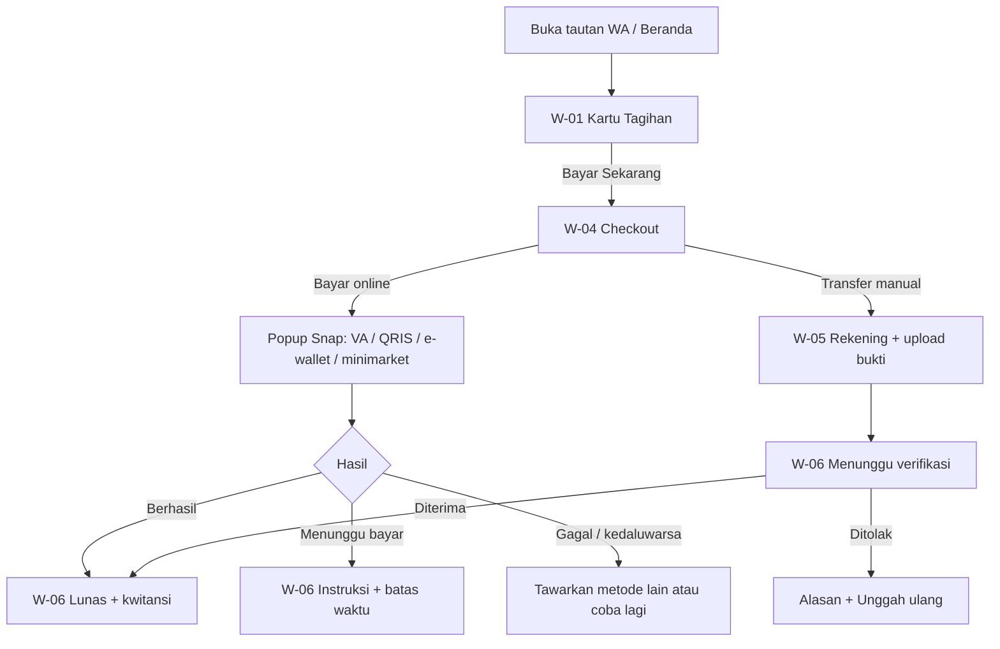
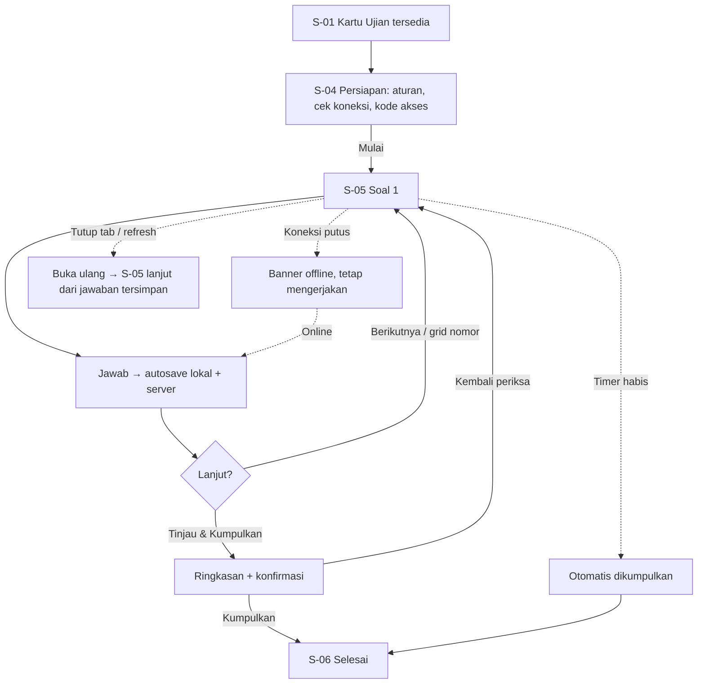
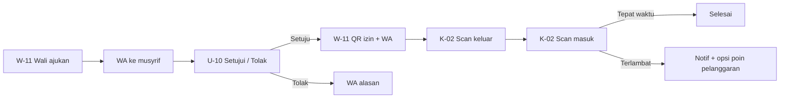
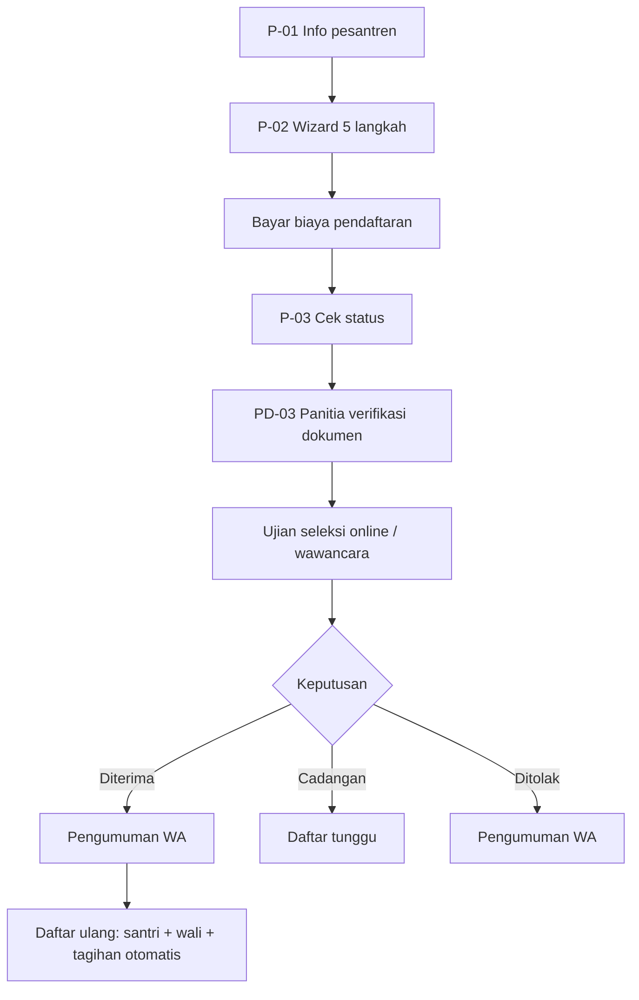
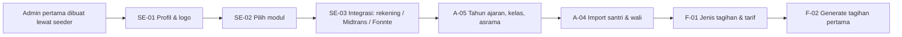
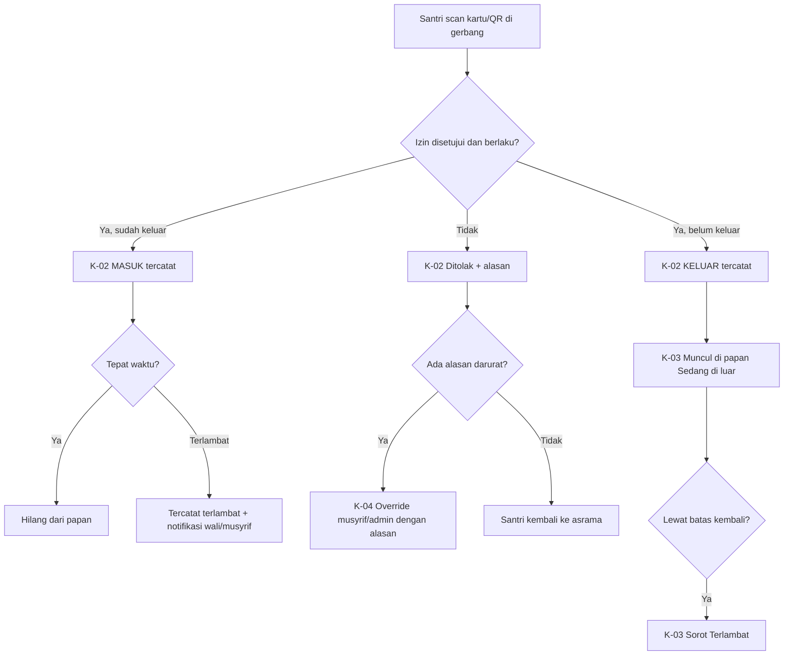
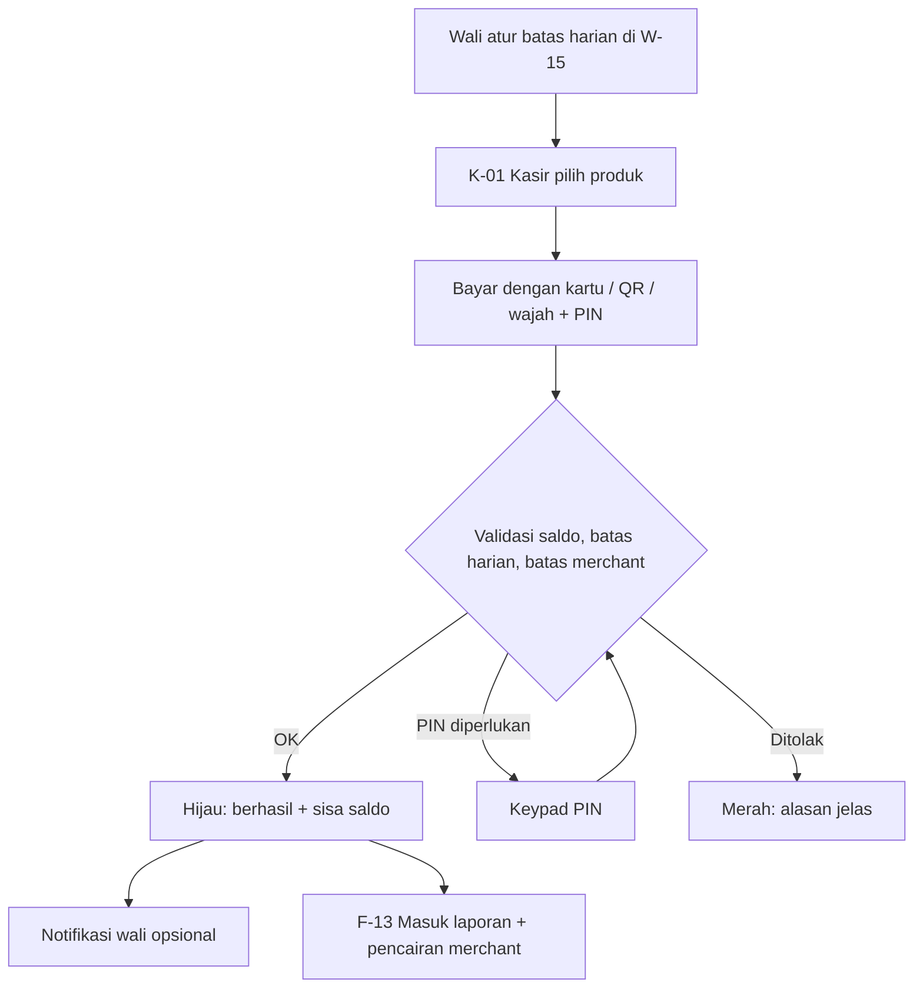
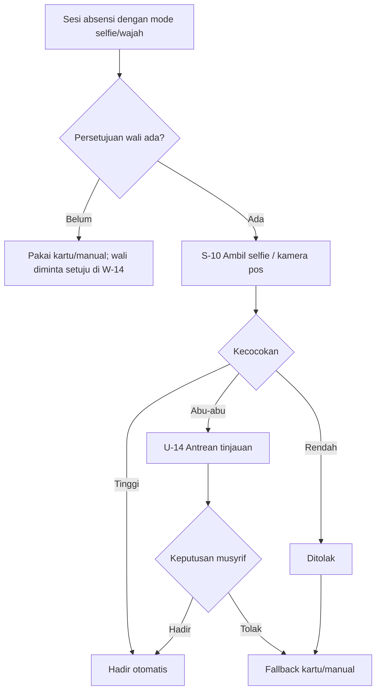

# PRD UI/UX — SANAD, Pesantren Digital Ecosystem

| | |
|---|---|
| **Versi** | 2.0 — single pesantren, arah visual non-template |
| **Tanggal** | 6 November 2026 |
| **Dipakai untuk** | Claude Design (desain layar & komponen) dan Claude Code (implementasi UI), bersama `PRD-Sistem-Pesantren.md` dan `MASTER-PROMPT-Claude-Code.md` |
| **Referensi** | Role, modul (`module_key`), nama tabel, dan alur mengacu ke PRD Sistem — tidak diulang penuh di sini |
| **Dasar keputusan desain** | Checklist prioritas UI/UX Pro Max: Accessibility → Touch & Interaction → Performance → Style → Layout & Responsive → Typography & Color → Animation → Forms & Feedback → Navigation → Charts |

---

## 1. Ringkasan Produk & Target Role

Sistem ini dipakai oleh banyak orang dengan perangkat yang sangat berbeda. Desain harus **mobile-first untuk wali, santri, ustadz, dan pendaftar**, serta **desktop-first untuk staf administrasi**.

| Role | Perangkat utama | Konteks pakai | Prioritas UX |
|---|---|---|---|
| Wali santri | HP Android (jaringan seluler, layar 360–412 px) | Cek tagihan & saldo, bayar, ajukan izin; sering sambil sibuk | Cepat, bahasa sederhana, tombol besar, bayar maksimal 3 langkah |
| Santri | HP (sering pinjam/berbagi, kadang Wi-Fi pesantren yang tidak stabil) | Jadwal, **ujian online**, tahfidz, kartu digital | Ujian tahan putus koneksi, teks jelas, timer terlihat |
| Ustadz | HP + laptop | Absensi cepat, input nilai, setoran tahfidz, buat ujian | Input massal minim ketukan, default pintar |
| Musyrif | HP | Absensi asrama, persetujuan izin, catat pelanggaran | Tindakan satu tangan, daftar santri ringkas |
| Admin pesantren / TU / Bendahara | Laptop/desktop | Kelola data, tagihan, verifikasi pembayaran, laporan | Tabel padat tapi terbaca, filter kuat, aksi massal |
| Petugas UKS | Laptop/HP | Catat kejadian kesehatan | Form singkat, privasi |
| Kasir mart/warung/kantin | Tablet landscape + reader USB | Transaksi cepat, antre panjang | Target sentuh besar, umpan balik instan, minim salah |
| Penjaga gerbang | Tablet/HP + reader USB, di pos jaga (kadang cahaya silau/malam) | Mencatat siapa keluar/masuk, melihat siapa yang sedang izin di luar, menyerahkan shift | Papan "sedang di luar" selalu terlihat, hasil scan terbaca dari jarak jauh, input manual cepat |
| Pengelola mart/warung | Tablet + HP | Kelola katalog, stok, laporan harian, pencairan | Stok cepat diperbarui, laporan sekali lihat |
| Panitia PPDB | Desktop | Verifikasi dokumen, seleksi | Pratinjau dokumen berdampingan dengan data |
| Calon santri/wali (pendaftar) | HP | Mengisi form sekali waktu | Wizard pendek, simpan draft, upload foto dari kamera |

**Prinsip pengalaman:**
1. **Tiga detik pertama:** setiap beranda menjawab satu pertanyaan utama peran tersebut (wali: "ada yang harus saya bayar?"; santri: "ada ujian/jadwal apa sekarang?"; ustadz: "kelas apa berikutnya?"; bendahara: "apa yang perlu saya verifikasi?").
2. **Satu aksi utama per layar** (primary CTA tunggal).
3. **Jangan hilangkan data pengguna:** form panjang menyimpan draft; ujian menyimpan jawaban lokal.
4. **Jelaskan modul yang mati:** fitur yang dinonaktifkan tidak hilang tanpa penjelasan di area admin.

---

## 2. Design System

### 2.1 Arah visual: "buku besar pesantren" (anti-template)

Referensi visual yang dipelajari: dasbor dengan satu kartu statistik utama berlatar warna merek di antara kartu putih, pola garis miring untuk data "belum selesai", kartu bergerigi seperti tiket, dan kalender kehadiran bertitik warna. Yang **dipinjam** adalah prinsipnya, bukan tampilannya; yang **dihindari**: grafik 3D, teks putih di atas latar ungu pucat (kontras gagal), peta/daun dekoratif tanpa fungsi, dan kartu statistik "ikon bulat di kiri + angka di kanan" yang seragam.

**Konsep:** sistem terasa seperti *buku besar dan kartu catatan* yang rapi: kertas hangat, hijau zamrud tua, satu aksen emas, dan bentuk yang punya fungsi (tiket, stempel, garis arsir). Bukan dasbor SaaS biru-putih standar; hijau dipilih karena identik dengan pesantren, dengan nada tua dan tenang, bukan hijau neon.

| Elemen khas | Pemakaian | Aturan |
|---|---|---|
| **Kartu hero tunggal** | Satu kartu hijau `#0B5D45` di tiap beranda berisi angka terpenting (wali: total yang harus dibayar; bendahara: terbayar bulan ini; ustadz: kelas berikutnya) | Maksimal **satu** kartu biru solid per layar; kartu lain putih di atas kertas |
| **Kartu tiket bergerigi** | Invoice, kwitansi, QR izin keluar, kartu santri digital, struk belanja | Takik setengah lingkaran di sisi kiri-kanan memisahkan "rincian" dan "bukti/QR"; hanya untuk objek yang memang berfungsi sebagai tiket/bukti |
| **Arsiran garis miring** | Status **menunggu** (menunggu verifikasi, izin belum disetujui, sisa kuota) dan bagian grafik yang belum tercapai | Selalu disertai ikon + teks, bukan arsiran saja |
| **Kalender titik** | Kehadiran, mutabaah, setoran tahfidz bulanan: kotak hari dengan titik hijau/kuning/merah/abu | Titik wajib berpasangan huruf/ikon kecil dan legenda; dapat dibaca pembaca layar |
| **Stempel status** | Lunas, Terverifikasi, Hadir pada kwitansi/rapor | Tampil sebagai label bergaris ganda bertema "stempel" miring 0° (tidak diputar agar tetap terbaca) |
| **Garis pemisah bergaya buku** | Judul bagian memakai garis tipis ganda di bawahnya | Hanya pada judul bagian utama, bukan di semua kartu |
| **Pola geometris Islami tipis** | Latar login, PPDB, sisi kartu santri, header rapor | Opasitas ≤ 6%, tidak pernah di belakang teks bacaan atau di layar kerja |

Ranking santri (peringkat) **tidak** ditampilkan secara default di portal wali/santri; admin dapat mengaktifkannya per laporan.

Gaya dasar tetap *data-first*, kontras tinggi, dan bersih; kebaruan ada pada beberapa elemen khas di atas, bukan pada dekorasi di mana-mana.

### 2.2 Warna (token semantik)

Komponen **tidak** memakai hex mentah; semua lewat token.

| Token | Nilai | Pemakaian | Kontras terhadap latar |
|---|---|---|---|
| `--color-primary` | **`#0B5D45`** | Tombol primer, item sidebar aktif, tautan, ikon aktif, seri grafik utama | 7,9:1 di atas putih; teks putih di atasnya 7,9:1 |
| `--color-primary-hover` | `#094E3A` | Hover/pressed tombol | — |
| `--color-primary-active` | `#073C2D` | Active/pressed dalam | — |
| `--color-primary-soft` | `#E8F3EE` | Latar item aktif, badge info, hover baris | — |
| `--color-primary-border` | `#BFDCCF` | Garis fokus lembut, outline sekunder | — |
| `--color-success` | `#15803D` (soft `#DCFCE7`) | Lunas, hadir, berhasil | ≥ 4,5:1 |
| `--color-warning` | `#B45309` (soft `#FEF3C7`) | Jatuh tempo dekat, menunggu verifikasi | ≥ 4,5:1 |
| `--color-danger` | `#B91C1C` (soft `#FEE2E2`) | Menunggak, alpa, gagal, hapus | ≥ 4,5:1 |
| `--color-info` | `#1D5FA8` (soft `#E4EEF9`) | Informasi netral (sengaja bukan hijau agar tidak tertukar dengan status sukses) | ≥ 4,5:1 |
| `--color-text` | `#16213A` | Teks utama (tinta) | ≥ 14:1 di atas kertas |
| `--color-text-muted` | `#4A5163` | Teks sekunder | ≥ 6,5:1 di atas kertas |
| `--color-border` | `#E6E0D1` | Garis kartu/tabel (hangat) | — |
| `--color-surface` | `#FFFFFF` | Kartu, panel | — |
| `--color-bg` | `#F7F4EC` | Latar halaman ("kertas") | — |
| `--color-accent` | `#8A6212` (soft `#F6E9C8`) | Aksen emas: stempel, penanda penting yang bukan status, sorotan angka | 5,5:1 di atas putih untuk teks |
| `--color-hatch` | `#0B5D45` pada 14% | Arsiran status menunggu | — |
| `--color-chart-1/2/3` | `#0B5D45` / `#D97706` / `#1D5FA8` | Seri grafik (utama / pembanding / tambahan) | ≥ 3:1 untuk grafis |

**Aturan warna:**
- Status **selalu** didampingi ikon + teks (tidak hanya warna). Contoh: badge `Lunas` = ikon centang + teks, bukan hanya hijau.
- Warna utama pesantren (`school_profile.brand_color`, default `#0B5D45`) hanya mengganti `--color-primary*` setelah lolos uji kontras 4,5:1; selain itu sistem menolak dan menyarankan versi lebih gelap.
- Mode gelap **tidak termasuk** rilis ini (alasan: pengguna utama adalah wali/santri di HP siang hari; prioritas pada kontras tinggi mode terang). Token sudah semantik sehingga bisa ditambahkan kemudian.

### 2.3 Tipografi

Menghindari pasangan font yang sudah menjadi default template. Pilihan di bawah adalah **usulan** dan harus lolos uji render (Latin, angka, Arab) di HP Android kelas menengah sebelum dikunci.

| Peran | Font | Ukuran / bobot |
|---|---|---|
| Judul besar & angka hero | **Fraunces** (variabel, serif humanis) | H1 28/34 600 · angka hero 36–44 · hanya untuk judul halaman, angka hero, dan judul dokumen cetak |
| Judul bagian & UI | **Figtree** | H2 22/28 600 · H3 18/24 600 |
| Body & tabel | **Figtree** | 16 px/1,5; tabel padat 14 px/1,4; keterangan 12–13 px hanya metadata |
| Angka uang/data | Figtree dengan **tabular-nums** | Rata kanan di kolom uang |
| Teks Arab (ayat, soal Arab, nama) | **Amiri** (utama), **Noto Naskh Arabic** (cadangan) | ≥ 22 px, line-height 2, `dir="auto"`; jangan dicampur ke font Latin |

Skala: 12 / 14 / 16 / 18 / 22 / 28 / 36. Panjang baris teks bacaan 35–60 karakter di HP, 60–75 di desktop. `font-display: swap`; preload hanya Fraunces (satu bobot) dan Figtree regular. Fallback sistem disiapkan agar tidak terjadi lompatan tata letak. Perbesaran teks sistem sampai 200% tanpa terpotong.

### 2.4 Spasi, bentuk, elevasi, ikon

| Aspek | Aturan |
|---|---|
| Grid spasi | Kelipatan 4/8 px: 4, 8, 12, 16, 24, 32, 48 |
| Radius | Kartu 14 px · input/tombol 10 px · badge penuh (pill) · modal 18 px · takik tiket radius 10 px |
| Elevasi | 3 tingkat: `sm` (kartu), `md` (dropdown/popover), `lg` (modal/sheet). Tidak ada bayangan acak |
| Z-index | 0 konten · 10 sticky header · 20 sidebar · 40 dropdown · 100 modal · 1000 toast |
| Ikon | **Lucide**, stroke 1,75 px, ukuran 16/20/24 (token `icon-sm/md/lg`), satu set saja; outline untuk navigasi, filled hanya status aktif; **tanpa emoji** |
| Container | Maks 1280 px (admin), 720 px (konten bacaan/form), 480 px (wizard & portal mobile pada layar lebar) |
| Breakpoint | 375 · 768 · 1024 · 1440 |

### 2.5 Gerak

Durasi 150–250 ms (maks 300 ms untuk modal); *ease-out* masuk, *ease-in* keluar, keluar ±70% durasi masuk; hanya `transform` dan `opacity`; tidak menganimasi lebar/tinggi; maksimal 1–2 elemen beranimasi per layar; skeleton untuk muat > 300 ms; semua animasi menghormati `prefers-reduced-motion`; tidak ada animasi yang memblokir input; umpan balik sentuh < 100 ms (efek tekan skala 0,98 / ubah warna, tanpa menggeser tata letak).

### 2.6 Logo & identitas

| Item | Nilai |
|---|---|
| Warna utama | **`#0B5D45`** (hijau zamrud tua) |
| Nama aplikasi | **SANAD** — *Pesantren Digital Ecosystem* (tagline tampil di halaman masuk dan kop dokumen) |
| Nama pesantren | *Belum diputuskan — perlu konfirmasi user.* Gunakan `{{nama_pesantren}}` dari `school_profile`; nama SANAD tetap tampil sebagai merek aplikasi |
| Logo SANAD | Belum dibuat. Sementara: monogram "S" putih di lingkaran `--color-primary`; logotype "SANAD" memakai Fraunces. Rancang logo SANAD sebagai bagian Tahap 0 |
| Logo pesantren | Diunggah admin; tampil di header portal, kwitansi, rapor, kartu santri. Bila kosong: monogram huruf awal di lingkaran `--color-primary-soft` |
| Bahasa antarmuka | Indonesia; istilah pesantren dipakai apa adanya (syahriyah/SPP, musyrif, mutabaah, tahfidz) |

### 2.7 Aksesibilitas (wajib)

- Kontras teks ≥ 4,5:1 (teks besar ≥ 3:1); status tidak hanya warna.
- Fokus terlihat (ring 2 px `--color-primary`, offset 2 px) pada semua elemen interaktif; navigasi keyboard penuh di panel staf; tab order = urutan visual; tautan "Lewati ke konten utama".
- Target sentuh ≥ 44×44 px (48 px di kasir & ujian), jarak antar target ≥ 8 px.
- Label terlihat untuk setiap input (bukan placeholder saja); ikon-saja memiliki `aria-label`; `aria-live="polite"` untuk toast; error form `role="alert"`.
- Urutan heading berurutan H1→H3; gambar bermakna punya alt; grafik punya ringkasan teks dan tabel alternatif.
- Tidak menonaktifkan zoom; `viewport` standar; `min-h-dvh` bukan `100vh` pada mobile; hormati safe-area pada bar tetap.

---

## 3. Arsitektur Informasi & Navigasi

### 3.1 Pola navigasi per perangkat

| Portal | Pola | Keterangan |
|---|---|---|
| Panel staf (desktop ≥ 1024) | **Sidebar kiri tetap** + topbar | Sidebar 264 px, bisa dilipat ke ikon 72 px; grup bagian; item aktif = latar `primary-soft` + garis kiri `primary` + teks primary |
| Panel staf (tablet/HP) | Drawer dari kiri + topbar | Tombol menu 44 px; drawer menutup setelah memilih |
| Portal wali / santri / ustadz / musyrif (mobile) | **Bottom navigation ≤ 5 item** (ikon + label) + top app bar | Navigasi tidak berubah antar halaman; badge notifikasi hemat |
| Kasir (tablet landscape) | Layout dua panel: katalog kiri, keranjang kanan; tanpa sidebar | Tombol besar, mode layar penuh (kiosk) |
| PPDB publik | Wizard linier dengan indikator langkah | Tombol Kembali selalu ada |

Aturan: navigasi **konsisten** di semua halaman; tidak mencampur sidebar + bottom nav pada tingkat yang sama (desktop = sidebar, mobile = bottom nav); halaman dalam mempertahankan posisi scroll & filter saat kembali; semua halaman penting punya URL tersendiri (deep link dari notifikasi WA).

### 3.2 Topbar panel staf

Kiri: tombol lipat sidebar + **breadcrumb** (untuk kedalaman ≥ 3) + judul halaman. Kanan: pencarian cepat (santri/NIS/no. invoice, `/` untuk fokus), lonceng notifikasi dengan badge, profil (nama, role, ganti sandi, keluar). Keluar dipisahkan dari item biasa dan dikonfirmasi bila ada perubahan belum tersimpan.

### 3.3 Struktur sidebar admin (item muncul sesuai modul aktif & role)

| Grup | Item |
|---|---|
| **Utama** | Dashboard · Pengumuman |
| **Kesantrian** | Santri · Wali · Kartu Santri · Perizinan · Pos Gerbang · Pelanggaran · Kesehatan |
| **Akademik** | Kelas & Asrama · Jadwal · Absensi · Nilai & Rapor · Tahfidz · Ujian |
| **Keuangan** | Tagihan · Pembayaran · Verifikasi Transfer · Tunggakan · Dompet · Mart & Warung · Laporan Kas |
| **PPDB** | Periode · Pendaftar · Seleksi |
| **Lainnya** | Analitik Risiko · Alumni · Inventaris · Piket · Ekspor Dapodik/EMIS |
| **Pengaturan** | Profil & Branding · Modul · Integrasi · Jenis Tagihan · Notifikasi · Pengguna & Role · Audit Log |

Modul yang tidak aktif **tidak muncul**; di *Pengaturan → Modul* modul tersebut tampil dengan tombol "Aktifkan" dan daftar dependensi yang belum terpenuhi (alasan eksplisit, bukan tersembunyi).

### 3.4 Bottom navigation mobile

| Portal | 5 item |
|---|---|
| Wali | Beranda · Tagihan · Dompet · Perkembangan · Lainnya |
| Santri | Beranda · Jadwal · Ujian · Tahfidz · Kartu |
| Ustadz | Beranda · Absensi · Nilai · Tahfidz · Ujian |
| Musyrif | Beranda · Absensi · Izin · Pelanggaran · Lainnya |

Item untuk modul yang mati diganti/diringkas ke "Lainnya"; jumlah tidak melebihi 5.

---

## 4. Daftar Halaman & Detail per Halaman

Legenda state: **L** = loading (skeleton), **E** = empty (pesan + aksi), **X** = error (penyebab + cara pulih + coba lagi), **S** = success (umpan balik singkat), **O** = offline/koneksi buruk.

Kolom "Perangkat": **M** = mobile-first, **D** = desktop-first, **T** = tablet landscape.

### 4.1 Halaman publik & autentikasi

| ID | Layar | Perangkat | Komponen & layout | State | Interaksi utama |
|---|---|---|---|---|---|
| P-01 | Halaman pesantren (publik) | M | Hero logo+nama pesantren, info singkat, tombol "Daftar Santri Baru" (hanya bila PPDB aktif), tombol "Masuk", kontak | L/X | CTA Daftar → P-02; Masuk → P-04 |
| P-02 | Pendaftaran PPDB (wizard 5 langkah) | M | Indikator langkah; 1 Data calon santri · 2 Data wali · 3 Dokumen · 4 Tinjau · 5 Bayar pendaftaran; satu kolom form, label di atas input, bantuan di bawah input | L, validasi per langkah, E (draft kosong), X upload gagal, S terkirim, O draft tersimpan lokal | Simpan draft otomatis; Kembali tanpa kehilangan data; unggah dokumen dari kamera/galeri dengan pratinjau; input telepon `inputmode=tel`, tanggal pakai date picker native |
| P-03 | Cek status pendaftaran | M | Input nomor pendaftaran + OTP; hasil: stepper status, tagihan, tombol bayar | L/X | Salin nomor; bayar biaya daftar |
| P-04 | Masuk | M | Tab: **Wali** (nomor WA → OTP) · **Santri** (NIS + sandi) · **Staf** (email + sandi); pola geometris tipis di latar, logo pesantren | Error di bawah field ("OTP salah, sisa 2 percobaan"), terkunci sementara, X | Tampilkan/sembunyikan sandi; autofill didukung; fokus ke field pertama yang error |
| P-05 | Verifikasi OTP | M | 6 kotak digit (satu input `autocomplete=one-time-code`), hitung mundur kirim ulang, ubah nomor | L, X, S | Tempel otomatis dari SMS/WA; kirim ulang setelah 60 dtk |
| P-06 | Lupa/reset sandi | M | Form email atau nomor; langkah reset | S "tautan terkirim" | — |

### 4.2 Portal wali (mobile)

| ID | Layar | Komponen & layout | State | Interaksi utama |
|---|---|---|---|---|
| W-01 | **Beranda** | Pemilih anak (chip/avatar bila > 1 anak); kartu **Tagihan** (total belum bayar, jatuh tempo terdekat, tombol "Bayar Sekarang" — CTA tunggal); kartu **Saldo** (angka besar, tombol "Top-up"); jadwal hari ini; ringkasan kehadiran bulan ini; pengumuman terbaru | L skeleton per kartu, E per kartu (teks "Semua tagihan sudah lunas" dengan ikon centang, tanpa emoji), X per kartu independen | Ketuk kartu → detail; tarik untuk menyegarkan |
| W-02 | Daftar tagihan | Tab **Belum dibayar** / **Riwayat**; kartu per tagihan: periode, nominal, badge status (ikon+teks), jatuh tempo; ringkasan total di bar bawah sticky dengan tombol "Bayar (n)" | L, E, X | Pilih beberapa tagihan (checkbox ≥ 44 px) → total berubah real-time |
| W-03 | Detail tagihan | Rincian item (SPP, makan, diskon, denda), total, riwayat pembayaran, tombol unduh kwitansi | L/X | Salin nomor invoice; unduh PDF |
| W-04 | Checkout | Ringkasan tagihan; pilihan metode: **Bayar online** (VA/QRIS/e-wallet/minimarket) dan **Transfer manual**; rincian biaya admin jelas; satu tombol utama | L saat membuat transaksi, X (gateway gagal → tawarkan metode lain) | Online → popup Snap; Manual → W-05 |
| W-05 | Transfer manual & upload bukti | Kartu rekening (nama bank, nomor besar, tombol salin), nominal (dengan kode unik bila aktif, ditonjolkan), unggah bukti (kamera/galeri, pratinjau, kompres otomatis), tombol Kirim | Progress upload, X (ukuran/format), S "Menunggu verifikasi" | Salin nomor rekening & nominal; ganti foto sebelum kirim |
| W-06 | Status & kwitansi | Stepper status (Dibuat → Dibayar/Menunggu verifikasi → Lunas), tombol unduh/bagikan kwitansi | L, S, X (ditolak + alasan + tombol "Unggah ulang") | Bagikan via WA |
| W-07 | Dompet | Kartu saldo besar; limit harian (bisa diubah); status kartu (Aktif/Diblokir) dengan tombol "Blokir Kartu" (konfirmasi); daftar riwayat transaksi (ikon tipe, merchant, nominal +/−, saldo setelah) | L, E "Belum ada transaksi", X | Top-up; atur limit (bottom sheet); blokir kartu dengan konfirmasi 2 langkah |
| W-08 | Top-up | Pilihan nominal cepat (chip: 50rb, 100rb, 200rb, lainnya), input nominal dengan format Rupiah, metode seperti W-04 | Validasi min/maks di bawah field | → W-04 flow |
| W-09 | Perkembangan anak | Segment: **Absensi · Nilai · Tahfidz · Mutabaah · Pelanggaran · Kesehatan**; tiap segmen kartu ringkas + grafik kecil dengan alternatif tabel; hanya segmen modul aktif | L, E per segmen, X | Pilih periode (term/bulan) |
| W-10 | Rapor | Daftar rapor per term; pratinjau ringkas; unduh PDF | E "Rapor belum terbit" | Unduh/bagikan |
| W-11 | Perizinan | Daftar izin + status (badge); tombol "Ajukan Izin" → form (jenis, tanggal-jam keluar/kembali, alasan); detail izin menampilkan **QR izin** besar saat disetujui | Validasi tanggal, S terkirim, X | Batalkan izin yang belum disetujui |
| W-12 | Notifikasi & pengumuman | Daftar (belum dibaca ditandai garis kiri + teks tebal), filter kategori | E, L | Ketuk → deep link; tandai semua dibaca |
| W-13 | Profil & pengaturan | Data wali, daftar anak, preferensi notifikasi (kategori kritis terkunci dengan penjelasan), keluar | S | — |
| W-14 | Persetujuan data wajah | Hanya bila modul `face_attendance` aktif: penjelasan data (embedding, bukan foto penuh), tujuan, lama simpan, tombol **Setuju** dan **Cabut persetujuan** (konfirmasi) | S, X | Riwayat persetujuan dengan tanggal |
| W-15 | Aturan belanja anak | Bila Mart & Warung aktif: batas harian total, batas per merchant/kategori (mis. warung maks Rp20.000/hari), ambang PIN; daftar transaksi per merchant | Validasi nominal, S tersimpan | Perubahan berlaku setelah konfirmasi |

### 4.3 Portal santri (mobile)

| ID | Layar | Komponen & layout | State | Interaksi utama |
|---|---|---|---|---|
| S-01 | Beranda | Salam + kelas; kartu "Sekarang/Berikutnya" (kegiatan atau pelajaran); kartu **Ujian tersedia** (jika ada, tombol "Mulai"); target hafalan; saldo (lihat saja) | L/E/X per kartu | Ketuk kartu → detail |
| S-02 | Jadwal | Pemilih hari (strip tanggal horizontal), daftar blok waktu berwarna per jenis (kbm/sholat/halaqah/makan/…; jenis juga berlabel teks), penanda "sedang berlangsung" | L, E "Tidak ada jadwal" | Pindah hari dengan strip, bukan swipe-only |
| S-03 | Daftar ujian | Tab **Tersedia · Mendatang · Selesai**; kartu: judul, mapel, durasi, jendela waktu, status | L, E, X | Ketuk → S-04 |
| S-04 | Persiapan ujian | Aturan (daftar singkat), durasi & jendela waktu, **cek koneksi & penyimpanan lokal** (indikator ikon+teks), input kode akses bila ada, pernyataan kejujuran (checkbox), tombol "Mulai Ujian" (nonaktif sampai syarat terpenuhi, dengan alasan terlihat) | Validasi kode (X di bawah field) | Mulai → S-05 |
| S-05 | **Halaman ujian** | Lihat §4.3.1 | L, O, X, S | Lihat §4.3.1 |
| S-06 | Selesai ujian | Konfirmasi "Jawaban terkirim" dengan jam; skor (jika diizinkan) atau "Hasil akan diumumkan"; tombol kembali | S | — |
| S-07 | Tahfidz & mutabaah | Progres juz (ring/bar + angka), riwayat setoran (surat & ayat dengan teks Arab RTL), checklist mutabaah hari ini (toggle besar) | L/E/X | Centang amalan; status "menunggu verifikasi" berlabel |
| S-08 | Nilai & absensi | Daftar nilai per mapel dengan predikat; kehadiran % per bulan; tabel alternatif untuk grafik | L/E | Pilih term |
| S-09 | Kartu digital | Kartu santri (foto, nama, NIS, QR dinamis berjeda ±30 dtk dengan indikator hitung mundur), saldo, tombol "Tampilkan lebih terang" (atur kecerahan layar) | O: QR tetap tampil terakhir dengan peringatan "Perlu koneksi untuk QR baru" | Layar tetap menyala saat QR tampil (opsi) |
| S-10 | Absensi selfie | Kamera depan layar penuh dengan bingkai wajah, tantangan acak di layar (mis. kode 3 digit), status lokasi (geofence) berikon+teks, tombol "Ambil & Kirim" | Izin kamera ditolak (panduan mengaktifkan), lokasi di luar area, X unggah, S "Absensi terkirim, menunggu/otomatis tercatat", O antre lokal | Ulangi foto sebelum kirim |
| S-11 | Persetujuan data wajah | Penjelasan ringkas tujuan, lama simpan, hak mencabut; hanya wali yang dapat menyetujui (tampil di W-13 untuk wali); santri melihat status "Terdaftar/Belum" | — | — |

#### 4.3.1 Detail halaman ujian (S-05)

| Area | Spesifikasi |
|---|---|
| **Header tetap** | Judul ujian (ringkas), **timer** (angka tabular, `MM:SS`), indikator **autosave** (`Tersimpan 08:12:31` / `Menyimpan…` / `Offline — jawaban aman di HP`), tombol grid nomor. Tinggi ±56 px, menghormati safe-area atas |
| **Timer** | Berasal dari `deadline_at` server; peringatan di 5 menit dan 1 menit: banner berikon + teks ("Sisa 5 menit"), getar ringan bila didukung, bukan hanya warna; tidak menutupi soal |
| **Area soal** | Satu soal per layar; nomor + poin; teks soal 16–18 px; **soal/opsi Arab RTL** 22+ px; gambar dimuat lazy dengan rasio tetap (tanpa layout shift) dan bisa diperbesar |
| **Opsi jawaban** | Kartu opsi lebar penuh, tinggi ≥ 48 px, jarak 8–12 px, pemilihan jelas (ikon radio/checkbox + warna + garis tepi), tidak bergantung pada hover; essay: textarea otomatis membesar, penghitung karakter, tombol keyboard `Selesai` |
| **Navigasi bawah (sticky)** | `Sebelumnya` · `Tandai ragu` (toggle) · `Berikutnya`; di soal terakhir `Berikutnya` menjadi `Tinjau & Kumpulkan`. Aman dari area gesture bawah |
| **Grid nomor (bottom sheet)** | Kotak nomor ≥ 44 px dengan 3 status berikon+teks kecil/legenda: terjawab, belum, ragu; lompat ke nomor |
| **Tinjau & kumpulkan** | Ringkasan: terjawab/belum/ragu; daftar nomor belum dijawab (ketuk untuk lompat); dialog konfirmasi tegas "Kumpulkan sekarang? 3 soal belum dijawab" dengan tombol utama "Kumpulkan" dan "Kembali periksa" |
| **Tahan putus koneksi** | Banner non-menghalangi "Koneksi terputus — lanjutkan mengerjakan, jawaban tersimpan"; antrean disinkron otomatis saat online dengan toast "Tersinkron"; jika timer habis saat offline, jawaban dikirim begitu online |
| **Perlindungan** | Peringatan sebelum menutup/refresh tab; kembali-browser tidak keluar ujian; bila fokus tab hilang → modal "Tetap di halaman ujian" (dicatat, tidak mengeluarkan santri) |
| **Layar kecil** | Minimum 360×640; mode landscape tetap terbaca; tidak ada scroll horizontal; teks mengikuti ukuran font sistem |
| **Kinerja** | Soal berikutnya di-prefetch; gambar dikompres; tidak ada animasi berat; respons ketuk < 100 ms |

### 4.4 Portal ustadz & musyrif (mobile + desktop)

| ID | Layar | Komponen & layout | State | Interaksi utama |
|---|---|---|---|---|
| U-01 | Beranda | Kartu "Kelas berikutnya" (CTA "Mulai Absensi"), tugas tertunda (nilai belum diinput, essay belum dikoreksi), ujian berjalan | L/E/X | — |
| U-02 | Jadwal mengajar | Tampilan hari/minggu | L/E | — |
| U-03 | **Absensi kelas** | Daftar santri (foto kecil + nama), semua **Hadir** secara default; ketuk baris → segmented `H · I · S · A · T` (huruf + warna + ikon); bar bawah: ringkasan jumlah per status + tombol "Simpan" | Simpan otomatis lokal bila offline, S toast "Absensi tersimpan", X | Tandai semua hadir; cari nama; hanya ubah yang tidak hadir |
| U-04 | Input nilai | Desktop: grid tabel (santri × penilaian) dengan sel dapat diedit, navigasi Tab/Enter; mobile: daftar satu per satu dengan input angka (`inputmode=numeric`) | Validasi 0–maks inline, indikator belum diisi, S tersimpan | Impor dari hasil ujian; kunci setelah rapor terbit |
| U-05 | Setoran tahfidz | Pilih santri → form: jenis (ziyadah/murojaah/tahsin), surat dari–sampai, ayat dari–sampai (picker dengan nama surat Arab+Latin), predikat, catatan; riwayat di bawah | Validasi ayat vs jumlah ayat surat | Simpan & lanjut santri berikutnya |
| U-06 | Bank soal | Daftar bank, filter mapel/tag; editor soal: pilih tipe, editor teks dengan tombol RTL, unggah gambar, opsi dinamis, kunci, poin; pratinjau tampilan santri | L/X, S, validasi kunci | Impor xlsx dengan laporan error baris |
| U-07 | Buat ujian (wizard 4 langkah) | 1 Info & jadwal · 2 Pilih soal (manual/acak per tag) · 3 Pengaturan (acak, percobaan, kode, tampilkan hasil) · 4 Sasaran & tinjau | Validasi bobot/jendela, peringatan bentrok | Simpan draft; Terbitkan dengan konfirmasi |
| U-08 | **Monitor ujian live** | Stat card (Belum mulai · Mengerjakan · Selesai · Terputus), tabel peserta dengan progres bar (n/total), jumlah `blur`, waktu terakhir terlihat; auto-refresh 5 dtk dengan indikator | L, E, X, "terputus" berikon | Buka detail peserta; tutup ujian (konfirmasi) |
| U-09 | Koreksi & hasil | Essay: jawaban santri di kiri, rubrik/poin di kanan, tombol Berikutnya; rekap: rata-rata, distribusi, soal tersulit (grafik batang + tabel) | S, progres koreksi | Kirim ke nilai |
| U-10 | Persetujuan izin (musyrif) | Daftar menunggu dengan kartu: santri, alasan, waktu; tombol **Setujui** (primer) dan **Tolak** (alasan wajib) | L/E, S | Setujui dari notifikasi WA via deep link |
| U-11 | Catat pelanggaran | Pilih santri (cari), pilih aturan (poin tampil), catatan, foto opsional; tampilkan total poin saat ini dan ambang berikut | Konfirmasi bila lintas ambang | — |
| U-12 | Verifikasi mutabaah | Daftar centang santri per amalan, setujui massal | S | — |
| U-13 | Absensi asrama/sholat & piket | Seperti U-03 untuk sesi asrama; mode kartu: layar "Siap memindai" menampilkan kartu terakhir yang di-tap | O, S | Reader USB mengetik UID → baris langsung hijau |
| U-14 | Antrean tinjauan absensi | Daftar absensi wajah/selfie berstatus "menunggu tinjauan": foto/hasil kecocokan di kiri, data santri di kanan, tombol **Hadir** / **Tolak** (alasan); pemilihan massal untuk yang jelas | L/E, S, X | Pintasan keyboard di desktop; sampel acak selfie untuk audit |
| U-15 | Pendaftaran wajah santri | Pilih santri → ambil beberapa foto dari sudut berbeda dengan panduan bingkai → cek kualitas → simpan; cek persetujuan wali sebelum aktif | Blokir bila persetujuan wali belum ada | Hapus data wajah (konfirmasi) |

### 4.5 Panel admin, bendahara, akademik (desktop-first)

#### 4.5.1 Dasbor & data induk

| ID | Layar | Komponen & layout | State | Interaksi utama |
|---|---|---|---|---|
| A-01 | **Dashboard** | Baris stat card (Santri aktif · Tagihan bulan ini · Terbayar % · Tunggakan · Menunggu verifikasi · Saldo dompet total), satu kartu garis tren pembayaran 6 bulan (seri utama `#0B5D45`, pembanding oranye), kartu kehadiran hari ini, daftar "Perlu tindakan" (verifikasi, izin, essay) | L skeleton, E, X per kartu; stat card ada tren naik/turun (ikon+angka) | Klik kartu → halaman terkait; rentang waktu |
| A-02 | Daftar santri | Tabel dengan pencarian, filter (kelas, asrama, status), kolom dapat diatur, aksi massal (pindah kelas, ekspor, cetak kartu); di mobile menjadi daftar kartu | L, E (dengan tombol Import/Tambah), X | Sort (aria-sort), paginasi/virtualisasi > 50 baris |
| A-03 | Detail santri | Header profil (foto, nama, NIS, status, kelas, asrama, saldo); tab: Profil · Wali · Tagihan · Pembayaran · Dompet & Kartu · Akademik · Tahfidz · Kesantrian · Dokumen · Riwayat | L per tab | Edit inline modal; tindakan di menu overflow |
| A-04 | Form santri & import | Form dibagi grup (Identitas, Alamat, Wali, Akademik, Field tambahan); import: unduh template → unggah → pratinjau validasi baris → konfirmasi | Progress import, laporan error dapat diunduh, S | Draft tersimpan; peringatan perubahan belum tersimpan |
| A-05 | Master akademik | Tahun ajaran, term, kelas, asrama, mapel dalam tab dengan tabel + drawer form | E, validasi satu aktif | — |
| A-06 | Guru, staf & role | Tabel pengguna; drawer set role (multi) | Konfirmasi saat mencabut role sendiri | — |
| A-07 | Kartu santri | Tabel kartu (status), tombol terbitkan (fokus ke input yang menerima ketikan reader), blokir, ganti; **cetak kartu** (pratinjau desain kartu dengan logo pesantren, foto, QR) | S, X (UID sudah dipakai) | Cetak batch PDF |

#### 4.5.2 Keuangan

| ID | Layar | Komponen & layout | State | Interaksi utama |
|---|---|---|---|---|
| F-01 | Jenis tagihan & tarif | Daftar jenis (kode, kategori, wajib?, aktif toggle); panel kanan editor tarif bertingkat (default/jenjang/kelas/asrama/santri) berbentuk tabel dengan masa berlaku; pratinjau "tarif efektif untuk santri X" | Validasi tumpang tindih | Tambah jenis baru (SPP, Makan, dll) tanpa developer |
| F-02 | Generate tagihan | Form periode + filter; tombol **Pratinjau** (hitung tanpa simpan: jumlah invoice, total, santri dilewati dan alasannya) lalu **Generate** | L progres, S ringkasan, X | Pratinjau wajib sebelum generate |
| F-03 | Daftar tagihan | Tabel: no., santri, periode, total, terbayar, status badge, jatuh tempo; filter; aksi: lihat, void (alasan wajib), kirim pengingat | L/E/X | Ekspor xlsx |
| F-04 | **Verifikasi transfer** | Dua panel: kiri antrean (urut terlama), kanan detail: pratinjau bukti besar (zoom), data tagihan, rekening tujuan, nominal vs bukti; tombol **Verifikasi** (primer) / **Tolak** (alasan) | E "Tidak ada yang menunggu", S toast + lanjut item berikut otomatis | Pintasan keyboard ↑/↓, V, T |
| F-05 | Pembayaran tunai | Cari santri → pilih tagihan → nominal diterima → kembalian → cetak kwitansi | Validasi nominal | — |
| F-06 | Tunggakan & pengingat | Tabel tunggakan dikelompokkan per santri/kelas, total, lama menunggak; aksi massal "Kirim pengingat WA" dengan pratinjau pesan & jumlah penerima | Konfirmasi sebelum kirim | Ekspor |
| F-07 | Laporan kas & pengeluaran | Ringkasan kas masuk/keluar/saldo (stat card), tabel transaksi, formulir pengeluaran (kategori, lampiran) | L/E | Ekspor xlsx/PDF |
| F-08 | Rekonsiliasi Midtrans | Tabel pembayaran online dengan penanda selisih status; tombol "Sinkron" | Selisih ditandai ikon+teks | Sinkron satu/massal |
| F-09 | Dompet admin | Cari santri, saldo, ledger, tombol Top-up tunai dan Penyesuaian (alasan wajib + konfirmasi), atur limit | Konfirmasi untuk aksi uang | — |
| F-10 | **Mart & Warung — beranda** | Hero: penjualan hari ini; kartu per merchant (mart, warung, kantin) dengan penjualan, jumlah transaksi, stok menipis; tombol "Buka kasir" | L/E/X | Pilih merchant |
| F-11 | Katalog produk | Tabel: foto kecil, nama, barcode, kategori, harga, stok, aktif; drawer form produk (barcode dapat discan dengan kamera atau diketik); impor xlsx; aksi massal ubah harga | Validasi barcode unik, E, S | Cetak daftar harga |
| F-12 | Stok & mutasi | Stok masuk (kulakan), penyesuaian (alasan wajib), opname (hitung fisik vs sistem, selisih ditandai ikon+teks); riwayat mutasi | Konfirmasi untuk penyesuaian | Peringatan stok minimum |
| F-13 | Laporan penjualan & pencairan | Ringkasan harian/bulanan (stat card + tabel), per produk/kategori; komisi pesantren dan bagian merchant ditampilkan terpisah; daftar pencairan (status) dan tombol **Ajukan/Proses pencairan** | L/E, konfirmasi aksi uang | Ekspor xlsx/PDF |

#### 4.5.3 Kasir, gerbang & pos jaga (tablet landscape)

| ID | Layar | Komponen & layout | State | Interaksi utama |
|---|---|---|---|---|
| K-01 | **Kasir POS** | Kiri: grid produk (tombol ≥ 64 px, nama + harga) + pencarian; kanan: keranjang (item, qty stepper, total besar), tombol **Bayar dengan Kartu** (primer, besar) dan metode lain sesuai pengaturan merchant (QR dinamis dari HP santri, wajah + PIN bila aktif); pemindai barcode produk lewat reader atau kamera; layar "Tap kartu" menampilkan animasi sederhana + input fokus untuk reader; hasil: besar-hijau "BERHASIL — sisa Rp…" atau besar-merah dengan alasan ("Saldo kurang", "Limit harian terlampaui", "PIN salah") **plus ikon**; modal PIN dengan keypad angka besar bila diperlukan | Loading < 1 dtk, X jaringan ("Tidak tersambung — transaksi belum diproses"), S otomatis kembali ke keranjang kosong dalam 3 dtk | Dobel tap tidak memotong dua kali (UI menonaktifkan tombol saat proses); batalkan transaksi terakhir (peran khusus) |
| K-02 | Pemindai gerbang (kartu / QR) | Layar penuh "Siap memindai"; hasil scan: foto santri besar, nama, kelas, izin berlaku sampai; hasil **KELUAR/MASUK** dalam teks ≥ 32 px + ikon + warna; suara/getar pendek; **kamera QR** sebagai alternatif reader | Ditolak: alasan jelas (tidak ada izin, belum disetujui, kedaluwarsa, kartu diblokir) dengan tombol "Panggil musyrif" | Kiosk mode; scan ganda dalam 5 detik diabaikan |
| K-03 | **Papan "Sedang di luar"** | Hero: jumlah santri sedang di luar (angka besar). Daftar kartu: foto, nama, kelas, tujuan, jam keluar, **harus kembali pukul**, penghitung hitung mundur; sorot **terlambat** (ikon + teks + arsiran merah lembut). Filter: Semua · Segera kembali · Terlambat · Izin pulang bermalam. Pembaruan otomatis 15 dtk | L skeleton, E "Tidak ada santri di luar" (ikon centang), X, O (data terakhir + waktu pembaruan) | Ketuk kartu → K-04; bunyikan/getarkan saat ada yang terlambat |
| K-04 | Detail & pencatatan manual | Data izin (jenis, alasan, penyetuju), riwayat keluar-masuk hari ini, tombol **Catat Keluar** / **Catat Masuk**; mode manual: cari nama/NIS, pilih santri, bila **tanpa izin** ditolak kecuali override (khusus musyrif/admin dengan alasan wajib); isian penjemput (nama & hubungan) dan foto opsional | Validasi, S toast, X | Override butuh PIN musyrif |
| K-05 | Serah terima shift | Ringkasan: santri masih di luar, yang terlambat, catatan insiden; penjaga berikut menekan **Terima shift** (tercatat) | S | Cetak/WA ringkasan ke musyrif (opsional) |
| K-06 | Riwayat gerbang | Tabel log keluar-masuk (read-only, tidak bisa dihapus), filter tanggal/santri/hasil/metode, ekspor | L/E | Ekspor xlsx |

#### 4.5.4 Akademik, kesantrian, PPDB, lainnya

| ID | Layar | Komponen & layout | State | Interaksi utama |
|---|---|---|---|---|
| AC-01 | Pembuat jadwal | Grid minggu × jam; kartu kegiatan dapat dibuat lewat form (alternatif drag-and-drop yang punya padanan keyboard/form); deteksi bentrok berikon+teks | Peringatan bentrok | Salin jadwal term lalu |
| AC-02 | Rekap absensi | Filter kelas/periode; tabel + grafik kehadiran dengan tabel alternatif | L/E | Ekspor |
| AC-03 | Rapor | Daftar santri status (draft/terbit), pratinjau PDF, tombol Generate & Publish (konfirmasi: mengunci nilai) | S progres | — |
| AC-04 | Rekap hasil ujian | Tabel peserta+skor, distribusi, analisis butir | — | Ekspor, kirim ke nilai |
| KS-01 | Perizinan | Tabel/kanban status (Menunggu · Disetujui · Keluar · Kembali · Terlambat) | L/E | Aksi cepat setujui/tolak |
| KS-02 | Pelanggaran & poin | Daftar, filter, ranking poin, konfigurasi aturan & ambang | — | — |
| KS-03 | Kesehatan (UKS) | Daftar kejadian, form singkat; **tanda "Data sensitif"** dan catatan akses tercatat | Akses ditolak: penjelasan role | — |
| PD-01 | Pengaturan PPDB | Periode, kuota, biaya, tahapan seleksi + bobot (daftar yang dapat diurutkan lewat tombol naik/turun) | Validasi bobot = 100% | — |
| PD-02 | Pendaftar & seleksi | Tabel pendaftar dengan filter status; kolom skor; aksi massal ubah status | L/E | Umumkan hasil (konfirmasi + jumlah penerima) |
| PD-03 | Detail pendaftar | Dua panel: kiri data, kanan **pratinjau dokumen** (carousel + setujui/tolak per dokumen); tab Seleksi & Nilai; tombol **Daftar Ulang** (aktif bila diterima) | S | Daftar ulang membuat santri + tagihan, tampil ringkasan sebelum konfirmasi |
| AN-01 | Analitik risiko | Daftar santri berisiko (level badge ikon+teks), kolom **alasan** (chip sinyal), filter level; detail menampilkan tren tiap sinyal | E "Tidak ada santri berisiko" | Tandai ditindaklanjuti + catatan |
| AL-01 | Alumni | Tabel & detail, ekspor | — | — |
| IV-01 | Inventaris asrama | Tabel barang per asrama, mutasi (masuk/keluar/rusak) | — | — |
| PK-01 | Jadwal piket | Kalender mingguan + penugasan | — | Tukar piket |
| EX-01 | Ekspor Dapodik/EMIS | Pilih jenis & periode → unduh file | Progress | — |

#### 4.5.5 Pengaturan

| ID | Layar | Komponen & layout | State | Interaksi utama |
|---|---|---|---|---|
| SE-01 | Profil pesantren & branding | Form identitas, unggah logo (pratinjau di header/kwitansi/kartu), pemilih warna utama dengan **indikator kontras** (lulus/tidak); default `#0B5D45` | Validasi ukuran logo | — |
| SE-02 | **Modul** | Kartu per modul: nama, deskripsi singkat, toggle (≥ 44 px), badge dependensi; toggling modul yang memiliki dependensi tak terpenuhi menampilkan daftar yang harus diaktifkan; menonaktifkan memunculkan konfirmasi "Data tidak dihapus, menu disembunyikan" | S/X | Pencarian modul |
| SE-03 | Integrasi | Kartu **Midtrans** (mode sandbox/production, key tersembunyi `••••`, kanal yang diaktifkan, biaya admin ditanggung/dibebankan, URL webhook dengan tombol salin + panduan 3 langkah, tombol Tes koneksi), kartu **Fonnte** (token, nomor pengirim, batas pesan/jam, Tes kirim), kartu **Rekening transfer manual** (daftar rekening, opsi kode unik) | Status koneksi berikon+teks, X jelas | Kunci tidak pernah ditampilkan penuh |
| SE-04 | Template notifikasi | Daftar event + toggle; editor pesan dengan chip variabel dan **pratinjau gelembung WA** | Validasi variabel | — |
| SE-05 | Pengguna & role | Tabel + drawer | — | — |
| SE-06 | Audit log | Tabel read-only, filter, detail sebelum/sesudah | E | — |
| SE-07 | Mode absensi | Per sesi (kelas, asrama, sholat): pilih manual / kartu / QR / selfie / wajah; ambang wajah (otomatis, tinjau, tolak); geofence untuk selfie; status persetujuan wajah (jumlah wali setuju/belum) | Peringatan jika wajah aktif tanpa persetujuan | Uji coba di perangkat |
| SE-08 | Setup awal & kesehatan sistem | Checklist setup, status antrean, job gagal, webhook terakhir, backup terakhir | X | Ulangi job gagal |

---

## 5. User Flow & Navigasi

### 5.1 Wali membayar tagihan (target ≤ 3 ketukan dari Beranda ke popup bayar)

Deep link dari pesan WA langsung membuka W-04 dengan tagihan terpilih (sesi masuk via OTP bila belum login).

### 5.2 Santri mengerjakan ujian

### 5.3 Perizinan

### 5.4 Top-up dan belanja kartu

```mermaid
flowchart TD
    A[W-07 Dompet] --> B[W-08 Top-up] --> C[Bayar via alur 5.1]
    C -->|Settlement| D[Saldo bertambah + WA]
    E[K-01 Kasir: keranjang] --> F[Tap kartu]
    F --> G{Validasi}
    G -->|OK| H[Hijau: berhasil + sisa saldo]
    G -->|PIN diperlukan| I[Keypad PIN] --> G
    G -->|Ditolak| J[Merah: alasan jelas]
```

### 5.5 PPDB sampai daftar ulang

### 5.6 Setup awal pesantren

Setelah login pertama admin melihat **checklist setup** di Dashboard (7 langkah di atas, progres %, setiap item tautan ke layar terkait; bisa disembunyikan setelah selesai).

### 5.6b Pos gerbang: izin keluar sampai kembali

### 5.6c Belanja di Mart & Warung

### 5.6d Absensi selfie / wajah

### 5.7 Aturan navigasi lintas alur

- Tombol kembali selalu ke layar sebelumnya dengan posisi scroll & filter tersimpan.
- Modal/sheet punya tombol tutup jelas; menutup dengan perubahan belum tersimpan meminta konfirmasi.
- Setelah aksi sukses (simpan, verifikasi), pengguna dibawa ke langkah logis berikut (mis. item antrean berikutnya), bukan kembali ke awal.
- Fokus berpindah ke konten utama setelah berpindah halaman (pembaca layar).

---

## 6. Requirement Responsive

| Area | Pendekatan | Detail |
|---|---|---|
| Wali, santri, ustadz, musyrif, PPDB, halaman ujian | **Mobile-first** (desain mulai 375 px, uji 360 px) | Satu kolom; bottom nav; kartu; font body 16 px (menghindari auto-zoom iOS); tombol primer lebar penuh di area jempol; tidak ada scroll horizontal |
| Panel admin/bendahara/akademik/panitia | **Desktop-first** (1280–1440 px), tetap berfungsi di tablet | Sidebar + tabel padat; di < 768 px tabel menjadi daftar kartu dengan kolom paling penting; aksi massal berpindah ke bar bawah |
| Kasir & gerbang | **Tablet landscape** (1024×768 ke atas) | Tombol ≥ 64 px; teks hasil ≥ 28 px; tidak bergantung hover |
| Cetak (kwitansi, rapor, kartu, laporan) | Stylesheet cetak/PDF terpisah | Ukuran A4 untuk dokumen, ukuran kartu CR80 (85,6×54 mm) untuk kartu |

| Breakpoint | Perubahan utama |
|---|---|
| < 768 | Bottom nav (portal) / drawer (staf); tabel → kartu; bottom sheet menggantikan modal besar; grid 4 kolom |
| 768–1023 | Sidebar tersembunyi (drawer); grid 8 kolom; form 2 kolom bila muat |
| 1024–1439 | Sidebar tampil; grid 12 kolom; tabel penuh |
| ≥ 1440 | Container maks 1280 px terpusat; panel detail berdampingan |

Aturan tambahan: orientasi landscape tetap terbaca; bar tetap (header/bottom nav/CTA) memberi *padding* agar konten tidak tertutup; hormati safe-area (notch/gesture bar); gambar punya rasio tetap (tanpa pergeseran tata letak); tabel panjang > 50 baris divirtualisasi; muat bertahap (skeleton) bukan spinner penuh layar; mode hemat data (gambar dikompres, tanpa autoplay).

---

## 7. Komponen Reusable

| Komponen | Spesifikasi |
|---|---|
| **Tombol** | Varian: primer (`primary`), sekunder (outline), tersier (teks), bahaya (`danger`). Tinggi 44 px (mobile 48), keadaan: default/hover/pressed/focus/loading (spinner + teks "Memproses…", nonaktif)/disabled (opasitas 0,4 + atribut disabled). Satu tombol primer per layar |
| **Input & form field** | Label terlihat di atas, teks bantuan di bawah, error di bawah field (`role=alert`), penanda wajib (*), tipe input semantik (tel/email/number/date), tinggi ≥ 44 px, validasi saat blur, fokus otomatis ke error pertama + ringkasan error untuk form panjang |
| **Input Rupiah** | Format `Rp 350.000`, rata kanan, angka tabular, `inputmode=numeric` |
| **Pemilih tanggal/jam** | Native di mobile; picker ringkas di desktop; rentang tanggal untuk laporan |
| **Select & combobox cari** | Untuk santri/NIS/kelas; hasil dengan foto kecil + NIS; navigasi keyboard |
| **Kartu (Card)** | Radius 12, bayangan `sm`, padding 16/24, header opsional dengan aksi |
| **Stat card** | Angka besar (28–32 px, tabular), label, indikator tren (ikon + teks), status warna dengan ikon |
| **Badge status** | Pill dengan ikon + teks: Lunas, Belum bayar, Sebagian, Terlambat, Menunggu verifikasi, Void; Hadir/Izin/Sakit/Alpa/Terlambat; Aktif/Diblokir |
| **Tabel data** | Header sticky, kolom dapat diurutkan (`aria-sort`), filter, pencarian, seleksi baris, aksi massal, paginasi atau virtualisasi, kolom uang rata kanan, mode kartu di mobile, ekspor |
| **Sidebar & topbar** | §3; dapat dilipat; item aktif jelas; breadcrumb |
| **Bottom navigation** | ≤ 5 item, ikon+label, badge hemat |
| **Modal / bottom sheet** | Modal desktop (radius 16, scrim hitam 40–60%), sheet mobile; tutup via tombol, Esc, ketuk scrim (kecuali ada perubahan belum tersimpan); fokus terkunci di dalam |
| **Dialog konfirmasi** | Untuk aksi destruktif/uang: judul jelas, konsekuensi, tombol bahaya terpisah dari batal, alasan wajib bila relevan |
| **Toast** | Muncul di atas/bawah, 3–5 dtk, `aria-live=polite`, tidak mencuri fokus, tombol "Urungkan" bila bisa dibatalkan |
| **Banner/alert inline** | Info/peringatan/error/sukses berikon; untuk status sistem (offline, modul mati, integrasi bermasalah) |
| **Skeleton** | Bentuk menyerupai konten asli; hindari spinner > 1 dtk tanpa konteks |
| **Empty state** | Ikon sederhana + satu kalimat + satu aksi ("Belum ada tagihan. Generate tagihan pertama.") |
| **Error state** | Penyebab singkat + cara pulih + tombol "Coba lagi"; kode error kecil untuk dukungan |
| **Stepper / wizard** | Indikator langkah, simpan draft, Kembali selalu ada |
| **Upload berkas** | Ambil foto/galeri, pratinjau, progres, kompres klien, batas ukuran & format di teks bantuan, ganti/hapus |
| **Pratinjau dokumen** | Gambar zoomable / PDF viewer, aksi setujui/tolak berdampingan |
| **Timer ujian** | Tabular-nums, status peringatan berikon + teks |
| **Indikator autosave** | Tiga keadaan: Menyimpan / Tersimpan jam / Offline-aman |
| **Grid nomor soal** | Kotak ≥ 44 px, status terjawab/belum/ragu dengan ikon+teks |
| **Segmented control status absensi** | H · I · S · A · T dengan huruf + warna + ikon; ≥ 44 px |
| **Daftar/timeline jadwal** | Blok waktu berlabel jenis, penanda "sedang berlangsung" |
| **Grafik** | Garis (tren), batang (perbandingan), ring/bar progres (hafalan); ≤ 5 kategori untuk donut; legenda terlihat, tooltip dapat diakses keyboard/sentuh, label sumbu berunit, ringkasan teks + tabel alternatif, palet `chart-1/2/3`, skeleton saat muat, empty state bermakna |
| **Kartu santri (tampilan & cetak)** | Gaya tiket bergerigi: foto, nama, NIS, kelas, logo pesantren, QR; versi cetak ukuran CR80 |
| **Kartu tiket bergerigi** | Dua zona (rincian atas, bukti/QR bawah) dipisah takik dan garis putus; dipakai invoice, kwitansi, QR izin, struk; versi cetak mempertahankan takik |
| **Kartu hero** | Satu per layar; latar `--color-primary`, angka Fraunces 36–44, satu aksi putih di dalamnya |
| **Arsiran status menunggu** | Pola garis miring `--color-hatch` untuk bar/badge/kolom status menunggu; wajib ikon + teks |
| **Kalender titik** | Grid bulanan; titik berwarna + huruf; legenda; fokus keyboard per hari |
| **Kartu santri di papan gerbang** | Foto, nama, kelas, tujuan, jam keluar, hitung mundur kembali; varian terlambat |
| **Hasil transaksi/scan besar** | Teks ≥ 28–32 px + ikon + warna; auto-reset 3 dtk; terbaca dari 1 meter |
| **Kamera selfie/wajah** | Bingkai wajah, panduan cahaya, status lokasi, tantangan acak, pratinjau ulang |
| **Stempel status** | Label bergaris ganda untuk Lunas/Terverifikasi di dokumen |
| **Chip variabel & pratinjau pesan WA** | Untuk editor template notifikasi |
| **Penanda data sensitif** | Ikon kunci + label pada layar kesehatan/dokumen pribadi |
| **Pemilih surat/ayat** | Daftar 114 surat (Arab + Latin + jumlah ayat), validasi rentang ayat |
| **Teks Arab/RTL** | Komponen pembungkus `dir=auto`, font Arab, ukuran & line-height khusus |

---

## 8. Panduan Konten (Microcopy) & Status

| Konteks | Panduan | Contoh |
|---|---|---|
| Nada | Hormat, jelas, hangat; tidak menggurui; Bahasa Indonesia baku sederhana | "Tagihan November sudah terbit" |
| Tombol | Kata kerja spesifik | "Bayar Sekarang", "Kirim Bukti", "Verifikasi", bukan "OK"/"Submit" |
| Error | Penyebab + cara memperbaiki | "Bukti terlalu besar (7 MB). Maksimal 5 MB — coba foto ulang dengan resolusi lebih rendah." |
| Aksi destruktif | Sebut konsekuensi | "Kartu akan diblokir seketika. Saldo tetap aman di dompet." |
| Uang | Selalu `Rp` + pemisah titik; tampilkan rincian sebelum bayar | "Rp 625.000" |
| Tanggal | Format Indonesia (`6 Nov 2026`, jam 24 jam) | "Jatuh tempo 10 Nov 2026" |
| Status | Teks + ikon selalu | Centang + "Lunas" |
| Waktu relatif | Dengan tanggal pasti di tooltip | "2 jam lalu" |

**Matriks keadaan wajib untuk setiap layar data:** *loading (skeleton) → terisi → kosong → error → sebagian gagal (kartu independen) → offline (bila relevan)*. Aksi yang memicu proses > 300 ms menonaktifkan tombol dan menampilkan progres; hasil ditegaskan lewat toast/banner.

---

## 9. Daftar Periksa Penerimaan Desain

Desain dianggap siap diserahkan ke implementasi jika:

- [ ] Semua layar di §4 punya desain untuk keadaan **L/E/X/S** (dan **O** untuk ujian, absensi, kartu digital).
- [ ] Warna hanya memakai token §2.2; kontras teks ≥ 4,5:1; tidak ada informasi yang hanya diwakili warna.
- [ ] Target sentuh ≥ 44×44 px (48 px pada kasir & ujian), jarak ≥ 8 px.
- [ ] Layar wali, santri, ustadz, musyrif, PPDB dan ujian diuji di lebar 360 px dan 375 px, termasuk landscape; tanpa scroll horizontal.
- [ ] Halaman ujian: timer, autosave 3 keadaan, grid nomor, tinjau & kumpulkan, banner offline, soal Arab RTL terlihat benar.
- [ ] Kasir: hasil sukses/gagal terbaca dari jarak 1 meter (teks ≥ 28 px + ikon).
- [ ] Sidebar/Bottom nav mengikuti §3 dan konsisten; modul mati tidak menyisakan menu kosong.
- [ ] Komponen §7 dibuat sebagai library tunggal (tidak ada gaya satu-kali per layar).
- [ ] Mode `prefers-reduced-motion` dan perbesaran teks 200% diperiksa.
- [ ] Teks Arab memakai font & line-height khusus; PDF rapor/kartu menampilkan Arab dengan benar.
- [ ] Arah visual §2.1: tepat satu kartu hero per layar, kartu tiket hanya untuk objek tiket/bukti, arsiran selalu berikon+teks, tidak ada grafik 3D, tidak ada ilustrasi stok.
- [ ] Pos gerbang: papan "Sedang di luar" terbaca dari jarak 1 meter; terlambat terlihat tanpa mengandalkan warna.
- [ ] Mart & Warung: kasir, katalog, stok, laporan, dan aturan belanja wali punya semua keadaan L/E/X/S.
- [ ] Absensi selfie/wajah: alur persetujuan wali, pendaftaran, antrean tinjauan, dan fallback tersedia; teks penjelasan data biometrik mudah dipahami.
- [ ] Tidak ada sisa kata "tenant", "paket", atau "platform" di teks antarmuka.
---

*Akhir PRD UI/UX. Dokumen pasangan: `PRD-Sistem-Pesantren.md` (data, API, aturan bisnis) dan `MASTER-PROMPT-Claude-Code.md`.*

